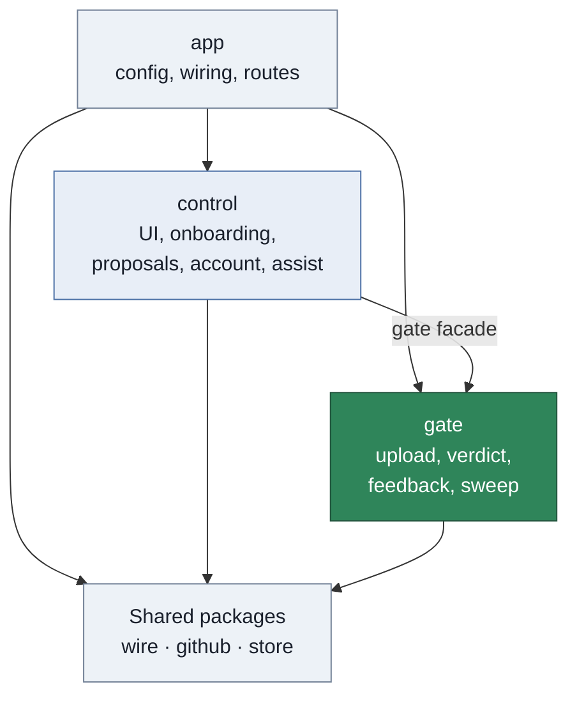
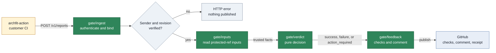
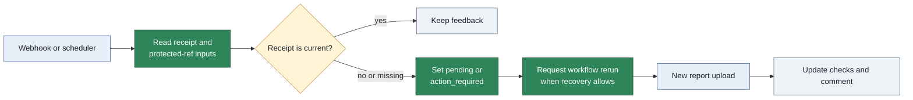

# Architecture

This page explains the App boundary, the main request flows, and the Go package structure.
Read the [module specifications](../internal/module.md) for package contracts and test specifications.

## The main idea

The Archfit engine runs in customer CI and writes a report. The report is customer-attested evidence.
The App does not trust the report until it verifies the sender, revision, policy, and other gate inputs.

For each report, the App:

1. Verifies the GitHub Actions OIDC token and the upload envelope.
2. Reads policy, baseline, labels, and settings from the protected ref.
3. Compares the report with those trusted inputs.
4. Publishes feedback on the pull request.

The protected ref is the base branch of a pull request. For a default-branch push, it is the default branch.

## System context

Solid arrows show request, read, or publication flow. The dotted arrow shows an optional AI proposal.

The App stores no report or source code. GitHub stores checks, comments, workflow runs, and the no-source
report artifact that the Graph page reads. The App stores entitlements, consent records, and an LLM budget
counter in a key-value store.

The repository split is:

- `archfit` owns the engine, CLI, images, and report schemas.
- `archfit-action` runs the engine in customer CI and uploads the report.
- `archfit-app` owns approved policy, report intake, the gate, and feedback.

## Packages

The App is one Go binary. The main internal packages are shown below.

Arrows show permitted import groups. The `gate` arrow from `control` is a facade call.
The shared group contains `wire`, `github`, and `store`.

| Package   | Main responsibility                                                            | Child packages                                         |
| --------- | ------------------------------------------------------------------------------ | ------------------------------------------------------ |
| `app`     | Loads environment settings, builds packages, and registers routes              | none                                                   |
| `gate`    | Verifies uploads, decides outcomes, publishes feedback, and runs the sweep     | `ingest`, `inputs`, `verdict`, `feedback`, `sweep`     |
| `control` | Serves the UI and manages onboarding, proposals, AI requests, and entitlements | `account`, `assist`, `onboarding`, `proposal`, `ui`    |
| `wire`    | Defines versioned file and message formats                                     | `envelope`, `manifest`, `policy`, `report`, `settings` |
| `github`  | Holds GitHub API, authentication, webhook, and OIDC knowledge                  | `api`, `auth`, `oidc`, `webhook`                       |
| `store`   | Defines the tenant key-value interface and the memory driver                   | none                                                   |

The import rules keep the gate independent:

- `gate` never imports `control`, `app`, UI code, or LLM code.
- `control` uses only the `gate` facade.
- `wire` and `store` import no other internal package.
- A seam implementation can import the package that defines its interface.
- Tests run `go list -deps` to enforce the allowed imports.

## Report upload

The upload path accepts a report, verifies it, and publishes feedback in one request.

Arrows show the order of the upload request. Authentication defects return an HTTP status.
After authentication, defects become gate reasons and appear in GitHub feedback.

`gate/ingest` verifies the token, envelope, payload digest, report format, run, pull request, and revision.
`gate/inputs` reads the protected-ref files and owner approval. `gate/verdict` performs no I/O and no AI call.
The upload handler has a 55-second deadline. The target is feedback within 60 seconds.

## Gate outcomes

The `verdict` package has three conclusions. It cannot represent `neutral` or `skipped`.
The first reason sets the conclusion. Later reasons remain in feedback.

| Conclusion        | Use                                                | Categories                               |
| ----------------- | -------------------------------------------------- | ---------------------------------------- |
| `success`         | Trusted evidence has no blocking finding           | `architecture`                           |
| `failure`         | Trusted evidence has a blocking finding            | `architecture`                           |
| `action_required` | Evidence, governance, or subscription needs action | `evidence`, `governance`, `subscription` |

The App publishes two checks:

- `archfit/state` is advisory. It is published for each accepted report upload and can use `neutral`.
- `archfit/gate` is the blocking check. It is published only when the settings file contains `gate: required`.

Each published check carries a receipt with the run ID, report digest, policy digest, baseline digest, and
labels digest. The sweep compares the receipt with the protected ref. See the [reason catalog](user-guide.md#reason-codes)
for recovery actions.

## Webhooks and the sweep

A webhook starts immediate work. The sweep repairs work after a lost webhook or a changed protected ref.

The arrows show recovery flow. The sweep does not compute a new report because the App stores no report.

| Event                                                    | Gate action                                             | Control action                        |
| -------------------------------------------------------- | ------------------------------------------------------- | ------------------------------------- |
| New pull request head                                    | Set a pending required check or refuse a fork           | None                                  |
| Push to the default branch that changes a protected path | Sweep that repository                                   | None                                  |
| Review change                                            | Rerun when the last reason was `owner_approval_missing` | None                                  |
| Installation added or removed                            | None                                                    | Start the trial or delete tenant data |

The app handler runs gate and control webhook work independently. A control error does not change gate work.

The sweep inspects open pull requests for these conditions:

- A pending required check is missing.
- No report arrived within 60 minutes.
- The policy, baseline, or labels changed on the protected ref.
- A waiver expires within seven days or has expired.
- The subscription changed.

The sweep reruns the customer workflow after stale inputs, an expired waiver, late owner approval, or restored
subscription. A missing upload becomes `action_required`. A fresh report is required for a new `success` result.

## Trust rules

These invariants keep repository authors from weakening the gate:

- Read policy, baseline, labels, settings, owners, and workflow from the protected ref.
- Verify the policy digest against the report.
- Accept a head policy only when an architecture owner approved the exact head SHA.
- Treat missing, incompatible, or unverifiable evidence as not successful.
- Describe report provenance as `customer-attested`, never as `verified`.
- Keep LLM output, billing, and UI code off the gate path.
- Resolve tenant identity from a verified webhook, OIDC claim, or OAuth session.
- Log IDs, digests, outcomes, and timings only.

The protected paths are:

- `.archfit.yaml`
- `.archfit-baseline.json`
- `.archfit-labels.yaml`
- `.archfit-app.yaml`
- The workflow file named by `.archfit-app.yaml`

A change to a protected path needs approval from an architecture owner on the exact head SHA.

## HTTP routes

The routes come from [`internal/app/handler.go`](../internal/app/handler.go) and
[`internal/control/ui/ui.go`](../internal/control/ui/ui.go).

### Service routes

| Method and route        | Owner     | Authentication             |
| ----------------------- | --------- | -------------------------- |
| `GET /healthz`          | `app`     | None                       |
| `POST /v1/reports`      | `gate`    | GitHub Actions OIDC token  |
| `POST /v1/discoveries`  | `control` | GitHub Actions OIDC checks |
| `POST /webhooks/github` | `app`     | `X-Hub-Signature-256`      |
| `POST /internal/sweep`  | `app`     | Operator bearer token      |
| `POST /internal/grants` | `app`     | Operator bearer token      |

### UI routes

| Method and route                                      | Authentication                                  |
| ----------------------------------------------------- | ----------------------------------------------- |
| `GET /`                                               | None. Shows the landing page or repository list |
| `GET /auth/login` and `GET /auth/callback`            | None                                            |
| `POST /auth/logout`                                   | GitHub OAuth session and CSRF token             |
| `GET /static/{path}` and `GET /schema/policy.json`    | None                                            |
| `GET /r/{o}/{n}`                                      | Session with repository `read` permission       |
| `POST /r/{o}/{n}/onboarding`, `/discover`, `/consent` | Session with repository `admin` permission      |
| `GET /r/{o}/{n}/policy` and `/graph`                  | Session with repository `read` permission       |
| `POST /r/{o}/{n}/policy` and `/policy/ready`          | Session with repository `write` permission      |
| `POST /r/{o}/{n}/assist`                              | Session with repository `write` permission      |

## Platform seams

The App keeps platform-dependent code behind three interfaces.

| Seam       | Current driver                       | Current behavior                    |
| ---------- | ------------------------------------ | ----------------------------------- |
| `Store`    | `memory`                             | Data is lost when the process stops |
| `Sandbox`  | `none`                               | Managed discovery is not available  |
| `Provider` | `anthropic` when a key is configured | Managed AI is optional              |

A new driver changes the composition in `app`. The gate contracts do not change.

## Deployment

Hosting is not decided. This page does not select a provider or give deployment steps.
A host must provide these runtime capabilities:

- Run one static Go binary in a container.
- Provide a key-value driver that passes the `store/storetest` suite.
- Call `POST /internal/sweep` with an external scheduler.
- Provide a sandbox driver before managed discovery is enabled.

### Configuration

The App reads environment variables. It does not read a `.env` file.
Secret variables name files. They do not contain secret values.
See [`.env.example`](../.env.example).

| Variable                             | Function                                               |
| ------------------------------------ | ------------------------------------------------------ |
| `ARCHFIT_ADDR`                       | Listen address. Default `:8080`                        |
| `ARCHFIT_BASE_URL`                   | Public URL and OIDC audience                           |
| `ARCHFIT_GITHUB_APP_ID`              | GitHub App ID                                          |
| `ARCHFIT_GITHUB_PRIVATE_KEY_FILE`    | GitHub App private-key file                            |
| `ARCHFIT_GITHUB_WEBHOOK_SECRET_FILE` | Webhook secret file                                    |
| `ARCHFIT_GITHUB_OAUTH_CLIENT_ID`     | OAuth client ID                                        |
| `ARCHFIT_GITHUB_OAUTH_SECRET_FILE`   | OAuth client secret file                               |
| `ARCHFIT_COOKIE_KEY_FILE`            | 32-byte session-cookie key file                        |
| `ARCHFIT_OPERATOR_TOKEN_FILE`        | Bearer token file for `/internal/*`                    |
| `ARCHFIT_ANTHROPIC_KEY_FILE`         | Optional Anthropic key file. Empty disables managed AI |
| `ARCHFIT_STORE`                      | Store driver. Only `memory` exists                     |
| `ARCHFIT_SANDBOX`                    | Sandbox driver. Only `none` exists                     |

### Release blockers

- The locked manifest contains placeholder image digests and an Action commit. A real upload ends in
  `action_required` while these values remain. `ARCHFIT_RELEASE=1` makes the release test fail.
- No GitHub App is registered.
- `archfit-action` does not send the envelope format of this service yet.
- The Monaco editor bundle is not built. The policy editor uses a plain text area.
