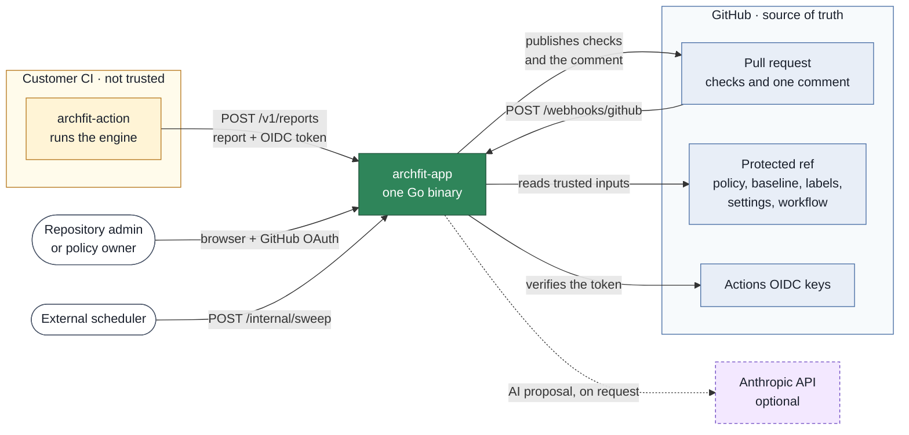
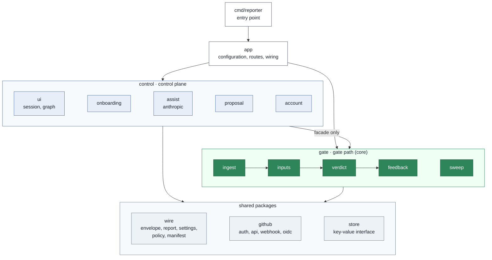
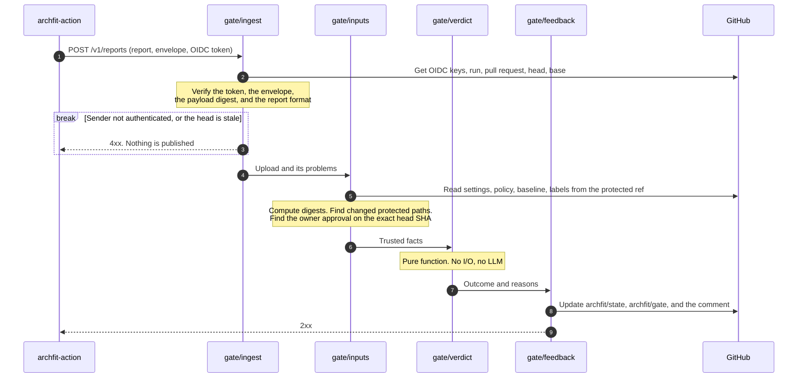

# Architecture

This page shows how `archfit-app` works and how the code is organized.
Each package has a detailed specification in a `module.md` file.
Start at [`internal/module.md`](../internal/module.md) when you need more detail.

## The main idea

The Archfit engine runs in the CI of the customer. The engine writes a report.
A report from customer CI is only a claim. The App does not trust it by default.

The App does three things with each report:

1. It verifies who sent the report, with a GitHub Actions OIDC token.
2. It compares the report with the approved policy on the protected ref.
3. It publishes the result on the pull request.

The protected ref is the base branch of the pull request.
For a push, the protected ref is the default branch.

## System context

The work is divided between three repositories:

| Repository       | Responsibility                                     |
| ---------------- | -------------------------------------------------- |
| `archfit`        | Engine, CLI, images, and report schemas            |
| `archfit-action` | Runs the engine in CI and uploads the report       |
| `archfit-app`    | Approved policy, report intake, gate, and feedback |

GitHub is the database. The App keeps only a small key-value store.
This store holds entitlements, consent records, and the LLM budget counter.
The App does not keep reports or source code.

## Packages

All code is in one Go binary. Each folder below `internal/` is one Go package.

Arrows inside `gate` show the order of the upload flow. Arrows between groups show the permitted imports.

| Package   | Function                                                                         |
| --------- | -------------------------------------------------------------------------------- |
| `app`     | Reads the configuration, builds all packages, and registers the HTTP routes      |
| `gate`    | Verifies a report, decides the outcome, and publishes the feedback               |
| `control` | Onboarding, the web UI, the policy editor, AI proposals, and entitlements        |
| `wire`    | Versioned file and message formats. These packages contain no domain logic       |
| `github`  | All GitHub API knowledge: App tokens, REST client, webhook parser, OIDC verifier |
| `store`   | The key-value interface and an in-memory driver                                  |

The import rules are strict:

- `gate` never imports `control`, `app`, UI code, or LLM code.
- `control` imports only the facade of `gate`, not its child packages.
- `wire` and `store` import no other internal package.
- A child package never imports its parent.

Tests in `internal/` run `go list -deps` and fail when an import breaks these rules.

## Report upload

This flow is the most important flow in the service.
All steps run in one HTTP request. The target is feedback in 60 seconds.

Two rules control this flow:

- **Before authentication, the answer is an HTTP status.** The App publishes nothing for an unknown sender.
- **After authentication, each defect is visible.** The defect becomes `action_required` with a reason on the pull request.

The `gate` package also verifies that the engine identity is in the locked manifest.
It also verifies that the upload comes from the workflow that the settings file names.

## Gate outcomes

The `verdict` package can return only three conclusions.
The type has no `neutral` and no `skipped` value, so the gate cannot pass by accident.

| Conclusion        | Meaning                                                 | Category                                 |
| ----------------- | ------------------------------------------------------- | ---------------------------------------- |
| `success`         | The report is trusted and has no blocking finding       | `architecture`                           |
| `failure`         | The report is trusted and has blocking findings         | `architecture`                           |
| `action_required` | The App cannot trust the evidence, or a person must act | `evidence`, `governance`, `subscription` |

The [user guide](user-guide.md#reason-codes) lists each reason code.

The App publishes two check runs:

- `archfit/state` is advisory. The App publishes it for each accepted upload.
- `archfit/gate` is the blocking check. The App publishes it only when the settings file contains `gate: required`.

The check run is also the receipt. It holds the run ID, the report digest, and the policy digests.
The sweep compares these values with the protected ref.

## Webhooks and the sweep

The App receives GitHub events on `POST /webhooks/github`.
First, `app` verifies the signature. Then `gate` handles the event. Then `control` handles the event.
An error in `control` never changes the result of `gate`.

| Event                                                    | Action                                                          |
| -------------------------------------------------------- | --------------------------------------------------------------- |
| New head commit on a pull request                        | `gate` sets a pending gate check, or refuses a fork             |
| Push to the default branch that changes a protected path | `gate` runs a sweep of that repository                          |
| Review change                                            | `gate` re-runs the workflow when the owner approval was missing |
| Installation added or removed                            | `control` starts the trial, or deletes the tenant data          |

Webhooks can get lost. The sweep (`POST /internal/sweep`) repairs the state.
An external scheduler calls this route. The planned interval is one hour.

The sweep finds these conditions on open pull requests:

- The pending check is missing.
- No report arrived in 60 minutes.
- The policy or the baseline changed on the protected ref.
- A waiver expired, or expires in 7 days.
- The subscription changed.

The App stores no report. Thus the sweep cannot calculate a new result.
It re-runs the workflow of the customer, and the new report gives the new result.

## Trust rules

These rules are the invariants of the design. [`AGENTS.md`](../AGENTS.md) gives the short form.

- **Trusted inputs come only from the protected ref.** The App verifies them by digest.
  A head-branch policy is accepted only when an owner approved the exact head SHA.
- **The gate fails closed.** Missing or incompatible evidence is never `success`.
- **The feedback says "customer-attested".** The App never says that a report is "verified".
- **No LLM output is on the gate path.** The import rules and the tests enforce this.
- **The tenant identity comes from a verified source.** The sources are the webhook signature, the OIDC claims, or the OAuth session.
- **Logs contain only IDs, digests, outcomes, and timings.**

Five paths are protected. A change to one of them needs the approval of a policy owner:

- `.archfit.yaml` (the policy)
- `.archfit-baseline.json`
- `.archfit-labels.yaml`
- `.archfit-app.yaml` (the settings file)
- The workflow file that the settings file names

## HTTP routes

Source: [`internal/app/handler.go`](../internal/app/handler.go) and [`internal/control/ui/ui.go`](../internal/control/ui/ui.go).

| Route                   | Owner     | Authentication              |
| ----------------------- | --------- | --------------------------- |
| `GET /healthz`          | `app`     | None                        |
| `POST /v1/reports`      | `gate`    | GitHub Actions OIDC token   |
| `POST /v1/discoveries`  | `control` | The same OIDC checks        |
| `POST /webhooks/github` | `app`     | `X-Hub-Signature-256`       |
| `POST /internal/sweep`  | `app`     | Operator bearer token       |
| `POST /internal/grants` | `app`     | Operator bearer token       |
| All other routes        | `control` | GitHub OAuth session cookie |

## Platform seams

Three interfaces isolate the parts that depend on the hosting platform.
A new platform adds a driver package. It does not change the other packages.

| Seam       | Interface owner      | Driver today                                      |
| ---------- | -------------------- | ------------------------------------------------- |
| `Store`    | `store`              | `memory`. The data is lost when the process stops |
| `Sandbox`  | `control/onboarding` | `none`. Managed discovery is not available        |
| `Provider` | `control/assist`     | `anthropic`, optional                             |

## Deployment

Hosting is not decided. The candidates are Cloudflare and Google Cloud.
See the [hosting research](research/20260918-hosting.md) and the [tech stack](tech-stack.md#platform-seams).

The service needs these items from a host:

- A container host for one static Go binary. The [`Dockerfile`](../Dockerfile) builds a distroless image.
- A key-value driver that passes the `store/storetest` test suite.
- A scheduler that calls `POST /internal/sweep`.
- A sandbox for container jobs. Only managed discovery needs it.

### Configuration

The service reads environment variables. It does not read a `.env` file.
Each secret is a file path (`*_FILE`), never a value. See [`.env.example`](../.env.example).

| Variable                             | Function                                  |
| ------------------------------------ | ----------------------------------------- |
| `ARCHFIT_ADDR`                       | Listen address. The default is `:8080`    |
| `ARCHFIT_BASE_URL`                   | Public URL. It is also the OIDC audience  |
| `ARCHFIT_GITHUB_APP_ID`              | GitHub App ID                             |
| `ARCHFIT_GITHUB_PRIVATE_KEY_FILE`    | Private key of the GitHub App             |
| `ARCHFIT_GITHUB_WEBHOOK_SECRET_FILE` | Webhook secret                            |
| `ARCHFIT_GITHUB_OAUTH_CLIENT_ID`     | OAuth client ID for the UI login          |
| `ARCHFIT_GITHUB_OAUTH_SECRET_FILE`   | OAuth client secret                       |
| `ARCHFIT_COOKIE_KEY_FILE`            | 32-byte key for the session cookie        |
| `ARCHFIT_OPERATOR_TOKEN_FILE`        | Bearer token for the `/internal/*` routes |
| `ARCHFIT_ANTHROPIC_KEY_FILE`         | Optional. When empty, managed AI is off   |
| `ARCHFIT_STORE`                      | Store driver. Only `memory` exists        |
| `ARCHFIT_SANDBOX`                    | Sandbox driver. Only `none` exists        |

### Release blockers

- [`internal/wire/manifest`](../internal/wire/manifest/module.md) contains placeholder image digests and a placeholder Action commit.
  With these values, each real upload ends in `action_required`.
  A test fails on the placeholders when `ARCHFIT_RELEASE=1` is set.
- No GitHub App is registered.
- `archfit-action` does not send the envelope format of this service yet.
- The Monaco editor bundle is not built. The policy editor is a plain text area.
