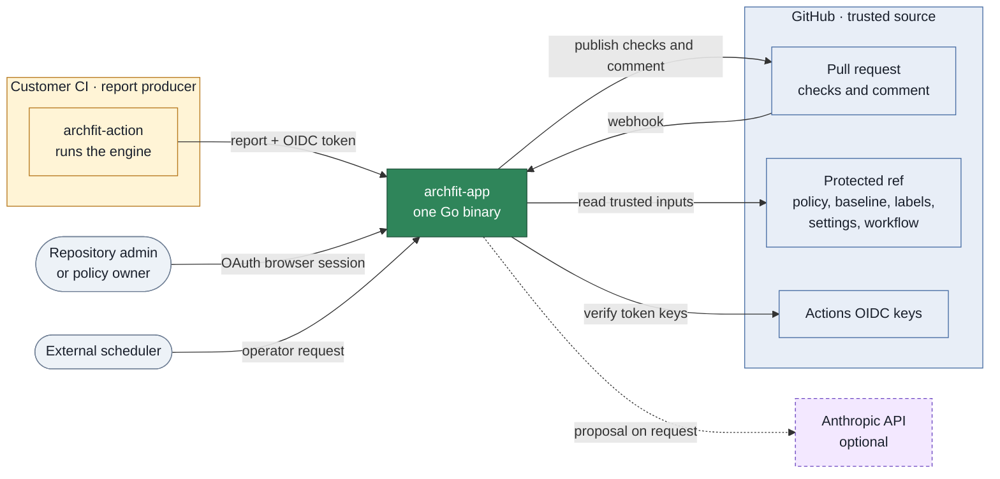
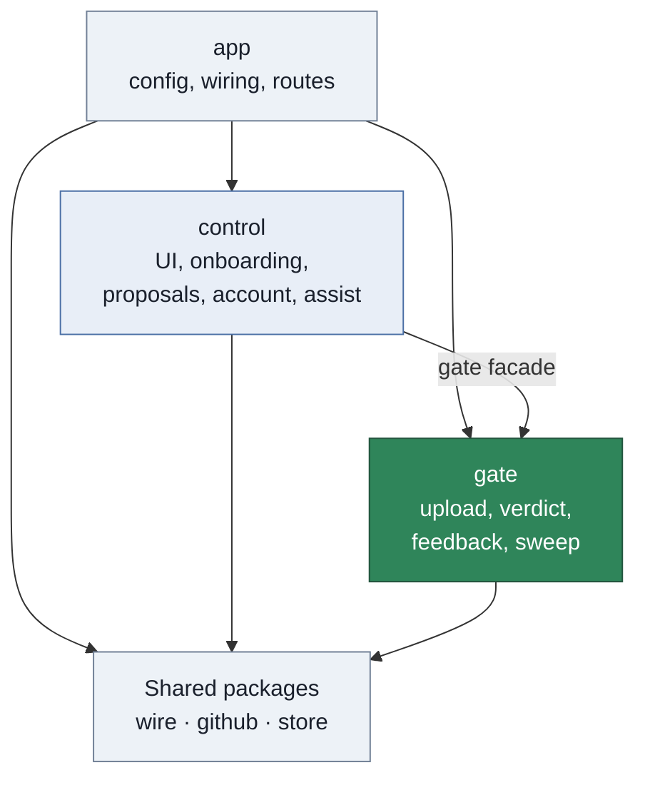
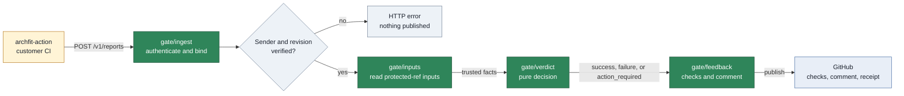
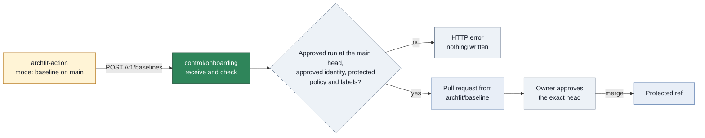
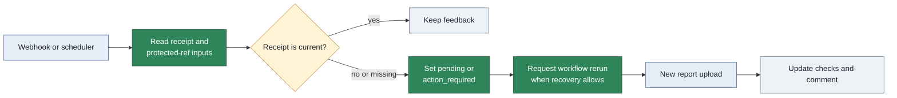

# Architecture

This page explains the App boundary, the main request flows, and the Go package structure.
Read the [module specifications](../internal/module.md) for package contracts and test specifications.

## The main idea

The Archfit engine runs in customer CI and writes a report. The report is customer-attested evidence.
The App does not trust the report until it verifies the sender, revision, policy, and other gate inputs.

For each report, the App:

1. Verifies the GitHub Actions OIDC token and the upload envelope.
2. Reads policy, baseline, labels, and settings from the protected ref.
3. Compares the report with those trusted inputs.
4. Publishes feedback on the pull request.

The protected ref is the base branch of a pull request. For a default-branch push, it is the default branch.

## System context

Solid arrows show request, read, or publication flow. The dotted arrow shows an optional AI proposal.

The App stores no report or source code. GitHub stores checks, comments, workflow runs, and the no-source
report artifact that the Graph page reads. The App stores entitlements, consent records, an LLM budget
counter, and short-lived publication leases in a key-value store. A lease makes the writes for one head SHA run
one at a time, on every instance, so an older publication cannot overwrite a newer one. Inside the lease an upload
reads its inputs again, so a decision from replaced inputs is never written. Without the store, the App
publishes nothing.

The repository split is:

- `archfit` owns the engine, CLI, images, and report schemas.
- `archfit-action` runs the engine in customer CI and uploads the report.
- `archfit-app` owns approved policy, report intake, the gate, and feedback.

## Packages

The App is one Go binary. The main internal packages are shown below.

Arrows show permitted import groups. The `gate` arrow from `control` is a facade call.
The shared group contains `wire`, `github`, and `store`.

| Package   | Main responsibility                                                            | Child packages                                         |
| --------- | ------------------------------------------------------------------------------ | ------------------------------------------------------ |
| `app`     | Loads environment settings, builds packages, and registers routes              | none                                                   |
| `gate`    | Verifies uploads, decides outcomes, publishes feedback, and runs the sweep     | `ingest`, `inputs`, `verdict`, `feedback`, `sweep`     |
| `control` | Serves the UI and manages onboarding, proposals, AI requests, and entitlements | `account`, `assist`, `onboarding`, `proposal`, `ui`    |
| `wire`    | Defines versioned file and message formats                                     | `envelope`, `manifest`, `policy`, `report`, `settings` |
| `github`  | Holds GitHub API, authentication, webhook, and OIDC knowledge                  | `api`, `auth`, `oidc`, `webhook`                       |
| `store`   | Defines the tenant key-value interface and the memory driver                   | none                                                   |

The import rules keep the gate independent:

- `gate` never imports `control`, `app`, UI code, or LLM code.
- `control` uses only the `gate` facade.
- `wire` and `store` import no other internal package.
- A seam implementation can import the package that defines its interface.
- Tests run `go list -deps` to enforce the allowed imports.

## Report upload

The upload path accepts a report, verifies it, and publishes feedback in one request.

Arrows show the order of the upload request. Authentication defects return an HTTP status.
After authentication, defects become gate reasons and appear in GitHub feedback.

`gate/ingest` verifies the token, envelope, payload digest, report format, run, pull request, and revision.
It reads the report with the key set of the engine release that the envelope claims.
`gate/inputs` reads the protected-ref files and owner approval. `gate/verdict` performs no I/O and no AI call.
The upload handler has a 55-second deadline. The target is feedback within 60 seconds.

The upload body is at most 5 MiB. A larger body gets `413 payload_too_large`, and the App publishes nothing.
The App does not read part of a report.

## Baseline upload

The baseline is a file on the protected ref. It changes only through a pull request that an architecture owner
approves. The App never commits it to the default branch.

Arrows show the order of the baseline flow. Only the merge writes the protected ref.

`control/onboarding` uses the gate's `Receiver`, so the token, envelope, run and digest checks are the same as for a
report. Then it checks, in this order, and the first failure decides:

1. The run has no problem and ran on the default branch.
2. The run checked out the current head of the default branch. Every later read is at that commit.
3. The run used the workflow that `.archfit-app.yaml` names.
4. The engine identity is a row of the locked manifest.
5. The file is a structurally valid `archfit.baseline.v2` baseline of at most 1 MiB, and its measurement profile is
   the profile of that manifest row.
6. Its `state.config_hash` is the digest of the protected `.archfit.yaml`.
7. The envelope's `labels_digest` is the digest of the protected `.archfit-labels.yaml`, or empty when there is none.

A file equal to the protected baseline opens nothing. Otherwise the App opens a draft pull request from
`archfit/baseline` into the default branch that changes only `.archfit-baseline.json`, with the uploaded bytes. A new
upload updates the same branch and pull request and rewrites its body. The body counts the accepted findings added
and removed, lists them by rule ID and finding ID, names the run, engine identity and digests, and states that an
architecture owner must approve the exact head commit. The gate's protected-path rule then governs the merge.

Today the Action captures with plain `archfit baseline`, which accepts all current eligible debt. The added count in
the body is what keeps that visible to the owner. When the engine ships `archfit baseline --reanchor`, a re-capture
after an engine or profile change should use it, so that the pull request accepts no new finding by construction.

### Baseline upload contract

The Action must implement this contract in `mode: baseline` when `endpoint` is set:

- Request: `POST <endpoint>/v1/baselines`.
- Headers: `Authorization: Bearer <OIDC token>` with the endpoint as audience, `X-Archfit-Envelope` with the
  one-line `archfit.report-envelope.v1` JSON, and `Content-Type: application/json`.
- Body: the exact bytes of the `.archfit-baseline.json` that `archfit baseline` wrote, at most 1,048,576 bytes.
- Envelope: `kind` is `baseline`; `event` is `workflow_dispatch` (or `push` to the default branch); `pull_request` is
  `0`; `base_sha` and `merge_base_sha` are `""`; `head_sha` is the checked-out default-branch commit; `baseline_digest`
  is `""`; `labels_digest` is the bare hex SHA-256 of the labels file the capture read, or `""` without one;
  `payload_digest` is `sha256:<hex>` of the body; the engine identity fields are those of the pinned image.

| Status        | Body                                    | Meaning                                                                  |
| ------------- | --------------------------------------- | ------------------------------------------------------------------------ |
| 200           | `{"pull_request": <n>, "url": "<url>"}` | The baseline pull request was opened or updated                          |
| 200           | `{"unchanged": true}`                   | The capture equals the protected baseline. Nothing was written           |
| 400           | `{"error": "<code>"}`                   | Malformed or unbound upload, or `baseline_invalid`. Final                |
| 401           | `{"error": "<code>"}`                   | `token_missing` or `token_invalid`. Final                                |
| 403           | `{"error": "<code>"}`                   | Not eligible or not bound to the protected inputs (below). Final         |
| 409           | `{"error": "<code>"}`                   | `stale_head` or `stale_attempt`. Superseded: dispatch the capture again  |
| 413           | `{"error": "<code>"}`                   | `baseline_too_large` above 1 MiB, `payload_too_large` above 5 MiB. Final |
| 429, 503, 500 | `{"error": "<code>"}`                   | `rate_limited`, `oidc_unavailable` or `internal`. Retry                  |

The `400` codes are `method_not_allowed`, `envelope_missing`, `envelope_invalid`, `kind_mismatch`, `digest_mismatch`,
`unsupported_event`, `envelope_mismatch`, `fork` and `baseline_invalid`. The `403` codes are `repository_mismatch`,
`not_installed`, `run_not_found`, `run_mismatch`, `not_default_branch`, `settings_missing`, `workflow_not_approved`,
`unknown_engine_identity`, `policy_missing`, `policy_mismatch` and `labels_mismatch`.

## Gate outcomes

The `verdict` package has three conclusions. It cannot represent `neutral` or `skipped`.
The first reason sets the conclusion. Later reasons remain in feedback.

| Conclusion        | Use                                                | Categories                               |
| ----------------- | -------------------------------------------------- | ---------------------------------------- |
| `success`         | Trusted evidence has no blocking finding           | `architecture`                           |
| `failure`         | Trusted evidence has a blocking finding            | `architecture`                           |
| `action_required` | Evidence, governance, or subscription needs action | `evidence`, `governance`, `subscription` |

The App publishes two checks:

- `archfit/state` is advisory. It is published for each accepted report upload. It uses `neutral` for advisory
  attention and for findings it does not enforce, and `action_required` whenever the gate result is
  `action_required`. Errors and unverifiable evidence are never `neutral` or `skipped`.
- `archfit/gate` is the blocking check. It is published only when the settings file contains `gate: required`.
- A `needs_attention` verdict with nothing else to act on is `success` with the reason `attention_only`, never
  `healthy`. A required rule whose selector matches nothing is `action_required` with `policy_defect`.

Each published check carries a receipt with the run ID, report digest, policy digest, baseline digest, and
labels digest. The sweep compares the receipt with the protected ref. See the [reason catalog](user-guide.md#reason-codes)
for recovery actions.

## Engine releases

An engine upgrade needs no flag day. Three `wire` packages share the rule:

- `wire/manifest` approves engine images by rows. Rows of two releases can exist together during an upgrade:
  the release that new workflows pin and the release before it.
- `wire/report` reads a report with the key set of its engine release. Each release has its own key set, and a
  key of a later release is an unknown key. A release that is not in the list gives `report_invalid`.
- The gate decides only from fields that every listed release defines: the verdict, the hard gates, the
  unevaluated required rules, the config hash, the measurement-profile version, and the gate reference.
- `wire/policy` keeps one engine config schema, the schema of the release that new workflows pin.

The App reads v2.3.1, v2.4.0 and v2.4.1 reports; neither later release adds a report key. The manifest approves the
published images of v2.4.0 and v2.4.1. New workflows pin v2.4.1 (`current`), and the policy editor uses the v2.4.1
config schema, which lists the allowed rule types. The v2.4.0 rows stay for the upgrade window and go once workflows
have moved their pin. The v2.3.1 window is closed: its rows are gone, so a v2.3.1 upload concludes
`action_required`. The decoder still reads v2.3.1 documents because the fixture corpus is built from them.
Tests in `internal/wire` stop a manifest row for a release that the decoder cannot read, that has no real capture
in the fixture corpus, or whose config schema is not pinned when new workflows move to it.

Generated workflows pin `archfit-action` v1.0.0 by commit `a9cd2ce8d0dc996b258b5faa5145eaf11bd6bc5b`, the manifest
`action_ref`. The `action-conformance` CI job checks out that commit and fails when its vendored
`schema/envelope.v1.schema.json` differs from `internal/wire/envelope/envelope.v1.schema.json`.

## Webhooks and the sweep

A webhook starts immediate work. The sweep repairs work after a lost webhook or a changed protected ref.

The arrows show recovery flow. The sweep does not compute a new report because the App stores no report.

| Event                                                    | Gate action                                                                                                                                                                  | Control action                        |
| -------------------------------------------------------- | ---------------------------------------------------------------------------------------------------------------------------------------------------------------------------- | ------------------------------------- |
| New pull request head                                    | Set a pending required check or refuse a fork                                                                                                                                | None                                  |
| Push to the default branch that changes a protected path | Sweep that repository                                                                                                                                                        | None                                  |
| Review change                                            | Set `owner_approval_missing` when a `success` or `failure` check lost its owner approval; rerun when the last reason was `owner_approval_missing` and no approval is missing | None                                  |
| Installation added or removed                            | None                                                                                                                                                                         | Start the trial or delete tenant data |

The app handler runs gate and control webhook work independently. A control error does not change gate work.

The sweep inspects open pull requests for these conditions:

- A pending required check is missing.
- No report arrived within 60 minutes.
- An owner approval that a `success` or `failure` check relied on is gone.
- The policy, baseline, or labels changed on the protected ref.
- A waiver expires within seven days or has expired.
- The subscription changed.

An owner approval can end without a new commit: the owner dismisses the review or requests changes, the owner leaves
the settings file on the protected ref, or the pull request starts to change a protected path. Edits to the settings
file and the workflow file change no digest in the receipt, so the receipt digests cannot show this. The review event,
or the sweep when the event is lost, then sets the required check to `action_required` with `owner_approval_missing`.
It requests no rerun: no run can pass until an owner approves the head again, and that approval triggers the rerun.
The rerun also follows when no approval is needed any more, for example after a base retarget.
The review event and the sweep read the check, read the inputs, decide, and write all inside the head's publication
lease. So a newer run that turned green while they waited is the result they downgrade, and an approval that
arrives meanwhile is handled by its own review event after the write. An upload decided before the withdrawal reads
its inputs again inside the lease, writes nothing, and answers `503`. Without the Store nothing is written, and the
check keeps its current conclusion until the Store is back and the next review event or sweep pass runs. In
advisory mode there is no required check, and neither path changes the advisory `archfit/state` check.

The sweep reruns the customer workflow after stale inputs, an expired waiver, late owner approval, or restored
subscription. A missing upload becomes `action_required`. A fresh report is required for a new `success` result.

## Trust rules

These invariants keep repository authors from weakening the gate:

- Read policy, baseline, labels, settings, owners, and workflow from the protected ref.
- Verify the policy digest against the report.
- Accept a head policy only when an architecture owner approved the exact head SHA.
- Treat missing, incompatible, or unverifiable evidence as not successful.
- Describe report provenance as `customer-attested`, never as `verified`.
- Keep LLM output, billing, and UI code off the gate path.
- Resolve tenant identity from a verified webhook, OIDC claim, or OAuth session.
- Never commit to the protected ref. A captured baseline arrives only as a pull request that an owner approves.
- Log IDs, digests, outcomes, and timings only.

The protected paths are:

- `.archfit.yaml`
- `.archfit-baseline.json`
- `.archfit-labels.yaml`
- `.archfit-app.yaml`
- The workflow file named by `.archfit-app.yaml`

A change to a protected path needs approval from an architecture owner on the exact head SHA.

## HTTP routes

The routes come from [`internal/app/handler.go`](../internal/app/handler.go) and
[`internal/control/ui/ui.go`](../internal/control/ui/ui.go).

### Service routes

| Method and route        | Owner     | Authentication             |
| ----------------------- | --------- | -------------------------- |
| `GET /healthz`          | `app`     | None                       |
| `POST /v1/reports`      | `gate`    | GitHub Actions OIDC token  |
| `POST /v1/discoveries`  | `control` | GitHub Actions OIDC checks |
| `POST /v1/baselines`    | `control` | GitHub Actions OIDC checks |
| `POST /webhooks/github` | `app`     | `X-Hub-Signature-256`      |
| `POST /internal/sweep`  | `app`     | Operator bearer token      |
| `POST /internal/grants` | `app`     | Operator bearer token      |

### UI routes

| Method and route                                                               | Authentication                                  |
| ------------------------------------------------------------------------------ | ----------------------------------------------- |
| `GET /`                                                                        | None. Shows the landing page or repository list |
| `GET /auth/login` and `GET /auth/callback`                                     | None                                            |
| `POST /auth/logout`                                                            | GitHub OAuth session and CSRF token             |
| `GET /static/{path}` and `GET /schema/policy.json`                             | None                                            |
| `GET /r/{o}/{n}`                                                               | Session with repository `read` permission       |
| `POST /r/{o}/{n}/onboarding`, `/discover`; `GET` and `POST /r/{o}/{n}/consent` | Session with repository `admin` permission      |
| `GET /r/{o}/{n}/policy` and `/graph`, `POST /r/{o}/{n}/policy/check`           | Session with repository `read` permission       |
| `POST /r/{o}/{n}/policy` and `/policy/ready`                                   | Session with repository `write` permission      |
| `POST /r/{o}/{n}/assist`                                                       | Session with repository `write` permission      |

## Platform seams

The App keeps platform-dependent code behind three interfaces.

| Seam       | Current driver                       | Current behavior                    |
| ---------- | ------------------------------------ | ----------------------------------- |
| `Store`    | `memory`                             | Data is lost when the process stops |
| `Sandbox`  | `none`                               | Managed discovery is not available  |
| `Provider` | `anthropic` when a key is configured | Managed AI is optional              |

A new driver changes the composition in `app`. The gate contracts do not change.

## Deployment

The App is not deployed. The target is Google Cloud. The [cloud design](design/cloud/architecture.md) owns the deployment design.
This page lists only what any host must provide.
A host must provide these runtime capabilities:

- Run one static Go binary in a container.
- Provide a key-value driver that passes the `store/storetest` suite. When more than one instance runs, its
  `CompareAndSwap` must be atomic across all of them.
- Call `POST /internal/sweep` with an external scheduler.
- Provide a sandbox driver before managed discovery is enabled.

### Configuration

The App reads environment variables. It does not read a `.env` file.
Secret variables name files. They do not contain secret values.
See [`.env.example`](../.env.example).

| Variable                             | Function                                               |
| ------------------------------------ | ------------------------------------------------------ |
| `ARCHFIT_ADDR`                       | Listen address. Default `:8080`                        |
| `ARCHFIT_BASE_URL`                   | Public URL and OIDC audience. No trailing `/`          |
| `ARCHFIT_GITHUB_APP_ID`              | GitHub App ID                                          |
| `ARCHFIT_GITHUB_PRIVATE_KEY_FILE`    | GitHub App private-key file                            |
| `ARCHFIT_GITHUB_WEBHOOK_SECRET_FILE` | Webhook secret file                                    |
| `ARCHFIT_GITHUB_OAUTH_CLIENT_ID`     | OAuth client ID                                        |
| `ARCHFIT_GITHUB_OAUTH_SECRET_FILE`   | OAuth client secret file                               |
| `ARCHFIT_COOKIE_KEY_FILE`            | 32-byte session-cookie key file                        |
| `ARCHFIT_OPERATOR_TOKEN_FILE`        | Bearer token file for `/internal/*`                    |
| `ARCHFIT_ANTHROPIC_KEY_FILE`         | Optional Anthropic key file. Empty disables managed AI |
| `ARCHFIT_STORE`                      | Store driver. Only `memory` exists                     |
| `ARCHFIT_SANDBOX`                    | Sandbox driver. Only `none` exists                     |

### Release blockers

- No GitHub App is registered.
- No persistent Store driver: `ARCHFIT_STORE` supports only `memory`. Pilots need a driver with atomic cross-instance
  `CompareAndSwap` (Firestore, per docs/tech-stack.md).
