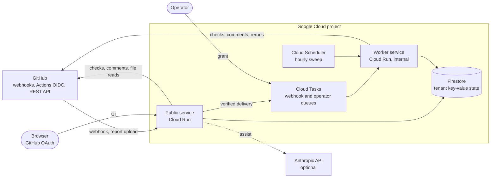
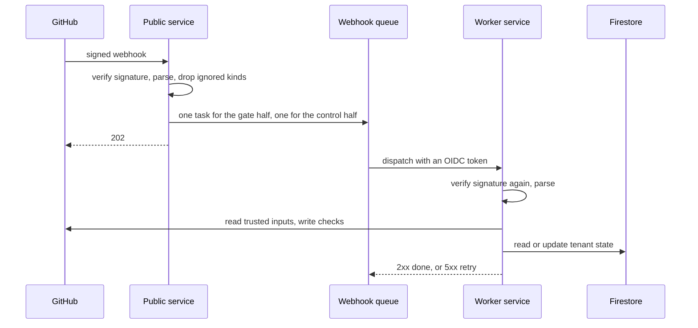

# Cloud architecture

This page sets the direction for running the App on Google Cloud: components, flows, state, guarantees, cost, and open
decisions. It is a design, not a specification. The implementation owns resource names, settings, files, and commands.

Current behavior lives in [Architecture](../../architecture.md) and the `module.md` files.
[Security](security.md) and [Operations](operations.md) complete this design.

## Principles

- Run the existing Go binary. Add drivers behind the existing seams. Do not add a second language.
- Use managed services that cost nothing at beta scale. Add a paid service only when a named trigger fires.
- Fail closed. A cloud failure never turns into a passed gate.
- Keep all regional resources in one region. The default is `europe-west1`.

## Workload and constraints

- Invite-only beta: the owner's repositories and a few friends. About 10 repositories and a few thousand requests a month.
- A report upload is at most 5 MiB. The Action waits for the verdict, and the handler deadline is 55 s.
- GitHub closes a webhook connection after 10 s and does not redeliver on its own.
- The App stores no reports and no source. Its state is entitlements, consent records, and an LLM budget counter, in kilobytes.
- Managed discovery stays off.

## System context

Solid arrows show requests. The dotted arrow shows the optional assist call. Secret Manager and Cloud Logging serve both
services and are not drawn.

## Components

| Component                    | Responsibility                                                                              |
| ---------------------------- | ------------------------------------------------------------------------------------------- |
| Public service               | Webhook intake, report upload and verdict, UI. The only component that the internet reaches |
| Worker service               | Webhook processing, the sweep, and grants. Only Cloud Tasks and Cloud Scheduler reach it    |
| Webhook queue                | Durable, retried, rate-limited hand-off from intake to the worker                           |
| Operator queue               | The only path for grants. Authenticated and audited                                         |
| Scheduler                    | Starts the sweep each hour                                                                  |
| Firestore                    | The `Store` driver                                                                          |
| Secret Manager               | Secrets, mounted as files to match the `*_FILE` rule                                        |
| Cloud Logging and Monitoring | Logs, metrics, traces, and alerts. See [Operations](operations.md#observability)            |

Both services run the same image. A role setting selects the routes. The public role never serves `/internal/*`.
The worker role never serves the UI or the upload route. Local runs and tests keep one process with every route.

## Flows

### Webhook

GitHub needs an answer in 10 s and does not redeliver on its own. So intake only verifies and queues.
The worker does the work, and the queue retries it.

Rules:

- A task carries GitHub's own body and headers. The worker verifies the signature again. So the queue is not trusted,
  and no App-defined wire contract exists between the two services.
- The gate half and the control half are separate tasks. A control failure never blocks or repeats gate work.
- The task name comes from the delivery ID. Cloud Tasks rejects a repeated name for 24 hours. Delivery is still
  at-least-once and can be out of order. See [Concurrency](#concurrency).
- A transient error returns 5xx, and the queue retries for about 2 hours. A permanent error returns success and is logged.
- If a body is too large for a task (1 MiB), or if the queue is unavailable, intake processes the webhook inline, as today.

### Report upload

The upload stays synchronous on the public service, because the Action waits for the verdict. The flow is
[Report upload](../../architecture.md#report-upload). Firestore is the only new dependency: it holds the entitlement.

### Sweep

The Scheduler calls the sweep on the worker each hour. The sweep is the recovery path for lost webhooks, changed
protected refs, missed uninstalls, and work that a bad release dropped. It reconciles from GitHub state. It does not replay events.

### Grant

The operator creates a task in the operator queue. The worker checks an operator token, then writes the account record and
its entitlement in one transaction. Cloud Audit Logs record who created the task.

## State

- Firestore in Native mode holds all tenant state in one database, behind the existing `Store` seam.
- Every key carries its tenant. Isolation is a property of the code and of `store/storetest`, not of IAM.
- The driver uses the REST API over `net/http`, in line with the no-SDK rule of [tech stack](../../tech-stack.md#dependencies).
  It must pass `store/storetest` against the Firestore emulator.
- `Store` gains one operation: a transaction over several keys of one tenant. See [Concurrency](#concurrency).
- `Store` already has a single-key `CompareAndSwap` for the publication leases. The driver implements it with a
  transaction that commits under the document's `updateTime` precondition, or with `exists=false` when the key must be
  missing. It must be atomic across all instances. A lock in one process is not enough.
- The free quota covers only the default database. The database location cannot change after creation.
- Daily backups with a 7-day retention. A restore creates a new database and never overwrites the live one.
- During a rollout, two revisions run at the same time. Each stored format change must be readable by the previous revision.

## Concurrency

Retries, duplicates, and two services make races more likely than in one process. Two races exist in today's code.

**Account state: fix.** Account writes its record and the derived entitlement as two separate writes, without a version check.
A concurrent write can drop a grant, and a crash between the writes leaves a stale entitlement.
The new multi-key `Store` transaction writes both together. A single-key transaction is not enough.

**Publications of one head: fixed.** Every write to GitHub for one head (an upload, a sweep repair, the pending check
and the waiver notice) holds a lease in the `Store`. The key is the installation and the head SHA. The holder reads the
check, compares the receipts and writes while it holds the lease. So an older publication can no longer overwrite a newer
one, and a late pending check can no longer replace a verdict. A `Store` error writes nothing.
The lease lasts 60 seconds. The holder stops its own work 10 seconds before that, by its own clock. A call that
fails after it sent a request to GitHub (a client timeout, a 5xx, the work deadline) keeps the lease until it expires,
so a write that GitHub still applies lands before the next holder reads. An upload reads its inputs again inside the
lease and writes nothing when they changed, so it never replaces a sweep correction made from newer inputs.

**Pending gate check: open.** The lease removes the race between concurrent calls on one instance or several. A lease
still cannot fence writes to GitHub: a request that GitHub applies more than 10 seconds after the holder's work
deadline can land after another instance took over. Branch protection already blocks a merge while a required check is missing, and GitHub shows it as
"Expected". So the pending check on webhooks can still be dropped. This is [open decision 1](#open-decisions).

**Remaining limit.** A request that GitHub applies more than 10 seconds after the holder's work deadline can land
after a takeover. Then the last write to GitHub wins until the next sweep.

## Failure handling

| Failure                                    | Behavior                                                                         |
| ------------------------------------------ | -------------------------------------------------------------------------------- |
| Worker returns 5xx or is down              | The queue retries for about 2 hours. The sweep repairs what is still missing     |
| Worker returns success without the work    | The task is gone. The sweep repairs gate and control state                       |
| The platform rejects a dispatch (401, 403) | The App never sees it. A platform alert catches it                               |
| Queue unavailable at intake                | Intake processes the webhook inline                                              |
| Firestore unavailable                      | Store calls fail. No publication lease, so nothing is published: uploads get 503 |
| GitHub API errors or rate limits           | The worker retries through the queue. The upload returns its error to the Action |
| Webhook lost before intake                 | The sweep repairs checks. GitHub keeps failed deliveries for 3 days              |
| Bad release                                | Roll back. See [Operations](operations.md#roll-back)                             |

## Required App changes

These capabilities must exist before the first deployment. Details belong to the implementation plan.

- A Firestore `Store` driver and the multi-key transaction, both covered by `store/storetest`.
- Account writes through the transaction.
- Open decision 1 applied.
- A queue seam with an inline driver (default) and a Cloud Tasks driver, and a worker route for queued webhooks.
- Transient and permanent error classes in webhook handling, and idempotent handlers under concurrent duplicates.
- Roles that select routes and the required secrets. The public role starts without the operator token.
- Two accepted webhook secrets during a rotation. See [Security](security.md#secrets).
- A readiness check that proves the App key works with GitHub and the store answers.
- Log fields that Cloud Logging reads. See [Operations](operations.md#observability).
- `module.md` and import-matrix updates for the new seams.
- The [release blockers](../../architecture.md#release-blockers) closed.

## Cost

At beta scale everything fits inside free tiers: about $0–1 a month. A warm public instance, which removes cold starts,
adds about $5–10. The main cost drivers, in order, are warm instances, a retry storm in the queue, and log volume.
Prices are list prices at design time and change. Free tiers are per billing account and shared with other projects on it.

## Options

| Area             | Chosen                             | Not chosen, and why                                                                                                                                          |
| ---------------- | ---------------------------------- | ------------------------------------------------------------------------------------------------------------------------------------------------------------ |
| Compute          | Cloud Run, two services, one image | One service: no retries past GitHub's 10 s. GKE or VMs: fixed cost and patching                                                                              |
| Webhook hand-off | Cloud Tasks                        | Pub/Sub: no named deduplication or per-queue rate limit. Synchronous: work lost after a disconnect                                                           |
| State            | Firestore over REST                | Firestore SDK: many dependencies. Cloud Storage: no free tier in the EU. Memorystore or Cloud SQL: fixed cost                                                |
| Custom domain    | Cloud Run domain mapping           | Load balancer: fixed monthly cost. Firebase Hosting: 60 s limit and cookie stripping                                                                         |
| Analytics        | Log Analytics on retained logs     | BigQuery tables and a pipeline: more parts for the same questions                                                                                            |
| Platform         | Google Cloud                       | Cloudflare Containers: a TypeScript Worker around the Go container, secrets only as environment variables, weaker alerting, and a higher floor at this scale |

Add these services when the trigger fires:

| Service                           | Trigger                                                                                   |
| --------------------------------- | ----------------------------------------------------------------------------------------- |
| Staging services and a second App | The first installation outside the owner and friends, or a release that breaks production |
| Load balancer and Cloud Armor     | Leaving the beta, a need for edge rate limits or a WAF, or domain mapping problems        |
| Cloud KMS signing for the App key | Before paying customers. See [Security](security.md#secrets)                              |
| Memorystore                       | GitHub rate limits bite and conditional requests are not enough                           |
| Cloud SQL                         | The App stores reports or needs relational queries                                        |
| Cloud Run jobs or sandbox         | Managed discovery is enabled                                                              |

## Open decisions

Each decision has a default. The design uses the default until the owner changes it.

| #   | Decision                                  | Default                             | Other choice                                                         |
| --- | ----------------------------------------- | ----------------------------------- | -------------------------------------------------------------------- |
| 1   | Create the pending gate check on webhooks | No                                  | Keep it. The lease leaves only a stalled holder's late write         |
| 2   | Region                                    | `europe-west1`                      | `us-central1` at the same price. The Firestore location is permanent |
| 3   | Warm public instance                      | No                                  | About $5–10 a month, no cold starts                                  |
| 4   | Final domain                              | `https://app.coupling.dev` (chosen) | It is the OIDC audience and must exist before the App is registered  |
| 5   | Google Cloud Organization                 | None for the beta                   | See [Security](security.md#organization)                             |
| 6   | Staging environment                       | None for the beta                   | See the trigger in [Options](#options)                               |

## Known limits

- Publications of one head are serialized by a `Store` lease. A request that GitHub applies more than 10 seconds
  after the holder's work deadline can still land after a takeover, until the next sweep.
- A `Store` outage stops all publication. Checks stay as they were until the `Store` is back. An unserialized write
  would let an older run overwrite a newer one.
- The release canary gets no real webhooks or uploads. See [Release](operations.md#release).
- Domain mapping is in Preview. It has no SLA.
- Two instances per service cap cost and throughput. That is intended for the beta.
