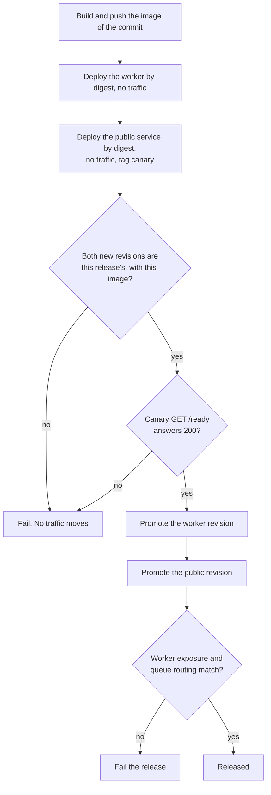

# Operations

This page sets the direction for delivering, observing, and running the [cloud architecture](architecture.md).
The implementation owns the concrete files, commands, metric names, thresholds, and runbooks.
Security rules for identities, secrets, and incidents are in [Security](security.md).

## Environments

- **Production:** one Google Cloud project, `coupling-dev-510710` (display name `coupling-dev`). Commands need the
  project ID, not the display name.
- **Local:** one process with every route, the memory store (or the Firestore emulator), and inline webhook processing. Local webhook tests use a
  separate development GitHub App and a tunnel. The production App never points at a tunnel.
- **Staging:** none for the beta. A staging pair of services with a second GitHub App costs about $0 at zero instances.
  It is the only way to test real webhooks, uploads, and the OIDC audience before production.
  See the trigger in [Options](architecture.md#options).

## Infrastructure as code

- Terraform (or OpenTofu) owns every cloud resource, IAM binding, and service setting.
- Long-lived data and identities (Firestore, logs, secrets, service accounts) live apart from the runtime (services,
  queues, Scheduler, monitors). A routine runtime change then cannot destroy data.
- CI owns only the image and the traffic of the two services. Terraform ignores those fields.
- Secret values never enter Terraform. The owner adds them directly to Secret Manager.
- The owner applies infrastructure changes. An infrastructure change never runs at the same time as a release.
- The code is in [`infra/`](../../../infra/README.md): a `data` stack and a `runtime` stack, with state in a
  versioned GCS bucket in the project.

## Roles and routing

Both services run the same image. `ARCHFIT_ROLE` selects the routes and the secrets.

| Service | Settings                                                                                                          | Secrets                                                                  |
| ------- | ----------------------------------------------------------------------------------------------------------------- | ------------------------------------------------------------------------ |
| Public  | `ARCHFIT_ROLE=public`, `ARCHFIT_QUEUE=cloudtasks`, `ARCHFIT_TASKS_QUEUE`, `ARCHFIT_WORKER_URL`, `ARCHFIT_INVOKER` | App key, webhook secret, OAuth secret, cookie key, Anthropic key         |
| Worker  | `ARCHFIT_ROLE=worker`, `ARCHFIT_WORKER_URL`, `ARCHFIT_INVOKER`                                                    | App key, webhook secret, operator token                                  |

A role never reads a secret that is not in its row, even when the variable is set. A missing secret of its own row
stops the startup. During a webhook secret rotation, both services also mount the previous webhook secret
(`ARCHFIT_GITHUB_WEBHOOK_SECRET_PREVIOUS_FILE`). Both services set `GOOGLE_CLOUD_PROJECT` to the project ID, so log
lines name their trace.

`ARCHFIT_WORKER_URL` is the worker service URL with no trailing `/`. It is the audience of the invoker ID token.
`ARCHFIT_INVOKER` is the e-mail of the invoker service account. The App refuses a worker request whose ID token has
another audience or another e-mail.

Each caller of the worker has one route. Terraform pins it at the queue level (`uriOverride`, enforced):

| Caller          | Worker route              | Request                                                                                                    |
| --------------- | ------------------------- | ---------------------------------------------------------------------------------------------------------- |
| Webhook queue   | `POST /internal/webhooks` | One queue for both halves. The header `X-Archfit-Half` selects the gate half or the control half           |
| Operator queue  | `POST /internal/grants`   | JSON `{"installation_id": <id>, "until": "<RFC 3339>"}`, and `X-Archfit-Operator: Bearer <operator token>` |
| Cloud Scheduler | `POST /internal/sweep`    | Hourly. No body and no secret                                                                              |

Every caller sends an OIDC token of the invoker service account with the worker URL as audience. A webhook task
names the invoker in its own `oidcToken`. Queue-level authentication, when Terraform sets it, overrides the task's.
A task with an `oidcToken` needs the creator to act as that service account: the public service account then needs
`roles/iam.serviceAccountUser` on the invoker account. The `data` stack in [`infra/`](../../../infra/README.md) grants it.

Task names are `<delivery ID>_gate` and `<delivery ID>_control`. Cloud Tasks refuses a name for up to 24 hours after
the task ran, so a GitHub redelivery inside that window is a duplicate. The adapter body limit is 900 KiB, leaving
room below the task-size limit. Public intake returns `503` if either enqueue fails; no inline fallback runs.
GitHub does not automatically redeliver failures. Inspect the failed delivery before explicit redelivery, or use sweep
reconciliation. An oversized payload needs investigation, not repeated submission of the same unsupported task.

## Project guardrails

The project has no Organization, so organization policies cannot restrict regions or services
(see [Security](security.md#organization)). These project-level controls were applied with `gcloud` before
Terraform existed. The `data` stack in [`infra/`](../../../infra/README.md) imports the enabled APIs, the quota
preferences, the alert policy with its channel, and the essential contact. The budget stays on the billing account,
outside Terraform.

| Control                 | Setting                                                                                                                                                              |
| ----------------------- | -------------------------------------------------------------------------------------------------------------------------------------------------------------------- |
| Enabled APIs            | `run`, `firestore`, `cloudtasks`, `cloudscheduler`, `secretmanager`, `artifactregistry`, `iam`, `iamcredentials`, `sts`, plus the platform APIs they need            |
| Disabled APIs           | The default BigQuery family, Dataform, Dataplex, Analytics Hub, `sql-component`, `apptopology`, `containerregistry`, `pubsub`, and the `cloudapis` bundle            |
| Cloud Run quotas        | `europe-west1`: 4 vCPU, 4 GiB, 4 services. Every other region: 0. One region per project. GPUs, jobs and worker pools: 0                                             |
| Default compute account | The automatic `roles/editor` grant is removed. Each component uses its own service account                                                                           |
| Guardrail alert         | One log-based alert policy emails the owner on IAM changes, API enable or disable, quota changes, service account key creation, and Cloud Run outside `europe-west1` |
| Essential contacts      | The owner gets security, billing, suspension, technical and legal notices                                                                                            |
| Budget                  | 200 ILS a month on the billing account. Alerts at 50%, 90% and 100% of actual spend, and at 100% of forecast spend                                                   |

Limits:

- An Owner or Editor credential can reverse every control in the table. The controls slow an attacker down. The alert
  tells the owner. Least privilege on the deploy identity is the control a leaked credential cannot undo.
- No budget action stops spending. A billing kill switch can delete resources, so the beta does not use one.
- Raise a Cloud Run quota before a release needs more: `gcloud quotas preferences update run-cpu-europe-west1
--service=run.googleapis.com --quota-id=CpuAllocPerProjectRegion --preferred-value=<milli-vCPU>`.
  A quota change also triggers the guardrail alert.
- Moving to another region needs new quota preferences for that region. The Firestore location cannot change.

## Firestore

The `firestore` Store driver uses one Native-mode database in the project.

| Setting                      | Value                                                                               |
| ---------------------------- | ----------------------------------------------------------------------------------- |
| `ARCHFIT_STORE`              | `firestore`                                                                         |
| `ARCHFIT_FIRESTORE_PROJECT`  | `coupling-dev-510710`. Required. A missing or invalid value stops the startup       |
| `ARCHFIT_FIRESTORE_DATABASE` | Empty, for `(default)`. The free quota covers only the default database             |
| Credentials                  | The service account of the Cloud Run service, from the metadata server. No key file |
| IAM                          | `roles/datastore.user` on the project for the service accounts of both services     |

Data layout: one collection, `kv`, with one document for each key. A document has two fields: `tenant` (integer)
and `value` (bytes). The document ID is the tenant and the hex form of the key. See
[`store/firestore`](../../../internal/store/firestore/module.md).

Indexes:

- The driver needs only the automatic single-field indexes on `tenant`. Do not exempt `tenant`: the uninstall and
  the sweep query it.
- Exempt `value` from single-field indexing. No query reads it, and the exemption makes writes cheaper.
- No composite index is needed.

TTL:

- No TTL policy is needed. The App stores no timestamp field, so a TTL policy has nothing to read.
- An expired publication lease stays as one small document per head SHA. The next lease on that head takes it over,
  and the uninstall of the installation deletes it. A cleanup of old leases needs a timestamp field in the driver
  first. It does not change the `Store` contract.

Local runs and tests use the emulator. Set `FIRESTORE_EMULATOR_HOST` to its `host:port`. The driver then uses plain
HTTP and no credentials, and logs one warning at startup. Never set it on a Cloud Run service. CI runs the driver
tests against the official emulator image.

## First deployment

The exact commands that the owner runs are in the [infrastructure runbook](../../../infra/README.md#first-deployment).
The order matters:

1. Create the data and identity resources. Add every secret value before any service exists,
   because a revision cannot start without its secrets.
2. Verify the final domain before the GitHub App is registered. The domain is the OIDC audience.
   The domain is `https://app.coupling.dev`, so `ARCHFIT_BASE_URL` is that exact string, with no trailing `/`.
   DNS for `coupling.dev` is at the registrar (Namecheap). Verify `coupling.dev` in Google Search Console with the
   owner account, then point `app` at the Cloud Run domain mapping with the CNAME record that the mapping shows.
3. Register the App with its webhook inactive, and install it nowhere yet.
4. Run the deploy workflow in build-only mode. Create the services with that real App image digest in
   `initial_image_digest`, with the queues and the Scheduler paused. No success-returning placeholder is used.
5. Validate the first runtime and release pipeline: run the deploy workflow in release mode by hand. Then turn on
   releases for each push to `main`.
6. Resume the queues and the Scheduler. Activate the webhook. Install the App on one test repository.
   Follow one pull request from webhook to check. Then install it on the invited repositories.

## Release

The workflow [`.github/workflows/deploy.yaml`](../../../.github/workflows/deploy.yaml) releases each push to `main`
while the repository variable `RELEASE_ON_PUSH` is `true`, and a manual run on `main`.
Its steps are the scripts in [`scripts/deploy/`](../../../scripts/deploy/). The commands for the owner are in the
[infrastructure runbook](../../../infra/README.md#releases).

- Before a new image build or release, run the complete CI workflow on the caller's exact source commit.
  Release validation rejects placeholder engine/image approvals. Validation has read-only repository permissions;
  only the release job receives cloud credentials.
- Image and traffic rollback modes do not wait for the application suite. They still run the shared deployment
  shell checks and Bats tests from the exact source commit. The rollback check does not need the Go module proxy;
  it installs Bats from apt only when the runner does not already provide it.
- Both deployment checkouts verify `HEAD` against `GITHUB_SHA` before any cloud authentication or image operation.
- Build one image for each commit on `main`. Deploy by digest. Keep the last few images for rollbacks.
- Deploy the worker first, because a new worker route must exist before anything sends to it.
- Deploy the public service as a tagged canary without traffic. The canary must pass the readiness check
  `GET /ready`: the App key works with GitHub, and the store answers. It answers `503` with the names of the failed
  checks, and keeps a result for 30 seconds after a pass and 5 seconds after a failure. CI cannot call the worker's
  `GET /ready` (see the worker check limit below).
- Do not use `GET /ready` as a startup probe. Cloud Run runs a startup probe on every new instance, so a GitHub API
  outage would stop every new instance, intake included, although intake does not need GitHub. The startup probe
  is `GET /health`, which checks only that the process serves.
- Promote the exact revisions that CI deployed, never "latest". A revision that another change created stays without traffic.
  A release that stops before the public promotion removes the canary tag, so its revision is not reachable.
- After promotion, check the worker's exposure and the queue routing. See [Worker protection](security.md#worker-protection).
- Record the image digest and the revision names of each release. A rollback needs them.
- Releases never overlap.

Canary limits: the canary gets no real webhooks and no uploads. GitHub calls the main domain, and an Actions token
names the main domain as its audience. The worker has no canary. For the beta, fast rollback covers the gap.

Worker check limit: the worker has internal ingress, so a GitHub runner cannot call its `GET /ready`. The release
promotes a worker revision only when Cloud Run reports it ready, which needs only a started container. The canary's
`GET /ready` checks the same image, key and store from the public service.

Each revision that the release creates has the name `<service>-r<run>-<attempt>` (the workflow run ID and attempt).
The release record (`release.json`, a workflow artifact, and the job summary) holds the commit of the run, the image
digest, the two new revisions, and the revisions that had traffic before.

### PR UI provenance and build metadata

The signed-in `GET /api/session` response includes a `build` object. Anonymous requests still receive `401`;
`/ready` remains health-only. Only these public metadata fields enter the UI; no credential or environment map is
returned. About is available to signed-in users, not limited to installation operators.

| Field                                        | Source and limit                                                                                                                                                                                  |
| -------------------------------------------- | ------------------------------------------------------------------------------------------------------------------------------------------------------------------------------------------------- |
| `source_revision`                            | `APP_SOURCE_REVISION` build arg injected into the binary; fallback to Go's embedded `vcs.revision`, never a checkout at request time. Full lowercase 40-hex SHA only.                             |
| `built_at`                                   | `APP_BUILT_AT`, the UTC image-build timestamp injected into the binary. No fallback to source commit time or deployment time.                                                                     |
| `version`                                    | Go main-module version embedded in the serving binary, when recorded. The UI does not infer a release tag or provide a separate version-injection path. Missing module version falls back to the source SHA in the footer.                                                              |
| `runtime_revision`                           | Validated `K_REVISION` from the serving runtime; not a GitHub analysis run.                                                                                                                       |
| `modified`                                   | Go embedded `vcs.modified`, when present.                                                                                                                                                         |
| Image digest / deployment time / environment | Not recorded in this UI contract. Obtain the digest from release `build.json`, and deployment evidence from `release.json` and the exact runtime inventory. An image cannot embed its own digest. |

`scripts/deploy/build.sh` supplies source SHA and build time on a fresh build. The final image carries the matching
OCI revision/created labels. Reusing an existing commit image preserves that image's metadata; a reuse does not
manufacture a new build timestamp. Direct Docker builds without these args show missing metadata explicitly.

PR analysis metadata has a different source: the selected App-authored `archfit/state` check. Its bounded recovery
prelude and Inputs and identity section supply diagnostics and the producer claim. The check's `external_id`
supplies run/attempt/report digest; its `head_sha` supplies the analysed revision. The report schema is read only
from a digest-matched admitted artifact. The historical check format records neither Action SHA nor analysis time
nor base revision. Do not substitute the deployed App's approved manifest values. Report provenance is not content
verification.

Before releasing a UI change:

1. Run `make all`, `make deploy-check`, and the PR diagnostics browser regressions on the exact source commit.
2. Capture both blocked tabs, an admitted partial report and a historical report across App build changes. The
   project Playwright harness uses sample API data under production CSP. For an integrated capture, the actual Go
   UI/session/API can run against the existing OAuth/GitHub test fixtures. Record which API boundary was used;
   neither kind is live GitHub authentication. Use no production cookies.
3. Record exact reviewed source SHA, image digest, compiled build time, intended project/region/services, previous
   image and traffic revisions, and screenshot/test evidence. If no image was built, release readiness is blocked.
4. Obtain human approval of that exact artifact and production destination before merging or running a production
   build/push/deployment. Passing CI is not deployment authorization.
5. After an approved canary deploy, check signed-in About against the release record, verify the PR analysis
   producer did not change across the App upgrade, and check both available and action-required views. Keep
   `/ready` as a health check, not version evidence. Record limits when live authenticated validation is unavailable.

The existing [rollback procedure](#roll-back) remains unchanged. This UI change requires no migration, policy edit,
baseline reset or re-anchor.

## Roll back

- **Traffic rollback.** Move traffic back to the previous revisions. If the worker does harm, pause the webhook queue
  first. The previous revisions use their own pinned secret versions, so those versions must still exist.
  Run the deploy workflow with `mode: traffic` and the revisions from "traffic before" in the bad release's
  record. It accepts only revisions that a release created, moves the public service first and the worker second,
  then removes the canary tag from the bad public revision and runs the post-release checks.
- **Image rollback.** After a secret was destroyed, an old revision cannot start. Redeploy the last good image with
  the current secrets through the release pipeline: run the deploy workflow with `mode: image` and the digest of
  that image from its release record.
- Run a rollback from `main`. Workload Identity admits no other ref.
- Turn off releases on push before you start a rollback. Runs wait in one queue, and a newer waiting run cancels an
  older one, so a push could otherwise replace the waiting rollback. Check that the rollback run started.
- **What is recovered.** Tasks that the worker answered with 5xx retry. See [Failure handling](architecture.md#failure-handling). Tasks that a bad worker
  answered with success are gone. The sweep repairs gate and control state for those.
- A rollback does not undo stored data. The format rule in [State](architecture.md#state) keeps old revisions working.
- After a rollback, do not release again until the cause is fixed. Keep releases on push off until then.

## Observability

### Logs

- Both services write one JSON line for each event to stdout. The App already writes a request line and event lines
  with IDs, digests, outcomes, and timings. The verdict line records each gate decision.
- Cloud Logging reads severity and message only from its own key names. The App writes `severity` (`DEBUG`, `INFO`,
  `WARNING`, `ERROR`) and `message`, so error alerts can match `severity>=ERROR`.
- Each line carries `role` and `revision`. A line logged inside a request also carries
  `logging.googleapis.com/trace`, `logging.googleapis.com/spanId` and `logging.googleapis.com/trace_sampled`, read
  from the request's `traceparent` or `X-Cloud-Trace-Context` header. This needs `GOOGLE_CLOUD_PROJECT`. A module
  line that is logged without the request context has no trace; use its IDs.
- Outcomes on the request line include `enqueue_failed`, `transient_error`, `permanent_error`, `swept`,
  `sweep_rate_limited`, `ready` and `not_ready`. Log-based counters read them.
- Logs never contain source, report content, tokens, headers, bodies, URL paths, or user names.
- The default log bucket keeps 30 days. Request and verdict lines also go to a long-retention bucket with Log Analytics.
  That bucket answers product questions with SQL, without a pipeline.

To follow a webhook, start from the delivery ID in the GitHub App settings. The same ID is on the intake line, in the
task names, and on the worker lines. To follow an upload, start from the request ID that the App returns to the Action.

### Metrics and traces

- Use the built-in Cloud Run and Cloud Tasks metrics for traffic, errors, latency, instances, and queue depth.
- Add a few log-based counters: requests by outcome, verdicts by conclusion, enqueue failures, and sweep passes.
- Labels must have few values. Never label a metric with an installation, repository, commit, or delivery ID.
- Cloud Run traces incoming requests without code. OpenTelemetry waits until a slow request needs a breakdown by call.

### Targets

These targets come from the code deadlines. Validate them after the first month.

- Upload feedback: 99% of uploads finish in less than 60 s.
- Webhook intake: 99% of intake requests finish in less than 1 s.
- Availability: 99.5% of public requests are not 5xx.
- Sweep: one finished pass at least every 2 hours.

### Alerts

Alerts go to email and the Google Cloud mobile app. The set must cover:

- the public health check failing.
- 5xx responses on the public service. At this traffic, a count works better than a ratio.
- any error line on either service.
- a missing sweep.
- a growing webhook queue, and task dispatches that fail, including 401 and 403 that never reach the App.
- enqueue failures. Public intake returns `503`; it never processes a refused task inline.
- the budget thresholds.

Alerting is free at design time. Pick thresholds during the implementation, and trigger each alert once before launch.

## Routine work

These procedures must exist before launch. Each one follows the rules on this page and in [Security](security.md).

| Procedure             | Rule                                                                                                           |
| --------------------- | -------------------------------------------------------------------------------------------------------------- |
| Grant or clear access | Through the operator queue only. The token never appears on a command line                                     |
| Run the sweep now     | Trigger the Scheduler job                                                                                      |
| Pause processing      | Pause the webhook queue. Intake continues and tasks wait                                                       |
| Stop all intake       | Deactivate the App webhook and close the public service's ingress. The sweep repairs the gap later             |
| Rotate a secret       | Follow the [rotation rules](security.md#secrets). Check that no release runs and that no rollback pins traffic |
| Replay webhook work   | Run the sweep. Inside 24 hours, a GitHub redelivery is rejected as a duplicate task                            |
| Restore Firestore     | Restore a backup into a new database. Fix single keys with grants, or switch the services to it                |
| Change scale or cost  | Warm instance, instance cap, queue rate, and log exclusions are the knobs                                      |

Routine checks: open alerts daily. Weekly, check the dashboard, failed deliveries in the GitHub App settings,
the billing report, and dependency updates. Monthly, check the backups and the serving revisions.

## Before launch

Run each drill once before the first invited installation:

- Roll back each service, by traffic and by image.
- Restore a backup into a scratch database and read one entitlement.
- Rotate the webhook secret and the App private key.
- Trigger each alert.
- Send a task at another URL through each queue, and check that it still reaches the pinned route.
- Send one webhook through the queue and check that the worker accepts the invoker ID token. Cloud Run can remove
  the token signature or change the `Authorization` header; the App reads the claims from
  `X-Serverless-Authorization` first, then from `Authorization`.
