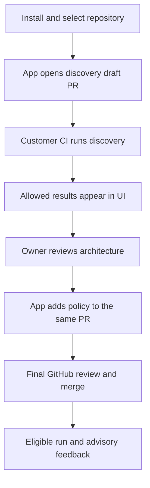

# Archfit App — high-level product and service design

Status: first review draft, based on the owner interview of 17–18 September 2026;
engine/integration status refreshed for v2.3.1 on 20 September 2026. Product scope
is unchanged.

This document describes the intended product, its boundaries, and its main
flows. It is not an implementation plan, a deployment decision, or a claim that
these capabilities already exist.

This is the canonical first-version product scope. Read it alongside
[trust, measurement, and reporting](trust-and-reporting.md) for technical
constraints and the [closed-beta plan](../archive/plans/closed-beta.md) for execution
order. Unresolved choices are explicit; they must not silently become
implementation requirements.

## 1. Product and first customer

Archfit App is a subscription service for preserving architectural boundaries
as a repository changes. It combines the open-source Archfit engine with
GitHub integration, approved policy, baselines, ownership, and useful PR
feedback.

The first customer is a small or medium product team actively using coding
agents. The buyer is its CTO or tech lead. The intended value is less manual
architecture review and less subsequent repair of architectural erosion.
Willingness to pay is a hypothesis to validate with external teams, not a
conclusion from testing our own repositories.

The product promise remains:

> Archfit enforces your approved policy over disclosed evidence.

It does not certify that an architecture is correct. Human approval establishes
the chosen policy; it does not prove every inferred architectural fact.

The service must address all four owner-selected scenarios:

| Scenario                                           | Expected product behavior                                                                   |
| -------------------------------------------------- | ------------------------------------------------------------------------------------------- |
| Code bypasses a module's public API                | Identify the boundary, affected locations, and approved access path                         |
| A change introduces an unwanted domain dependency  | Explain the violated dependency rule and the relevant modules                               |
| Business logic is placed in the wrong module       | Enforce explicit, observable classification rules; present semantic uncertainty as guidance |
| Individually plausible changes accumulate coupling | Compare compatible repository-wide evidence against the approved baseline                   |

Actual engine coverage of these scenarios needs verification. In particular,
an LLM's interpretation of business responsibility is never sufficient to fail
the required gate.

v2.3.1 release acceptance covers five supported language modes and the 11-project
engine corpus. App acceptance still needs the paired scenario/workflow matrix in
T02; those engine results do not establish trusted GitHub execution or customer
fit.

## 2. Scope of the first product version

### Required

- Installation for selected repositories belonging to an organization or a
  personal account, with repository-scoped setup and access.
- Both UI-led and GitHub-first architecture review and editing.
- Independent approved policy for each repository.
- Organization-level access administration, subscription, and repository
  overview, without a repository score.
- Managed discovery and a customer-executed mode in which source code is not
  transmitted to Archfit.
- Onboarding from code and existing documents, including outdated or drifted
  documents. Existing engine configuration generation and optional LLM
  discovery are reused rather than treated as new App inventions.
- YAML editing with highlighting, schema completion, clear validation, and
  AI assistance on explicit request.
- A graph for understanding modules, observed relationships, and policy.
- Advisory PR feedback and an explicitly enabled, fail-closed required gate.
- Architecture-owner approval, including atomic code-and-policy changes.
- Narrow temporary exceptions with reasons, expiry, and approval history.
- Public repositories free; full private-repository trial followed by a paid
  subscription, including advisory-only use.

This is the target product scope. It does not mean every feature must precede
the first internal pilot, and it does not authorize implementation across the
milestone boundaries without an agreed execution plan.

### Deferred or conditional

- An organization-wide mandatory policy floor that repositories cannot weaken.
- General-purpose visual architecture editing. A bounded set of graph edits is
  desirable only if it maps clearly and reliably to YAML changes.
- Automatic LLM review of every PR and continuous AI suggestions while typing.
- GitLab/Bitbucket integrations, an agent MCP channel, and enterprise deployment
  variants such as a customer-operated reporter.
- Independent server-side enforcement: future work,
  with a separate cost assessment and no applicability to a mode that forbids
  sending source to Archfit.

The technical prohibitions remain: no LLM on the gate path, no repository score,
no blanket re-baselining, no origin filtering as the enforcement rule, and no
claim that attested evidence is independently verified.

## 3. Architecture policy and authority

### One canonical policy

Git is the source of truth for approved architecture policy. UI edits produce
proposed changes; publication follows GitHub PR review and merge. A final
transition from the UI to GitHub is acceptable.

The UI must distinguish draft, awaiting review/merge, and published versions.
An unmerged draft never silently replaces the published policy. The graph is
a view of policy and evidence, not a second independently stored policy model.

Observed code structure and documented architectural intent are separate
inputs. Discovery presents disagreements and uncertainty for human resolution;
it does not automatically turn every current dependency into an approved one.

### Actors

| Actor                                 | Responsibility                                                                                      |
| ------------------------------------- | --------------------------------------------------------------------------------------------------- |
| Repository/organization administrator | Connect repositories, establish initial architecture-owner authority, administer integration access |
| Architecture owner                    | Approve architecture changes and temporary exceptions, including renewals                           |
| Contributor or coding agent           | Propose code and policy changes; consume feedback and suggestions                                   |
| Billing administrator                 | Manage subscription; billing authority alone does not confer architecture approval authority        |

Exact role mapping and bootstrap UX still need specification. A protected
policy path and CODEOWNERS provide the starting point.
Authority must be resolved from trusted configuration, never from the PR's own
edited ownership declarations. Administrative GitHub bypass remains a separate,
explicit override, not an architecture approval.

### Code and policy in the same PR

Anyone entitled to propose a PR may propose a policy change. Only a designated
architecture owner can authorize it. Code and policy may land atomically in one
PR; a separate policy PR is not mandatory.

Architecture approval is bound to the exact head SHA and policy snapshot. New
commits invalidate it. The App may evaluate an owner-approved candidate policy
for that exact PR, but must resolve and issue the snapshot itself. It never
accepts arbitrary head-tree policy as a trusted gate input.

Concurrent UI and Git edits require version checks. Stale edits or AI responses
cannot overwrite a newer proposal without review.

### Temporary exceptions

An exception covers a specific violation, carries a reason and expiry, and
requires architecture-owner approval. It is visible in PR feedback and history;
the underlying rule remains active for other violations.

The expiry is strict. Warn before it expires. If the violation remains after
expiry, it is blocking again, including in unrelated PRs. Recovery is a fix or
an explicitly approved renewal. Exceptions must not become permanent accepted
baseline debt by accident.

Design proposal for review: represent exceptions and renewals as versioned,
trusted policy inputs published through the same Git process. This also allows
an exception to accompany the affected code PR with exact-version approval.
The precise exception identity, storage contract, and notification schedule
remain to be specified.

Time-based expiry must invalidate and re-evaluate affected open-PR checks even
without a new commit. Policy changes, approval revocation, and confirmed
subscription transitions also need reliable invalidation. Delivery delays and
merge-time race windows require explicit integration testing; a previously green
check is not an unlimited guarantee of continuing eligibility.

## 4. Onboarding

Both paths are first-version requirements, using the same policy and approval
model. Neither turns on blocking enforcement without an explicit owner action.

### Managed discovery

1. Install the App, select repositories, and choose managed discovery.
2. Explain source processing and obtain separate consent before managed LLM use.
3. Inspect code and documents in an ephemeral isolated environment. Do not
   persist source. Produce a draft using existing engine capabilities, optionally
   assisted by the managed LLM.
4. Review manageable groups of boundaries, evidence, unresolved paths, and
   differences between documented intent and observed code.
5. Produce one onboarding PR containing the agreed policy and customer-side
   analysis workflow. A GitHub-first user reviews the proposed policy in the PR
   instead of relying on the UI.
6. After merge and a successful eligible run, complete connection automatically
   and present advisory results.
7. Rehearse representative forbidden and legitimate changes before the owner
   enables the required gate. Establish the baseline through an eligible run.

Discovery drafts do not establish measurement trust. A managed discovery scan
is not the same feature as the future independent-measurement gate.

### Customer-executed discovery

Source analysis and calls to the customer's model run in the customer's chosen
environment. Customer LLM credentials remain there. GitHub/CI is the default
onboarding experience; running a CLI manually is an alternative.

The intended convenient flow is:

This one-draft-PR flow is a target, not a verified universal guarantee. GitHub
documents PR workflow execution and App-triggered runs, but organization
restrictions, permissions, and execution policies vary. Validate it in fresh
repositories before promising it. Pre-merge discovery remains onboarding
evidence; it cannot satisfy the required architecture gate merely because the
App created the PR.

Supported alternatives:

- Merge a bootstrap-workflow PR, run discovery, then review and merge a policy
  PR. The owner explicitly accepted this additional step when needed.
- Use an existing approved CI job or a one-time CLI invocation, upload allowed
  results, then complete one policy PR.

Do not assume `workflow_dispatch` can start an entirely new PR-only workflow.
Do not use privileged execution of untrusted PR code to remove setup steps.
Show connection, workflow readiness, received report, policy approval, and
enforcement activation as distinct states with actionable diagnostics.

## 5. Editing and AI assistance

YAML is a first-class editor, not an expert-only fallback. Required capabilities:

1. Syntax highlighting and immediate schema-based completion.
2. Syntax and schema errors at the affected location, with clear explanations.
3. Engine validation of domain rules and their application to an identified
   repository snapshot. Schema validity alone cannot establish this.
4. Explicit AI requests to propose a rule or complete a YAML fragment.
5. A reviewable proposal/diff, validation, and deliberate user acceptance.

In customer-executed mode, waiting for AI work in the customer's environment is
acceptable. The UI must show pending, completed, failed, and stale requests;
fast schema completion stays available independently. A new always-on customer
agent is not an agreed first-version requirement.

The graph distinguishes observed dependencies by the engine's per-seam policy
status (`seams[].policy`, engine v2.5.0 and later): a violation, accepted debt,
an advisory, a dependency a blocking rule allows, or one no rule decides. For a
report from an older engine, the status comes from the report's findings, and no
link is ever labelled allowed. The App never computes an allowed status itself.
Selecting a module can navigate to its YAML definition. Any supported visual
edit proposes a YAML change rather than regenerating the whole document from
graph state. Preserve unrelated content and comments. If YAML is invalid, a
previous valid graph must be visibly marked as stale.

Technical candidates, not final stack decisions:

- A plain text area with server-side syntax and schema diagnostics by line, and no editor library (the current
  choice; highlighting and completion are open, see the later option in [decisions](decisions.md#6-ui-and-editing)).
- React Flow for graph interactions, with a separate layout solution if needed.

Before adoption, check engine-schema compatibility, round-trip behavior, and
graph usability on realistic module counts. An existing graph library does not
solve policy semantics or the UX of a large architecture.

## 6. PR feedback and enforcement

Use separate advisory state and required gate checks, plus one updated PR
comment. Feedback must be useful to both a developer and a coding agent:

- Verdict, reason, and next action first.
- The rule, modules, and relevant file locations.
- Introduced changes distinguished from previously accepted debt for display.
- Meaningful coupling changes and evidence gaps.
- A concrete validation command and structured remediation tasks where available.
- Applied policy/baseline identities and disclosed measurement provenance.

Ordinary PR feedback comes from the engine. LLM explanations and suggested
solutions are explicitly requested extras and do not determine the verdict.

Enforcement retains these technical invariants:

- One repository-wide assessment and authoritative gate; narrowing a view or
  assigning owners does not narrow the evidence boundary.
- Gate inputs are trusted policy, labels, baseline, and measurement identity.
- OIDC authenticates a producer but does not prove a report is true. The initial
  required gate may enforce customer-attested evidence, with that limitation
  named. The fabricated-report gap is not claimed closed.
- Measurement trust and evidence completeness are independent and disclosed
  per fact/rule, not collapsed into one badge.
- Missing, ineligible, or incompatible evidence is not a successful or neutral
  required check. Always post a conclusion, using failure or `action_required`
  as appropriate.
- Accepted debt is handled by the baseline, never by filtering findings to
  `origin == introduced`.
- Measurement/profile and architecture-model changes require explicit
  comparability handling and baseline migration, not a blanket refresh.
- Fork reports are not automatically eligible. A supported acquisition path
  needs trusted execution and isolated credentials; unavailable eligible
  evidence must not silently pass.

The product must distinguish architecture violations, evidence/infrastructure
problems, and subscription suspension. None should masquerade as another.

## 7. Privacy and data handling

There are two execution modes, with explicit consent and different claims.

| Mode              | Source processing                                        | LLM calls                                                               | Source storage in Archfit         |
| ----------------- | -------------------------------------------------------- | ----------------------------------------------------------------------- | --------------------------------- |
| Managed discovery | Temporary processing by Archfit in isolated environments | Our managed integration, explicitly enabled by an administrator         | No persistent source storage      |
| Customer-executed | Customer environment; Archfit receives allowed results   | Customer runner calls its chosen local or approved cloud model directly | No source transmission to Archfit |

The customer-executed promise does not automatically mean source never reaches
any third party: the customer may authorize a cloud LLM provider. Keys remain
with the customer. Connecting a customer's model account to our hosted service
is not required for the first version. OpenAI and Anthropic are provider
candidates; supported endpoints and provider-specific data handling need
separate research.

Results can themselves expose code. The customer-executed mode requires an
explicit transport contract for allowed configuration, module identities,
relationships, locations, measurements, and approval metadata. This information
can still be sensitive and must be disclosed to the customer.

Do not upload source snippets, arbitrary logs, raw LLM answers, or source-bearing
attachments under the label of a report. Request routing, error reporting,
telemetry, and support tooling must respect the same boundary. The exact
allowed-result schema and leakage validation remain a release prerequisite,
not a property already established by the current engine report schema.

Discovery implementations must not execute arbitrary repository scripts with
reporting or model credentials. Filtering the final upload alone does not
prevent code from making its own network requests.

## 8. Service boundaries and tenancy

The three-repository boundary remains:

| Repository       | Owns                                                              |
| ---------------- | ----------------------------------------------------------------- |
| `archfit`        | Engine, CLI, images, versioned wire contracts                     |
| `archfit-action` | Customer-side execution and upload adapter                        |
| `archfit-app`    | Tenancy, policy approval, baselines, reporting, UI, subscriptions |

The reporter is an independently deployable, small Go component. Its hot path
does not synchronously depend on billing providers, the UI, or LLM services.
Control-plane functions resolve approved inputs, manage onboarding and
approval state, and coordinate background work. Managed discovery runs in
isolated ephemeral workers. Customer discovery runs outside our infrastructure.

Tenant isolation starts at the GitHub installation and repository identities,
derived from authenticated context. Access checks cover jobs, database records,
object keys, cached results, model requests, and UI queries. A client-supplied
installation ID is not sufficient authorization.

A billing account and a GitHub installation are related but distinct concepts.
Organization overviews aggregate authorized repositories; they do not introduce
an organization-wide policy floor. Personal-account installations must have a
corresponding subscription/access model. Reinstallation, uninstall cleanup,
permission revocation, and account migration need explicit lifecycle design.

The owner selected Cloud Run with PostgreSQL and managed GCP services as the
primary technical-validation target. Cloud SQL is the proposed database service.
A dedicated beta project is planned but does not exist yet; its ID, region,
database tier, exact resource configuration and deployment acceptance remain
open. The frontend framework is not selected. Evaluate isolation and
consistency requirements before substituting storage technologies to meet the
budget.

## 9. Subscription and cost model

### Confirmed commercial decisions

- The open-source engine stays free.
- Public repositories use the App free.
- Private repositories receive a full-function trial, then require a paid
  subscription; advisory-only use is not permanently free.
- Hosted LLM use is limited during the pilot and has a hard budget.
- Customer-paid model calls happen directly from the customer's environment.

### Working pricing hypothesis

An account subscription with bands of connected private repositories is the
leading hypothesis, not a confirmed profitable tariff. Avoid per-PR, per-run,
or per-module charges for ordinary engine-driven checks. A monorepo may count
as one repository if measured service cost and explicit workload limits support
that offer. Do not promise unbounded vendor-funded work for a fixed repo price.

Normal engine compute is customer-funded, but our expenses still include:

| Expense                     | Main cost driver                                                 |
| --------------------------- | ---------------------------------------------------------------- |
| Reporter/control plane      | Run/event volume, report processing, concurrency                 |
| Reports, baselines, history | Bytes, retention, storage operations and transfer                |
| Managed discovery           | Source size, scan frequency, resource and isolation requirements |
| Managed LLM                 | Input/output volume and number of explicit requests              |
| Operations and support      | Tenant count, reliability and support commitments                |

Use an included, bounded allowance for managed discovery and LLM as a proposal
to validate. Any additional paid allowance must be explicit, without surprise
charges. Free public repositories also need resource budgets and abuse controls;
the exact free allowances have not been chosen.

Pilot infrastructure budget: **at most USD 100/month before paying customers**.
This covers our hosting, database, storage, and monitoring. Managed LLM has a
separate small hard-capped budget, with its amount determined through
measurement. Existing coding-agent subscriptions are development tools, not
an assumed runtime API allowance.

Measure cost distributions on normal and large workloads before selecting repo
bands, included resources, retention, or prices. Cloud Run/PostgreSQL is the
owner-selected validation target; Cloudflare remains a researched alternative.
Compatibility with the Go reporter, background work, and sandbox isolation must
be established rather than assumed. The budget is not proof of a particular
availability level.

### Trial expiry and billing failures

Warn before trial expiry and provide a grace period. After confirmed expiry
and grace without a subscription, suspend paid service and post an explicit
blocking subscription status, such as `action_required`. Do not fabricate an
architecture failure or a successful check. The reporter must remain able to
communicate this state.

The administrator pays or deliberately removes the Archfit requirement in
GitHub. The App does not automatically remove that protection. Trial duration,
start event, warning schedule, and grace duration are still open.

A billing-provider outage does not establish non-payment. Use cached
entitlements and the documented grace behavior; a billing outage must not turn
into an architecture failure. Budget exhaustion for optional managed LLM work
must not take down deterministic checks.

## 10. Reliability and operational limits

A required check makes the reporting service part of the merge path. There is
no claim that customer-side compute removes this availability dependency.

Keep the reporter independent of optional services; support idempotent event
handling, bounded retries, duplicate uploads, reconciliation, and stale-result
rejection. Checks must be bound to the relevant revision and trusted inputs.

Emergency recovery remains an explicitly authorized GitHub ruleset bypass.
The Archfit requirement belongs in a separate ruleset so an override need not
disable unrelated protections. An override is recorded as such and is never
reported as a successful architecture assessment.

Multi-region deployment is not an agreed pilot requirement or SLA.
Hosting research must establish what reliability, recovery, latency, and
operational burden fit the budget. Availability and PR-feedback latency targets
remain to be selected. Limits on reports or resources must produce explicit
diagnostics; incomplete evidence never becomes a passing required gate.

## 11. Pilots and validation

The confirmed release path is a **closed beta first**: internal use on Pumba and
Archfit, followed by a few invited teams. Validate onboarding, feedback,
enforcement, and operating cost before a public paid self-service launch. This
sequencing does not remove features from the agreed product scope.

| Repository             | Role                                                                                                                 |
| ---------------------- | -------------------------------------------------------------------------------------------------------------------- |
| `alexei-led/pumba`     | First realistic end-to-end GitHub App pilot: existing policy, clear Go module boundaries, PR feedback and governance |
| `alexei-led/archfit`   | Internal daily use, contract and baseline regressions; not independent evidence of customer fit                      |
| Local `omni` checkout  | Large, mixed-language architecture and load benchmark; no GitHub mirror or source upload is assumed                  |
| External OSS candidate | Independent structure and PR history; `go-task/task` is proposed, with FastAPI as a possible Python follow-up        |

External OSS work initially means a fork or replay of historical changes, not
installation into a third party's repository or an endorsement of our inferred
policy by its maintainers. A scoped Omni test makes only a scoped claim; it
cannot stand in for the repository-wide gate.

Pilot acceptance must cover:

- Legitimate changes pass and representative forbidden changes fail.
- Policy tampering, stale approval, missing evidence, incompatible profiles, and
  unsupported producer identities cannot create a successful required gate.
- Both onboarding modes complete, including the bootstrap fallback.
- Source-free mode does not transmit code through reports, logs, AI output, or
  alternate delivery paths.
- AI is optional, proposals are reviewable, and unavailable models do not stop
  deterministic workflows.
- Expired exceptions and confirmed subscription transitions are reflected in
  affected checks, with visible reasons and recovery instructions.
- Tenant and repository boundaries hold throughout ingestion, background jobs,
  stored data, and UI access.
- Resource cost and latency are measured, including large reports and bursts.

Technical pilots do not establish willingness to pay, the acceptable support
burden, or a public SLA. Recruit external product teams for those questions.

## 12. Open decisions

Resolve these through focused owner review, experiments, or research:

1. Trial length/start event, grace period, repo-band definition, included
   resources, and prices; validate cost and willingness to pay separately.
2. Detailed closed-beta and commercial-launch exit criteria, supported
   language/toolchain matrix, and measurable usability, latency, and reliability
   targets.
3. Architecture-owner bootstrap, role mapping, GitHub review enforcement,
   exception publication, and authority changes.
4. Same-draft-PR discovery feasibility across representative Actions policies,
   safe execution identity, and the exact fallback decision.
5. Allowed-result contracts, leakage checks, telemetry boundaries, retention,
   deletion, and the permitted context for customer-side AI requests.
6. State machines for async AI work, policy/waiver/entitlement invalidation,
   retries, races with merge, uninstall, and reinstallation.
7. Validate the selected Cloud Run/PostgreSQL candidate: project/region/tier,
   costs, storage isolation, queues, ephemeral workers, provider data handling,
   and minimum operational controls.
8. Current engine/Action contract coverage and required cross-repository work.
   Released v2.3.1 supplies measurement-profile comparison and persistence,
   explicit required-rule evidence states, waiver lifecycle safeguards and typed
   agent repair tasks. The open work is adopting pinned artifacts and validating
   App/Action conformance, producer eligibility, privacy-safe transport and
   approved baseline migration. The plan records inspected revisions and the
   advisory-first pilot; these capabilities are not yet implemented in the App.

The [closed-beta implementation plan](../archive/plans/closed-beta.md) defines milestone
boundaries, dependencies, and acceptance checks. The dated
[hosting research](../archive/research/20260918-hosting.md) supplies options and cost
assumptions, with Cloud Run selected for validation and deployment details still
open. Resolve the stated research and owner-decision gates before dependent
implementation. These documents do not grant authorization to deploy, publish,
or install an App into any pilot repo.

## 13. Research anchors

These sources informed the interview. They are reference points, not promises
that another vendor's guarantees or prices apply to Archfit.

- [GitHub auto-merge](https://docs.github.com/en/pull-requests/how-tos/merge-and-close-pull-requests/automatically-merging-a-pull-request): required checks and reviews still apply.
- [GitHub workflow triggers](https://docs.github.com/en/actions/how-tos/write-workflows/choose-when-workflows-run/trigger-a-workflow) and [event behavior](https://docs.github.com/en/actions/reference/workflows-and-actions/events-that-trigger-workflows): onboarding execution feasibility and restrictions.
- [GitHub secure PR execution](https://docs.github.com/en/actions/reference/security/securely-using-pull_request_target): workflow source and privileged execution risks.
- [Semgrep CI onboarding](https://docs.semgrep.dev/deployment/add-semgrep-to-ci): customer-executed scanning and documented data boundaries.
- [Aikido local onboarding](https://help.aikido.dev/code-scanning/local-code-scanning/github-action-setup-for-local-code-scanning) and [scanner controls](https://help.aikido.dev/code-scanning/local-code-scanning/cli-options-for-local-scanner): local execution and explicit upload controls.
- [Codecov setup](https://docs.codecov.com/docs/quick-start) and [security](https://about.codecov.io/security/): first-report activation; source access and retention are different claims.
- [React Flow](https://reactflow.dev/learn/customization/handles): a graph candidate; application semantics remain our responsibility.
- [Codecov pricing](https://about.codecov.io/pricing/), [Greptile pricing](https://www.greptile.com/pricing), [Sonar pricing](https://www.sonarsource.com/plans-and-pricing/), and [DeepSource pricing](https://deepsource.com/pricing): examples researched on 17 September 2026; no market-average per-repo price was established.
