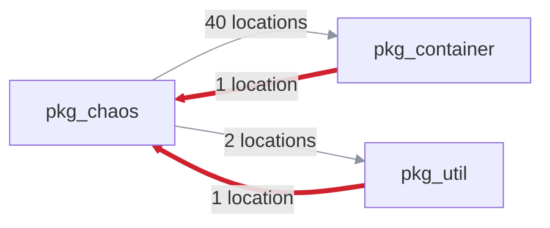

# Archfit App UI and PR feedback redesign

Status: in progress, 19 October 2026. Follows [`ui-review.md`](ui-review.md) (the rules decided there still hold:
status first, one primary action, details fold away, never "blocking" in advisory mode).

Input: the pilot pull request `coupling-dev/pumba-pilot#11`, which adds a dependency cycle among `pkg_chaos`,
`pkg_container` and `pkg_util` (two module pairs that import each other), its `archfit/state` check run 117740459237
and the report artifact of run 39149541868. The live comment was 14 KB, with the 6 accepted findings open and the
same 230-character explanation repeated 8 times.

Vocabulary follows Vlad Khononov's _Balancing Coupling in Software Design_: integration strength (intrusive,
functional, model, contract coupling), distance, volatility, balance. Engine tokens (`functional`, `cross_module`,
`high`) are shown as the engine writes them; the App adds no synonyms.

## Phases

One pull request each, in this order.

| Phase | Changes                                                                       | Behaviour change |
| ----- | ----------------------------------------------------------------------------- | ---------------- |
| a     | PR comment and check summaries (`internal/gate/feedback`)                     | display only     |
| b     | Shared visual system and the top bar                                          | display only     |
| c     | Findings on the repository and pull request pages                             | display only     |
| d     | Repository and pull request graphs, closer to `prototypes/graph-proto.js`     | display only     |
| e     | Consent                                                                       | owner decision   |
| f     | Policy editor: YAML highlighting, structure, AI instruction and mode controls | display only     |

## PR comment and check summary (phase a)

### What is most important

The reader of a pull request comment asks three things, in this order: does it block my merge, what did my change
break, and what do I change. The comment answers them in the first screen and folds everything else.

1. **Effect on merge**: the headline (unchanged matrix) and, in advisory mode, a GitHub `[!NOTE]` alert "This check
   does not block merging". The alert gives the line a colour without the word "blocking".
2. **What the pull request did, then the next step**: one sentence from origins and locations only, for example
   "This pull request closes a dependency cycle among `pkg_chaos`, `pkg_container`, `pkg_util`: it adds
   `pkg_container` → `pkg_chaos` (`pkg/container/appfilter.go:4`) and `pkg_util` → `pkg_chaos`
   (`pkg/util/flagports.go:4`); `pkg_chaos` → `pkg_container` (40 locations) and `pkg_chaos` → `pkg_util` (2
   locations) existed before." Then **Next**. Reason codes, categories and details move to a "Decision" section in the
   evidence fold (phase a2): "1 blocking finding" counts gate findings and read as a contradiction of "4 rule
   violations".
3. **One tally line** counts every group: "**4 rule violations** · 1 dependency cycle · 2 advisories · 6 accepted ·
   6 introduced by this pull request". The last part appears only when the engine compared against the PR base
   (`comparison.origin_status: comparable`), so "introduced" is never claimed without that comparison.
4. **The violation, drawn**: a dependency cycle is one item, not one item per pair. The App finds the strongly
   connected component from the findings themselves (same rule, kind, status and severity; target reaches source),
   so a three-module cycle with no reverse pair is caught too. The item has a Mermaid flowchart (one edge per
   direction, labelled with its location count), then a table of directions. A direction the pull request added is
   red and wide, one that existed before grey and thin, and the table says so in a "This PR" column (`added`,
   `existing`). The cycle's own findings are introduced in every direction when the cycle is new, so they cannot tell;
   the App reads the other findings on the same module pair: a `pre_existing` one proves the base had the dependency,
   otherwise an `introduced` one marks it added. Without either, the direction stays unmarked.

5. **Balanced Coupling in the table**: rows show integration strength, distance and volatility from the report's
   seam for that module pair, in the book's words: distance "same module", "across modules", "across services",
   "external"; the engine's own rules by name ("Imbalanced coupling"), and severity as one word, without the
   status and origin tokens that repeated the group. These are kept report fields (`seams[]`); the finding's `matched_by` stays dropped at
   decode, as the no-source rule requires.
6. **Each explanation once**: the engine repeats one `why` for every finding of a rule. Under a table each distinct
   `why`, `constraint` and set of alternatives is written once. A cycle shows its first `why` only, because the
   per-direction ones differ only in module names.
7. **Everything that never blocks folds**: advisories, accepted findings (baseline or waiver) and fixed findings are
   each one `
` with the count and the effect in the summary, then a table. Before, accepted debt was open.
8. Evidence, inputs, validation commands and agent tasks stay folded as before; dimensions are a table there, with
   `fail` and `warn` in bold, a Change column only when a dimension has metric changes, and the customer-attested
   trust stated once, under the inputs.

Result on PR #11: the visible part fits one screen (headline, note, next step, tally, cycle diagram and table, four
folds). The body is 13 KB, of which the agent task JSON is 4 KB and folded.

### Safety of the new syntax

- Mermaid: node IDs are generated (`m0`, `m1`); a label keeps `[A-Za-z0-9_./:@+-]` and writes every other rune as a
  Mermaid entity (`#<code>;`). A module name can neither end a label nor close the code fence (unit test with a
  hostile name).
- Tables: a `|` in a cell is escaped; rows keep their column count (same test).
- Cuts: `cutLines` closes an open code fence as well as an open fold before "Output truncated.".

### Check summaries

`archfit/state` uses the same blocks without the heading, the diagram and the alert. GitHub prints the check title,
which is the headline, right above the summary, so a heading repeated it. The check summaries keep the reason code,
category and detail in their head and have no lead sentence: they are the record that tools and support read.

The diagram and the alert are left out because Mermaid and GitHub alerts are documented for comments, issues and
Markdown files; their rendering in a check run summary is not verified. If a later check on a scratch repository shows
they render, the summary can take them too.

`archfit/gate` keeps block G (one line per blocking finding with its agent task goal); only the reason lines changed.

### Verified

- Golden files for all wire fixtures plus the real PR #11 report (`testdata/report/pilot-pr-cycle.json`, advisory mode).
- Rendered through GitHub's Markdown API (`gh api markdown`, mode `gfm`) and viewed in Chrome with
  `github-markdown-css` and Mermaid 10: the alert, the diagram, the tables and the folds render. Not yet seen on a
  live pull request: posting to the pilot needs the owner's approval.

### Not done, and why

- The comment does not say which direction to remove. The engine's constraint is "remove one direction"; picking one
  would be a repair of the App's own, which the feedback contract forbids. The location counts (40 against 1) make
  the cheap direction visible.
- Strength, distance and volatility come from seams, not from the finding. A finding without a matching seam shows
  empty cells. Promoting `matched_by` to a kept field is a wire contract change with a privacy review; not needed.

## Frontend stack for phases b to f (PLAN-2, for the owner)

Status: approved, 19 October 2026: stack A, without the no-JavaScript fallback. Built in phase b, with three changes
to the proposal below: the ported `archfit.css` instead of Tailwind, Svelte Flow and ELK for the graph instead of our
own SVG component (see Graphs), and the CSP nonce left to phase f, the first page that needs it. Phase a (the PR
comment) is not affected. The owner lifted the old limits (no frontend dependency, no build step, server-rendered pages only); the
contracts in `internal/control/ui/module.md` that state them change with this section as the rationale.

Today: `html/template` pages, `go:embed` of `templates` and `static`, 9 KB of CSS, a 31 KB hand-written `graph.js`
and a 2 KB `editor.js`. CSP `default-src 'self'; script-src 'self'; style-src 'self'; frame-ancestors 'none'`.

### Recommended: A. Svelte 5 + Vite single-page app, embedded in the Go binary

- **Svelte 5** (runes, TypeScript), built by **Vite**. Plain Vite, not SvelteKit: SvelteKit's static adapter needs an
  inline bootstrap script, so a strict CSP would need hashes for every build.
- **Styles**: `web/src/app.css`, the tokens and components of `prototypes/archfit.css` ported as one external
  stylesheet. Proposed was Tailwind CSS v4 with those tokens as its theme; the port is the same visual system with
  no build plugin and no class vocabulary to learn, and it is 4 KB gzip.
- **bits-ui** (headless, accessible) for dialog, popover, tabs, tooltip and menu; it styles nothing itself.
- **Graph**: proposed was our own SVG component, a port of today's layout in `graph.js`. The owner chose by visual
  quality after a prototype of both: Svelte Flow and ELK, as a lazy chunk on the graph pages (see Graphs).
- **Policy editor**: CodeMirror 6 (the owner's decision), a separate chunk loaded only on the policy page, with
  `EditorView.cspNonce` so its style elements pass the CSP. It comes from npm through the lockfile instead of the
  vendored bundle planned before.
- Why A: the smallest JavaScript for the result (about 60 to 100 KB gzip on first load, the editor apart), compiled
  components with no runtime style injection, and no extra server runtime.

Alternatives:

- **B. React 19 + Vite + shadcn/ui (Radix) + xyflow.** The largest ecosystem and the most hiring familiarity. About
  twice the JavaScript of A; Radix and xyflow inject `<style>` elements, so every one needs the nonce plumbing. Choose
  it if a React team will own the App.
- **C. Go templates plus Svelte islands.** Pages stay server-rendered; only the graph, the editor and the menus mount
  as components. The least change to routes and tests, but two ways to render every screen, and the shared visual
  system (phase b) has to be written twice: once as Go templates, once as components.

### Go integration (A)

- `web/` holds the app; `vite build` writes `internal/control/ui/spa`, embedded with `//go:embed all:spa`. The
  folder holds only a committed `.gitignore`; without a build the shell answers a page that says to run `make web`, so
  `go build` and `go test` work without Node.
- Routes: `/assets/*` immutable (hashed file names, `Cache-Control: public, max-age=31536000, immutable`); every
  other non-API `GET` returns `index.html` with `no-cache`; `/api/*` returns JSON with `no-store`.
- The handlers keep their authorization and change only their output: each page handler becomes a JSON endpoint
  behind the same chain (session, repository authorization, CSRF on writes).
- `GET /api/session` returns the signed-in login and the CSRF token. The session cookie stays as it is.
- Phase f: `index.html` is served through a small Go template that writes the per-response CSP nonce into a `<meta>`
  element; the policy page passes it to CodeMirror. Nothing else in the page is generated. Until then `index.html` is
  served as built, and `style-src` is `'self'` alone.
- Forms that work without JavaScript (policy Check and Save) are dropped: the App needs a browser with JavaScript.
  Say so if that is not acceptable; then C is the choice.

### Build, CI and Docker

- Node only at build time: a `node:24.15-alpine` Docker stage runs `npm ci && npm run build`, and the Go stage copies
  `spa` before `go build`. The runtime image stays distroless with the one binary.
- CI job `web`: `npm ci`, `svelte-check` (types), Vitest unit tests, `vite build`, a bundle-size check, then a
  headless browser (Playwright) smoke test of the built app under the production CSP. The smoke test fails on any
  `securitypolicyviolation` event and on any axe accessibility violation.
- `make all` runs the web checks when `node` is installed, and says it skipped them otherwise.
- Dependencies pinned by the lockfile; Dependabot for npm next to Go.

### Bundle budget

- First load of any page: at most 120 KB gzip of JavaScript and 20 KB of CSS. The editor chunk: at most 200 KB gzip,
  loaded on the policy page only. CI fails above either. The graph chunk (about 504 KB gzip, 467 KB of it ELK) loads
  on the graph pages only; it gets its own limit in phase d.
- Phase b ships 19 KB of JavaScript and 4 KB of CSS, gzip.

### Dark mode and accessibility

- Light and dark token sets from `prototypes/archfit.css`, following `prefers-color-scheme`, with a toggle stored in
  `localStorage`. Every status colour at least 4.5:1 on both canvases (today three are about 3.3:1 on dark).
- WCAG 2.2 AA: keyboard reach and a visible `:focus-visible` everywhere, status as a dot plus a word, never colour
  alone, `aria-current` in the nav, headless components for focus traps. The graph has a keyboard path through its
  nodes and a table view for screen readers. Checked by axe in the CI smoke test.

### Invariants, and how A keeps each

| Invariant | How it holds |
| --- | --- |
| No runtime CDN | Every script, style and font is built into `internal/control/ui/spa` and served by the App. CSP `script-src 'self'` and `font-src 'self'` would block anything else; the smoke test fails on a violation. |
| CSP without `unsafe-inline` or `unsafe-eval` | Svelte compiles to plain JavaScript (no `eval`); styles are one external file and no Svelte transition is used (they insert style elements); Vite's modulepreload polyfill is off (`build.modulePreload.polyfill: false`), so `index.html` holds no inline script. Styles set from script go through CSSOM (`element.style`), which CSP allows. CodeMirror's style elements carry a per-response nonce through `EditorView.cspNonce`, with `style-src 'self' 'nonce-…'`. Target: `default-src 'none'; script-src 'self'; style-src 'self' 'nonce-…'; connect-src 'self'; img-src 'self' data:; font-src 'self'; base-uri 'none'; form-action 'self'; frame-ancestors 'none'; object-src 'none'`. |
| CSRF and the session model | The session stays an HttpOnly, Secure, SameSite=Lax cookie that script cannot read. The stateless per-session HMAC token (`csrf.go`) is fetched from `/api/session` and sent as an `X-CSRF-Token` header on every write; the server checks it as today and also requires `Content-Type: application/json`. |
| Tenant identity only from the authorized session | Endpoints take the installation and repository from the session and the authorized route, never from the request body or a client-held value. The client sends only the `org/repo` path that it shows, and the server authorizes it again. |
| No secrets in the client | The OAuth token stays in the server-side session. API responses are built from explicit response types, never by serializing a stored record, and a test (`TestNoAPIResponseHoldsASecret`) checks that no API answer holds the token or the session cookie. |
| Every repository endpoint authorizes per request | `/api/repos/{org}/{repo}/…` goes through the same repository-authorization step as the pages today, on every request, with no client-side cache of permissions. A route test fails if a repository endpoint is registered outside that step. |

### Migration order

1. **b**: the `web/` app, the build, CI and Docker changes, the CSP change, the shell (header, nav, tokens, dark
   mode), `/api/session`, and the overview page. The other pages stay on templates, linked from the new shell.
2. **c**: the pull request page and the findings components, with the cycle drawn as on the comment.
3. **d**: both graphs on Svelte Flow and ELK, with the inspector and the seam fields.
4. **e**: Data sharing (decision A). The editor says why managed mode is off; its inline Allow comes with phase f.
5. **f**: the policy editor with CodeMirror 6. Then the templates, `graph.js`, `editor.js` and `app.css` are deleted.

Each phase is one pull request. A page moves only when its new version covers everything the old one shows.

## Screens of the App (phases b to f)

Seen in Chrome on app.coupling.dev on 19 October 2026 (pumba-pilot, PR #11), and read in code. Today the App looks
like unstyled HTML. `app.css` has 5 colour variables, no button, table or banner component, and no dark mode. The
prototype's `archfit.css` has all of these.

### Shared visual system and top bar (phase b)

Today:

- The top bar is a row of underlined links: brand, the repository name, Policy, Graph, Consent. Next to them is a
  grey browser-default "Sign out @login" button (`layout.html:10-26`). No item marks the current page.
- Consent is in the nav for every user, but the route is admin only (`ui.go:141`), so everyone else gets "Not
  found".
- The PR page has two "Graph" links: the top one opens the repository graph, the tab opens the PR graph.
- Buttons are browser defaults everywhere. Folds are browser `
` with an `<h2>` forced inline. Muted text uses
  opacity, so muted links fade too. Four chip classes come in four sizes.
- Dark mode: `--bad`, `--warn` and `--accent` are about 3.3:1 on a dark canvas, below AA (estimate). There is no
  global `:focus-visible`.

Target:

- Port the tokens of `prototypes/archfit.css`: light and dark sets, 14 px base, a heading scale, `:focus-visible`.
  Port its components: `.btn` and `.btn.primary`, `.label`, `.state`, `.box`, `.flash`, `table.data`, `details.fold`,
  `.seg`, `.blankslate`.
- One chip component. Status is always a dot plus a word, never colour alone.
- Header: logo mark, "Archfit", breadcrumb `org / repo` (plus `#n` on a pull request), spacer, user chip with a small
  Sign out. Under it, tabs Overview · Architecture · Policy with `aria-current`. Consent leaves the nav (phase e).
- The App says "violations found" where it says "blocked" today (`wording.go:102`). The earlier review already ruled
  out "blocked" in advisory mode.

### Repository overview and findings (phases b, c)

Today: seven flat sections in a narrow column. Setup and Onboarding show the same stage twice. The setup steps run
together as green text ("1. Installed2. Workflow merged3. …"), and done steps differ by colour only. The next step is
one 50-word paragraph. The state is a bold word ("attention"). The page lists no findings for the default branch.

Target (`prototypes/index.html` Overview):

- A hero row: state pill, `master`, a "gate: advisory" label.
- Three counters: rule violations, advisories (never block), open pull requests with a violation. Counts, no score.
- A "Needs you" card with one primary button, holding the next step and the onboarding or discovery action.
- A progress track that replaces both Setup and Onboarding.
- Open pull requests as rows with a state pill.
- "Findings on `master`", with the same cards as the pull request page.

### Pull request page (phase c)

Today: the cycle is two text blocks ("cycle `pkg_chaos` ⇄ `pkg_container`" and "… ⇄ `pkg_util`"). Each starts with the
rule ID and the engine tokens "gate, new, high", then runs into comma-joined locations. "and 37 more" is a `
`
nested in a `
` (invalid markup: the parser closes the paragraph early). Advisories, accepted debt, agent tasks and
evidence are four bold browser folds. The result chip shows the raw `archfit/state: neutral`. Agent tasks are raw JSON
with no copy button.

Target:

- One header partial shared with the PR graph: title and `#n`, state pill, "gate: advisory · does not block merging",
  a "compared with base" or "no baseline" chip, the short SHA.
- A cycle card: the drawn cycle, the same picture as the comment, as inline SVG, with counts per direction. Under it
  a table of directions with integration strength, distance and volatility, then Why and **Fix**.
- Other violations as cards: label, `from → to` as code chips, Why, Fix, 3 locations and a fold "All N locations".
- Advisories and accepted findings as `table.data` in one styled fold each, with the same words as the comment
  ("accepted · baseline or waiver").
- "Copy N tasks for agents" as a button in the box head, with the JSON folded below.
- Evidence: the nine dimensions as a strip, coverage in a table, readable names with the engine key as a tooltip.

### Graphs (phase d)

Today: the repository graph is a small drawing in a wide frame, with a "Problems" list on the left and the detail
panel under it, often off-screen. On the PR graph, the edge badges "new · 2" and "new · 40" overlap. Up to three
left-bordered banners push the graph down. There is no legend for line weight, dashes or halo. Colours differ from the
prototype: allowed is green here, grey there. The intro "Policy status of module relationships…" is jargon.

Decision (owner, 19 October 2026, after a prototype of both): Svelte Flow (`@xyflow/svelte`) with the ELK layered
layout (`elkjs`), a lazy chunk of about 504 KB gzip on the graph pages only. ELK gives each direction of a dependency
its own track, nearly no crossings, and room reserved for labels; the port of `graph.js` drew edges into one point
and crowded the badges at 7 modules, and dagre loops back edges. It runs under `style-src 'self'`: the xyflow
stylesheet is an external file and ELK runs on the main thread, with no worker and no `blob:`. ELK edge priority is
the dependency count, so the heavy direction stays downward.

Notes for phase d (owner, through the manager):

1. Edge novelty follows the comment (phase a2): a dependency is new only when it is added, not when another finding
   on the same module pair existed before. Only added dependencies get the "new in this PR" halo; an existing cycle
   edge keeps the violation colour without it. The chip counts added dependencies, so the comment, the PR page and
   the graph tell the same story.
2. Fit the view with padding, a minimum zoom and larger node text; module facts on the node (a volatility or
   subdomain chip).
3. Count is the line width; integration strength (contract, model, functional, intrusive) is its own visual channel
   (line style or colour family), with the legend in the book's terms. The inspector shows strength · distance ·
   volatility · balance; `graph.Build` projects the seam fields.
4. The legend is compact, collapsible, in the book's wording.
5. No debug toolbar in production. Svelte Flow is MIT; check the licence text before hiding its attribution.

Target (`prototypes/atlas.html` map, `graph-proto.js`):

- Canvas on the left, a 300–340 px inspector on the right. The problem list sits in a box above the canvas.
- A segmented Graph / Matrix control. A legend row: colour = status, weight = dependency count, dashed = accepted,
  dashed node = not in the policy.
- The inspector for a dependency: status, then "integration strength · distance · volatility" from the seam, then
  the findings behind it, then "Open in the policy". `graph.Build` has to project the three seam fields.
- On the PR graph, "N new in this PR" is the first chip. The edge badge shows the count only; "new" goes into the
  legend and the inspector. Banners become one-line `.flash.warn` items with the reason in a fold.
- One word per thing: "dependency" for an arrow, "coupling" for strength × distance × volatility, "accepted" for
  baseline or waiver (today the UI also says "link", "pair", "relationship" and "accepted exception").

### Consent (phase e, owner decision)

What it is: one record per GitHub App installation, not per repository, for each of two managed features.

- Managed discovery: Archfit clones the repository into a sandbox to propose a first policy.
- Managed AI: the policy text and the instruction go to the AI provider.

Each feature also needs `data_mode: managed` in the repository settings. Managed onboarding redirects here when consent
is missing. The editor hides the managed AI option without it.

Why it confuses: it is a top-level page that names neither the feature nor the moment it matters. It uses
installation and settings jargon, and does not show who allowed what and when, although the record holds both. The
UI never offers managed discovery, so one of the two consents guards a feature nobody can reach.

Proposal (no behaviour removed):

- **A (recommended)**: rename the page "Data sharing" and link it from the repository's admin area instead of the
  nav. Ask in context: the policy page's AI box shows managed mode disabled with its reason, and an admin gets an
  inline "Allow" button. Per feature, the page shows what leaves your environment, "Allowed by @login on <date>", and
  both preconditions as a checklist (organisation consent, this repository's `data_mode`).
- **B**: in-context prompts only. The route stays, reachable from those prompts.

**Decided (owner, 19 October 2026): A.**

Built in phase e (decisions A1 and B1, with the manager's review):

- `/r/{o}/{n}/data-sharing` is a page of the web app, admin only. One card per feature: what leaves your environment,
  "Allowed by @login on 20 October 2026" (the login as it was then; a record without one says only when), a checklist of
  preconditions, and Allow or Revoke. The scope reads "every repository of `<owner>` that the Archfit App can access"
  instead of "installation".
- The repository overview gives an administrator an Administration row, "Data sharing · Managed AI: allowed", from one
  Store read. The nav never shows it; `/consent` redirects with `308`, behind the same admin check.
- **A1**: the managed discovery card stays, with the note that the App does not start it yet. An existing consent can
  still be revoked.
- **B1**: the template editor says why managed mode is off and links an administrator to Data sharing. The inline Allow
  button comes with the phase f editor, on the same `POST`.
- `account.Consents.Get` tells "not recorded" from "cannot tell", so a Store outage is an error (`502`), never
  "not allowed". `Has` stays the fail-closed guard. A consent now also records the GitHub user ID.
- Allow and revoke are idempotent: allowing again keeps who and when. Each writes one audit log line with outcome, kind,
  installation ID and user ID.

### Policy editor (phase f)

Today: a 30-row plain textarea, with diagnostics under it and off-screen. Three equal grey buttons. A fieldset with a
one-line instruction field and a mode select that usually has one option. The instruction shares the form with
"Save", so Enter in it submits Save, the first submit button, and the instruction is dropped (HTML implicit
submission). Users without write access see Save, Ready and Propose, and get "Not found" on use.

Target (`prototypes/atlas.html` policy, `charter.html` amend):

- A box head with the file name, branch, draft label and PR link. A toolbar: Check (secondary), **Save to draft PR**
  (primary), and Ready only when allowed. Write actions only for users with write access.
- Diagnostics as an error list above the editor, with marks in a line-number gutter.
- **Decided (owner, 19 October 2026): CodeMirror 6**, not a home-made highlighter. Under stack A (PLAN-2) it comes
  from npm as a lazy chunk, and the vendored bundle below is not needed. Before PLAN-2: it ships as a pinned, vendored
  bundle: a small tools directory with `package.json`, a lockfile and a build script, and the generated `editor.js`
  and `editor.css` committed under the App's static assets. No Node at App build time or runtime. A make target checks
  that the committed bundle matches a build from the lockfile, if that is cheap.
- Extensions: YAML language, line numbers, folding, history, search, and server diagnostics as lint markers (gutter,
  underline, and an accessible list above the editor).
- CSP: a static theme stylesheet or `EditorView.cspNonce`, never `unsafe-inline`. Ace is the fallback only if CM6
  cannot meet the CSP.
- The textarea stays the form field and the no-JavaScript fallback. `internal/control/ui/module.md`, which forbids an
  editor library today, changes with the rationale.
- The AI box in its own form: a 3-row instruction, mode as two radios (managed disabled with its reason), Propose.
- A draft timeline: saved → checked → ready → owner approves → merged on GitHub.
