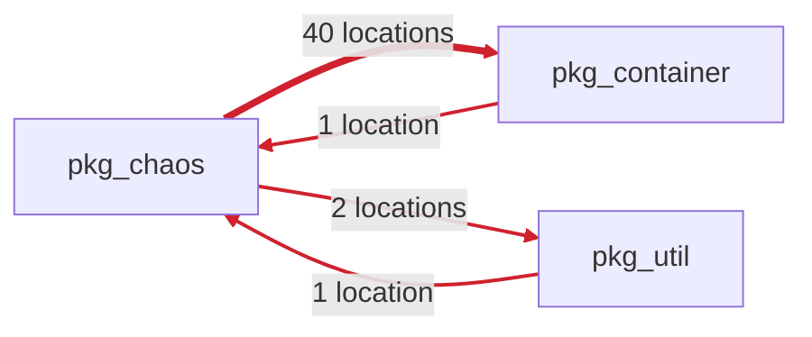

# Archfit App UI and PR feedback redesign

Status: in progress, 19 October 2026. Follows [`ui-review.md`](ui-review.md) (the rules decided there still hold:
status first, one primary action, details fold away, never "blocking" in advisory mode).

Input: the pilot pull request `coupling-dev/pumba-pilot#11`, which adds a dependency cycle among `pkg_chaos`,
`pkg_container` and `pkg_util` (two module pairs that import each other), its `archfit/state` check run 117740459237
and the report artifact of run 39149541868. The live comment was 14 KB, with the 6 accepted findings open and the
same 230-character explanation repeated 8 times.

Vocabulary follows Vlad Khononov's _Balancing Coupling in Software Design_: integration strength (intrusive,
functional, model, contract coupling), distance, volatility, balance. Engine tokens (`functional`, `cross_module`,
`high`) are shown as the engine writes them; the App adds no synonyms.

## Phases

One pull request each, in this order.

| Phase | Changes                                                                       | Behaviour change |
| ----- | ----------------------------------------------------------------------------- | ---------------- |
| a     | PR comment and check summaries (`internal/gate/feedback`)                     | display only     |
| b     | Shared visual system and the top bar                                          | display only     |
| c     | Findings on the repository and pull request pages                             | display only     |
| d     | Repository and pull request graphs, closer to `prototypes/graph-proto.js`     | display only     |
| e     | Consent                                                                       | owner decision   |
| f     | Policy editor: YAML highlighting, structure, AI instruction and mode controls | display only     |

## PR comment and check summary (phase a)

### What is most important

The reader of a pull request comment asks three things, in this order: does it block my merge, what did my change
break, and what do I change. The comment answers them in the first screen and folds everything else.

1. **Effect on merge**: the headline (unchanged matrix) and, in advisory mode, a GitHub `[!NOTE]` alert "This check
   does not block merging". The alert gives the line a colour without the word "blocking".
2. **Next step first**: `Next` is the first, bold line under the headline; the reason code and detail follow.
3. **One tally line** counts every group: "**4 rule violations** in 1 dependency cycle · 2 advisories · 6 accepted ·
   6 introduced by this pull request". The last part appears only when the engine compared against the PR base
   (`comparison.origin_status: comparable`), so "introduced" is never claimed without that comparison.
4. **The violation, drawn**: a dependency cycle is one item, not one item per pair. The App finds the strongly
   connected component from the findings themselves (same rule, kind, status and severity; target reaches source),
   so a three-module cycle with no reverse pair is caught too. The item has a Mermaid flowchart (one edge per
   direction, labelled with its location count, heavier lines for more locations), then a table of directions.

5. **Balanced Coupling in the table**: rows show integration strength, distance and volatility from the report's
   seam for that module pair. These are kept report fields (`seams[]`); the finding's `matched_by` stays dropped at
   decode, as the no-source rule requires.
6. **Each explanation once**: the engine repeats one `why` for every finding of a rule. Under a table each distinct
   `why`, `constraint` and set of alternatives is written once. A cycle shows its first `why` only, because the
   per-direction ones differ only in module names.
7. **Everything that never blocks folds**: advisories, accepted findings (baseline or waiver) and fixed findings are
   each one `
` with the count and the effect in the summary, then a table. Before, accepted debt was open.
8. Evidence, inputs, validation commands and agent tasks stay folded as before; dimensions are a table there, with
   `fail` and `warn` in bold.

Result on PR #11: the visible part fits one screen (headline, note, next step, tally, cycle diagram and table, four
folds). The body is 13 KB, of which the agent task JSON is 4 KB and folded.

### Safety of the new syntax

- Mermaid: node IDs are generated (`m0`, `m1`); a label keeps `[A-Za-z0-9_./:@+-]` and writes every other rune as a
  Mermaid entity (`#<code>;`). A module name can neither end a label nor close the code fence (unit test with a
  hostile name).
- Tables: a `|` in a cell is escaped; rows keep their column count (same test).
- Cuts: `cutLines` closes an open code fence as well as an open fold before "Output truncated.".

### Check summaries

`archfit/state` uses the same blocks without the diagram and without the alert: Mermaid and GitHub alerts are
documented for comments, issues and Markdown files; their rendering in a check run summary is not verified. If a
later check on a scratch repository shows they render, the summary can take them too.

`archfit/gate` keeps block G (one line per blocking finding with its agent task goal); only the reason lines changed.

### Verified

- Golden files for all wire fixtures plus the real PR #11 report (`testdata/report/pilot-pr-cycle.json`, advisory mode).
- Rendered through GitHub's Markdown API (`gh api markdown`, mode `gfm`) and viewed in Chrome with
  `github-markdown-css` and Mermaid 10: the alert, the diagram, the tables and the folds render. Not yet seen on a
  live pull request: posting to the pilot needs the owner's approval.

### Not done, and why

- The comment does not say which direction to remove. The engine's constraint is "remove one direction"; picking one
  would be a repair of the App's own, which the feedback contract forbids. The location counts (40 against 1) make
  the cheap direction visible.
- Strength, distance and volatility come from seams, not from the finding. A finding without a matching seam shows
  empty cells. Promoting `matched_by` to a kept field is a wire contract change with a privacy review; not needed.
