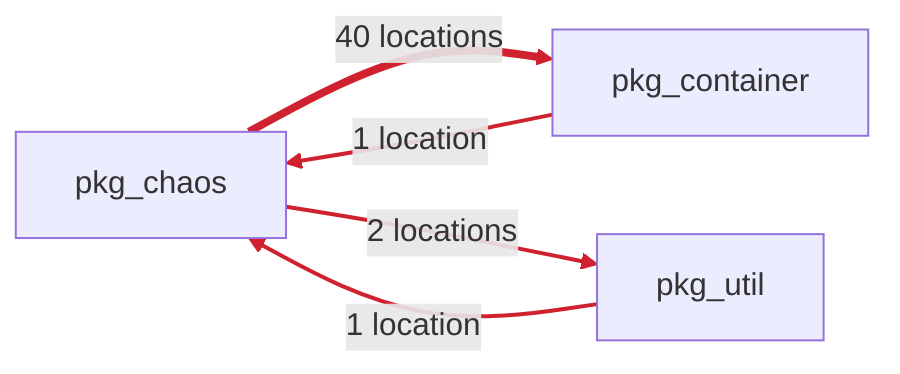

# Archfit App UI and PR feedback redesign

Status: in progress, 19 October 2026. Follows [`ui-review.md`](ui-review.md) (the rules decided there still hold:
status first, one primary action, details fold away, never "blocking" in advisory mode).

Input: the pilot pull request `coupling-dev/pumba-pilot#11`, which adds a dependency cycle among `pkg_chaos`,
`pkg_container` and `pkg_util` (two module pairs that import each other), its `archfit/state` check run 117740459237
and the report artifact of run 39149541868. The live comment was 14 KB, with the 6 accepted findings open and the
same 230-character explanation repeated 8 times.

Vocabulary follows Vlad Khononov's _Balancing Coupling in Software Design_: integration strength (intrusive,
functional, model, contract coupling), distance, volatility, balance. Engine tokens (`functional`, `cross_module`,
`high`) are shown as the engine writes them; the App adds no synonyms.

## Phases

One pull request each, in this order.

| Phase | Changes                                                                       | Behaviour change |
| ----- | ----------------------------------------------------------------------------- | ---------------- |
| a     | PR comment and check summaries (`internal/gate/feedback`)                     | display only     |
| b     | Shared visual system and the top bar                                          | display only     |
| c     | Findings on the repository and pull request pages                             | display only     |
| d     | Repository and pull request graphs, closer to `prototypes/graph-proto.js`     | display only     |
| e     | Consent                                                                       | owner decision   |
| f     | Policy editor: YAML highlighting, structure, AI instruction and mode controls | display only     |

## PR comment and check summary (phase a)

### What is most important

The reader of a pull request comment asks three things, in this order: does it block my merge, what did my change
break, and what do I change. The comment answers them in the first screen and folds everything else.

1. **Effect on merge**: the headline (unchanged matrix) and, in advisory mode, a GitHub `[!NOTE]` alert "This check
   does not block merging". The alert gives the line a colour without the word "blocking".
2. **Next step first**: `Next` is the first, bold line under the headline; the reason code and detail follow.
3. **One tally line** counts every group: "**4 rule violations** in 1 dependency cycle · 2 advisories · 6 accepted ·
   6 introduced by this pull request". The last part appears only when the engine compared against the PR base
   (`comparison.origin_status: comparable`), so "introduced" is never claimed without that comparison.
4. **The violation, drawn**: a dependency cycle is one item, not one item per pair. The App finds the strongly
   connected component from the findings themselves (same rule, kind, status and severity; target reaches source),
   so a three-module cycle with no reverse pair is caught too. The item has a Mermaid flowchart (one edge per
   direction, labelled with its location count, heavier lines for more locations), then a table of directions.

5. **Balanced Coupling in the table**: rows show integration strength, distance and volatility from the report's
   seam for that module pair. These are kept report fields (`seams[]`); the finding's `matched_by` stays dropped at
   decode, as the no-source rule requires.
6. **Each explanation once**: the engine repeats one `why` for every finding of a rule. Under a table each distinct
   `why`, `constraint` and set of alternatives is written once. A cycle shows its first `why` only, because the
   per-direction ones differ only in module names.
7. **Everything that never blocks folds**: advisories, accepted findings (baseline or waiver) and fixed findings are
   each one `
` with the count and the effect in the summary, then a table. Before, accepted debt was open.
8. Evidence, inputs, validation commands and agent tasks stay folded as before; dimensions are a table there, with
   `fail` and `warn` in bold.

Result on PR #11: the visible part fits one screen (headline, note, next step, tally, cycle diagram and table, four
folds). The body is 13 KB, of which the agent task JSON is 4 KB and folded.

### Safety of the new syntax

- Mermaid: node IDs are generated (`m0`, `m1`); a label keeps `[A-Za-z0-9_./:@+-]` and writes every other rune as a
  Mermaid entity (`#<code>;`). A module name can neither end a label nor close the code fence (unit test with a
  hostile name).
- Tables: a `|` in a cell is escaped; rows keep their column count (same test).
- Cuts: `cutLines` closes an open code fence as well as an open fold before "Output truncated.".

### Check summaries

`archfit/state` uses the same blocks without the diagram and without the alert: Mermaid and GitHub alerts are
documented for comments, issues and Markdown files; their rendering in a check run summary is not verified. If a
later check on a scratch repository shows they render, the summary can take them too.

`archfit/gate` keeps block G (one line per blocking finding with its agent task goal); only the reason lines changed.

### Verified

- Golden files for all wire fixtures plus the real PR #11 report (`testdata/report/pilot-pr-cycle.json`, advisory mode).
- Rendered through GitHub's Markdown API (`gh api markdown`, mode `gfm`) and viewed in Chrome with
  `github-markdown-css` and Mermaid 10: the alert, the diagram, the tables and the folds render. Not yet seen on a
  live pull request: posting to the pilot needs the owner's approval.

### Not done, and why

- The comment does not say which direction to remove. The engine's constraint is "remove one direction"; picking one
  would be a repair of the App's own, which the feedback contract forbids. The location counts (40 against 1) make
  the cheap direction visible.
- Strength, distance and volatility come from seams, not from the finding. A finding without a matching seam shows
  empty cells. Promoting `matched_by` to a kept field is a wire contract change with a privacy review; not needed.

## Screens of the App (phases b to f)

Seen in Chrome on app.coupling.dev on 19 October 2026 (pumba-pilot, PR #11), and read in code. Today the App looks
like unstyled HTML. `app.css` has 5 colour variables, no button, table or banner component, and no dark mode. The
prototype's `archfit.css` has all of these.

### Shared visual system and top bar (phase b)

Today:

- The top bar is a row of underlined links: brand, the repository name, Policy, Graph, Consent. Next to them is a
  grey browser-default "Sign out @login" button (`layout.html:10-26`). No item marks the current page.
- Consent is in the nav for every user, but the route is admin only (`ui.go:141`), so everyone else gets "Not
  found".
- The PR page has two "Graph" links: the top one opens the repository graph, the tab opens the PR graph.
- Buttons are browser defaults everywhere. Folds are browser `
` with an `<h2>` forced inline. Muted text uses
  opacity, so muted links fade too. Four chip classes come in four sizes.
- Dark mode: `--bad`, `--warn` and `--accent` are about 3.3:1 on a dark canvas, below AA (estimate). There is no
  global `:focus-visible`.

Target:

- Port the tokens of `prototypes/archfit.css`: light and dark sets, 14 px base, a heading scale, `:focus-visible`.
  Port its components: `.btn` and `.btn.primary`, `.label`, `.state`, `.box`, `.flash`, `table.data`, `details.fold`,
  `.seg`, `.blankslate`.
- One chip component. Status is always a dot plus a word, never colour alone.
- Header: logo mark, "Archfit", breadcrumb `org / repo` (plus `#n` on a pull request), spacer, user chip with a small
  Sign out. Under it, tabs Overview · Architecture · Policy with `aria-current`. Consent leaves the nav (phase e).
- The App says "violations found" where it says "blocked" today (`wording.go:102`). The earlier review already ruled
  out "blocked" in advisory mode.

### Repository overview and findings (phases b, c)

Today: seven flat sections in a narrow column. Setup and Onboarding show the same stage twice. The setup steps run
together as green text ("1. Installed2. Workflow merged3. …"), and done steps differ by colour only. The next step is
one 50-word paragraph. The state is a bold word ("attention"). The page lists no findings for the default branch.

Target (`prototypes/index.html` Overview):

- A hero row: state pill, `master`, a "gate: advisory" label.
- Three counters: rule violations, advisories (never block), open pull requests with a violation. Counts, no score.
- A "Needs you" card with one primary button, holding the next step and the onboarding or discovery action.
- A progress track that replaces both Setup and Onboarding.
- Open pull requests as rows with a state pill.
- "Findings on `master`", with the same cards as the pull request page.

### Pull request page (phase c)

Today: the cycle is two text blocks ("cycle `pkg_chaos` ⇄ `pkg_container`" and "… ⇄ `pkg_util`"). Each starts with the
rule ID and the engine tokens "gate, new, high", then runs into comma-joined locations. "and 37 more" is a `
`
nested in a `
` (invalid markup: the parser closes the paragraph early). Advisories, accepted debt, agent tasks and
evidence are four bold browser folds. The result chip shows the raw `archfit/state: neutral`. Agent tasks are raw JSON
with no copy button.

Target:

- One header partial shared with the PR graph: title and `#n`, state pill, "gate: advisory · does not block merging",
  a "compared with base" or "no baseline" chip, the short SHA.
- A cycle card: the drawn cycle, the same picture as the comment, as inline SVG, with counts per direction. Under it
  a table of directions with integration strength, distance and volatility, then Why and **Fix**.
- Other violations as cards: label, `from → to` as code chips, Why, Fix, 3 locations and a fold "All N locations".
- Advisories and accepted findings as `table.data` in one styled fold each, with the same words as the comment
  ("accepted · baseline or waiver").
- "Copy N tasks for agents" as a button in the box head, with the JSON folded below.
- Evidence: the nine dimensions as a strip, coverage in a table, readable names with the engine key as a tooltip.

### Graphs (phase d)

Today: the repository graph is a small drawing in a wide frame, with a "Problems" list on the left and the detail
panel under it, often off-screen. On the PR graph, the edge badges "new · 2" and "new · 40" overlap. Up to three
left-bordered banners push the graph down. There is no legend for line weight, dashes or halo. Colours differ from the
prototype: allowed is green here, grey there. The intro "Policy status of module relationships…" is jargon.

Target (`prototypes/atlas.html` map, `graph-proto.js`):

- Canvas on the left, a 300–340 px inspector on the right. The problem list sits in a box above the canvas.
- A segmented Graph / Matrix control. A legend row: colour = status, weight = dependency count, dashed = accepted,
  dashed node = not in the policy.
- The inspector for a dependency: status, then "integration strength · distance · volatility" from the seam, then
  the findings behind it, then "Open in the policy". `graph.Build` has to project the three seam fields.
- On the PR graph, "N new in this PR" is the first chip. The edge badge shows the count only; "new" goes into the
  legend and the inspector. Banners become one-line `.flash.warn` items with the reason in a fold.
- One word per thing: "dependency" for an arrow, "coupling" for strength × distance × volatility, "accepted" for
  baseline or waiver (today the UI also says "link", "pair", "relationship" and "accepted exception").

### Consent (phase e, owner decision)

What it is: one record per GitHub App installation, not per repository, for each of two managed features.

- Managed discovery: Archfit clones the repository into a sandbox to propose a first policy.
- Managed AI: the policy text and the instruction go to the AI provider.

Each feature also needs `data_mode: managed` in the repository settings. Managed onboarding redirects here when consent
is missing. The editor hides the managed AI option without it.

Why it confuses: it is a top-level page that names neither the feature nor the moment it matters. It uses
installation and settings jargon, and does not show who allowed what and when, although the record holds both. The
UI never offers managed discovery, so one of the two consents guards a feature nobody can reach.

Proposal (no behaviour removed):

- **A (recommended)**: rename the page "Data sharing" and link it from the repository's admin area instead of the
  nav. Ask in context: the policy page's AI box shows managed mode disabled with its reason, and an admin gets an
  inline "Allow" button. Per feature, the page shows what leaves your environment, "Allowed by @login on <date>", and
  both preconditions as a checklist (organisation consent, this repository's `data_mode`).
- **B**: in-context prompts only. The route stays, reachable from those prompts.

**Decided (owner, 19 October 2026): A.**

### Policy editor (phase f)

Today: a 30-row plain textarea, with diagnostics under it and off-screen. Three equal grey buttons. A fieldset with a
one-line instruction field and a mode select that usually has one option. The instruction shares the form with
"Save", so Enter in it submits Save, the first submit button, and the instruction is dropped (HTML implicit
submission). Users without write access see Save, Ready and Propose, and get "Not found" on use.

Target (`prototypes/atlas.html` policy, `charter.html` amend):

- A box head with the file name, branch, draft label and PR link. A toolbar: Check (secondary), **Save to draft PR**
  (primary), and Ready only when allowed. Write actions only for users with write access.
- Diagnostics as an error list above the editor, with marks in a line-number gutter.
- **Decided (owner, 19 October 2026): CodeMirror 6**, not a home-made highlighter. It ships as a pinned, vendored
  bundle: a small tools directory with `package.json`, a lockfile and a build script, and the generated `editor.js`
  and `editor.css` committed under the App's static assets. No Node at App build time or runtime. A make target checks
  that the committed bundle matches a build from the lockfile, if that is cheap.
- Extensions: YAML language, line numbers, folding, history, search, and server diagnostics as lint markers (gutter,
  underline, and an accessible list above the editor).
- CSP: a static theme stylesheet or `EditorView.cspNonce`, never `unsafe-inline`. Ace is the fallback only if CM6
  cannot meet the CSP.
- The textarea stays the form field and the no-JavaScript fallback. `internal/control/ui/module.md`, which forbids an
  editor library today, changes with the rationale.
- The AI box in its own form: a 3-row instruction, mode as two radios (managed disabled with its reason), Propose.
- A draft timeline: saved → checked → ready → owner approves → merged on GitHub.
