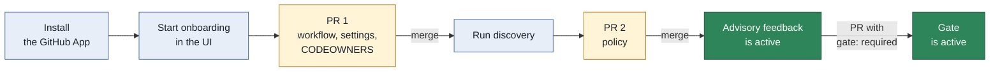

# User guide

This guide shows how to use Archfit on a GitHub repository.
It is for repository admins, policy owners, and developers.
The last section is for the operator of the service.

> **Status.** The service is not deployed, and no GitHub App is registered.
> This guide describes the behavior of the code in this repository.
> Managed discovery is not available, because no sandbox driver exists.

## What Archfit does

Archfit finds changes that break the architecture rules of your repository.
The rules are in a policy file in your repository. You review the policy like code.

On each pull request, Archfit does these steps:

1. A GitHub workflow runs the Archfit engine in your CI.
2. The workflow uploads the report to the App. The report contains no source code.
3. The App compares the report with the approved policy on the base branch.
4. The App publishes the result on the pull request.

## Terms

| Term          | Meaning                                                                         |
| ------------- | ------------------------------------------------------------------------------- |
| Policy        | The file `.archfit.yaml`. It contains the architecture rules and the waivers    |
| Settings file | The file `.archfit-app.yaml`. It contains the owners and the gate mode          |
| Policy owner  | A person or a team that approves changes to the protected files                 |
| Protected ref | The base branch of a pull request. The App trusts only the files on this branch |
| Gate          | The check `archfit/gate`. It can block a merge                                  |
| Waiver        | A policy entry that accepts one finding until a date                            |

## Roles

The App uses your permission on the GitHub repository.

| GitHub permission | You can                                                           |
| ----------------- | ----------------------------------------------------------------- |
| Read              | See the status page, the policy, and the graph                    |
| Write             | Save policy drafts, ask for an AI proposal, mark a draft as ready |
| Admin             | Start onboarding, run discovery, record or revoke consent         |

Policy owners are a different role. The settings file lists them.
An owner is a GitHub login (`alice`) or a team (`acme/architects`).

## Onboard a repository

Onboarding uses two pull requests. You need the Admin permission.



1. Install the Archfit GitHub App on the repository.
2. Open the App URL in a browser.
3. Click **Sign in with GitHub**.
4. On the **Repositories** page, click the repository.
5. In **Start onboarding**, type the policy owners. Put one login or one `org/team-slug` on each line.
6. Select **Customer mode**.
7. Click **Open the onboarding pull request**.
8. Review the pull request on GitHub, then merge it.
9. On the status page, click **Run discovery in your workflow**.
10. Wait for the second pull request. It contains the proposed policy.
11. Review the policy, then merge the pull request.

The first pull request adds three items:

- The workflow file `.github/workflows/archfit.yaml`
- The settings file `.archfit-app.yaml` with your owners
- `CODEOWNERS` entries for the protected files

The workflow uses no repository secret. It authenticates with the GitHub OIDC token of the job.

The status page shows the onboarding stage:

| Stage             | Meaning                                             | Next step                                    |
| ----------------- | --------------------------------------------------- | -------------------------------------------- |
| `installed`       | The App is installed. No valid settings file exists | Start onboarding                             |
| `workflow_merged` | The first pull request is merged                    | Run discovery                                |
| `report_received` | The App received the proposed policy                | Review and merge the policy pull request     |
| `policy_merged`   | The policy is on the default branch                 | Wait for the first run on the default branch |
| `gate_advisory`   | Advisory feedback is active                         | An owner can enable the gate                 |
| `gate_required`   | The gate is active                                  | None                                         |

The App does not store the stage. It reads the state from GitHub each time.

### Managed discovery

In managed mode, the App clones the repository into a short-lived sandbox and proposes the policy.
Your source code leaves your environment for the time of this job.

Managed mode needs two conditions:

- An admin recorded the **Managed discovery** consent on the consent page (`/r/<owner>/<repo>/consent`).
- The operator configured a sandbox driver.

No sandbox driver exists today. Thus the App answers that managed discovery is not available.

## Settings file

The file `.archfit-app.yaml` is on the default branch, next to the policy.

```yaml
version: 1
owners:
  - alice
  - acme/architects
gate: advisory
workflow: .github/workflows/archfit.yaml
data_mode: customer
```

| Key         | Values                 | Meaning                                                             |
| ----------- | ---------------------- | ------------------------------------------------------------------- |
| `version`   | `1`                    | Format version                                                      |
| `owners`    | One entry or more      | Policy owners: GitHub logins or `org/team-slug`                     |
| `gate`      | `advisory`, `required` | `advisory` is the default. `required` adds the `archfit/gate` check |
| `workflow`  | A path                 | The only workflow that can upload reports                           |
| `data_mode` | `customer`, `managed`  | `customer` is the default. Source code never reaches Archfit        |

## Read the feedback

The App publishes these items on a pull request:

- The check `archfit/state`. It is advisory.
- The check `archfit/gate`. It appears only when `gate: required` is set.
- One comment. The App updates the same comment after each run.

The gate has three conclusions:

| Conclusion        | Meaning                                               | Who acts                 |
| ----------------- | ----------------------------------------------------- | ------------------------ |
| `success`         | No blocking finding                                   | No one                   |
| `failure`         | The change breaks the policy                          | The author of the change |
| `action_required` | The App cannot trust the report, or a person must act | See the reason code      |

The gate never shows `neutral` or `skipped`. A missing report is never `success`.

### Reason codes

Each result has a reason code and a recovery step.

#### Architecture

| Reason              | What to do                                                 |
| ------------------- | ---------------------------------------------------------- |
| `healthy`           | Nothing                                                    |
| `blocking_findings` | Fix the blocking findings. Then run the validation command |

#### Governance

| Reason                   | What to do                                                               |
| ------------------------ | ------------------------------------------------------------------------ |
| `owner_approval_missing` | A policy owner must approve the exact head commit                        |
| `settings_missing`       | Merge the onboarding pull request                                        |
| `policy_missing`         | Merge the policy pull request                                            |
| `waiver_expired`         | Renew the waiver with an owner-approved pull request, or fix the finding |

#### Evidence

| Reason                        | What to do                                                                     |
| ----------------------------- | ------------------------------------------------------------------------------ |
| `missing_upload`              | No report arrived. Read the workflow log, then re-run the workflow             |
| `stale_inputs`                | The policy or the baseline changed on the base branch. Re-run the workflow     |
| `policy_mismatch`             | Run the workflow with the policy from the base branch                          |
| `baseline_mismatch`           | Run the workflow with the baseline from the base branch                        |
| `labels_mismatch`             | Run the workflow with the labels file from the base branch                     |
| `baseline_not_comparable`     | Open a baseline pull request. Get the approval of a policy owner               |
| `missing_required_coverage`   | Supply the evidence for the listed rules. An approval cannot clear this reason |
| `workflow_not_approved`       | Upload from the workflow that the settings file names                          |
| `unknown_engine_identity`     | Use the engine image that the onboarding workflow pins                         |
| `measurement_profile_missing` | Use engine v2.3.1 or later                                                     |
| `engine_error`                | Read the workflow log. Use the pinned engine image. Re-run the workflow        |
| `envelope_mismatch`           | Re-run the workflow. The upload did not match the GitHub run                   |
| `report_invalid`              | Upload the unmodified engine report. Use the pinned Action version             |
| `unsupported_event`           | Run Archfit on `pull_request`, or on `push` to the default branch              |
| `fork_unsupported`            | Push the branch to this repository. Pull requests from forks are not supported |

#### Subscription

| Reason                   | What to do                                                          |
| ------------------------ | ------------------------------------------------------------------- |
| `subscription_suspended` | Contact support, or remove the Archfit requirement from the ruleset |

For some reasons, the App re-runs your workflow automatically.
These reasons are a late owner approval, a policy change on the base branch, and an expired waiver.
The re-run uses your CI minutes.

## Change the policy

All policy changes go through a pull request. The App never writes to the default branch.

1. On the repository page, open **Policy** (`/r/<owner>/<repo>/policy`).
2. Edit the YAML text.
3. Click **Save to the draft pull request**. The App commits to a branch below `archfit/`.
4. Read the Archfit check on the draft pull request. This check is the authoritative validation.
5. Click **Mark ready for review**.
6. Get the approval of a policy owner on GitHub, then merge.

The editor validates only the schema. The check on the draft pull request validates the policy with the engine.

If another person changed the draft after you opened the page, the App refuses your save.
Click **Reload the draft**, then apply your change again.

### Owner approval

A change to a protected file needs the approval of a policy owner.
The approval must be on the exact head commit. A new push cancels the approval.

The protected files are:

- `.archfit.yaml`
- `.archfit-baseline.json`
- `.archfit-labels.yaml`
- `.archfit-app.yaml`
- The Archfit workflow file

This rule also applies to a pull request that changes code and policy together.

### Ask AI for a proposal

The AI proposal is optional. It arrives as a commit on your draft pull request.
Nothing is published until a person merges the pull request.

1. Save a draft first.
2. In **Ask AI for a proposal**, type the instruction.
3. Select the mode.
4. Click **Propose**.

| Mode       | Where it runs                 | Conditions                                                                      |
| ---------- | ----------------------------- | ------------------------------------------------------------------------------- |
| `customer` | In your CI, as a workflow run | None                                                                            |
| `managed`  | The App calls the AI provider | `data_mode: managed`, the **Managed AI** consent, and a configured provider key |

In managed mode, the App sends the draft policy text and your instruction to the AI provider.
It sends no source code and no report. AI output never affects the gate result.

## Enable the gate

1. Open a pull request that sets `gate: required` in `.archfit-app.yaml`.
2. Get the approval of a policy owner, then merge.
3. In the GitHub ruleset of the branch, add `archfit/gate` as a required check.

> **CAUTION:** Do not add `archfit/gate` as a required check while the settings file contains `gate: advisory`.
> In advisory mode the App does not publish this check, so each pull request stays blocked.

## See the graph

Open **Graph** (`/r/<owner>/<repo>/graph`). The page is read-only.

- The modules come from the policy. The page groups them by layer.
- The links come from the latest report.
- A red link is a dependency that the policy does not permit.

If the policy text differs from the policy of the latest report, the page shows a **Stale** banner.

## Plans and trial

These values are defaults. They can change before the launch.

| Plan        | When                                          | Effect on the gate                          |
| ----------- | --------------------------------------------- | ------------------------------------------- |
| `public`    | The installation has only public repositories | None                                        |
| `trial`     | 30 days from the first private repository     | None                                        |
| `grace`     | 7 days after the trial                        | None. The feedback shows a notice           |
| `granted`   | The operator set a grant date                 | None                                        |
| `suspended` | The grace period ended and no grant is active | `action_required`, `subscription_suspended` |

The notice starts 7 days before the end of the trial.
A suspension is not an architecture failure, and it is never `success`.
After a new grant, the App re-runs the workflow. Only a new report can give `success`.

If the App cannot read the subscription record, it treats the installation as not suspended.

When you uninstall the GitHub App, the App deletes all stored data of the installation.

## For the operator

The `/internal/*` routes need the operator token: `Authorization: Bearer <token>`.
[Architecture](architecture.md#deployment) lists the configuration.

### Run the sweep

The sweep repairs the state after lost webhooks. Call it from a scheduler one time each hour.

```sh
curl -X POST -H "Authorization: Bearer $TOKEN" "$ARCHFIT_BASE_URL/internal/sweep"
```

The response is a JSON summary. The status is `500` if the gate sweep failed.

### Set or clear a grant

Set a grant until a date. The date must be in the future.

```sh
curl -X POST -H "Authorization: Bearer $TOKEN" \
  -d '{"installation_id": 12345, "until": "2027-01-01T00:00:00Z"}' \
  "$ARCHFIT_BASE_URL/internal/grants"
```

To clear the grant, omit `until` or send `null`. The status is `204` for success.

### Health

```sh
curl -s "$ARCHFIT_BASE_URL/healthz"
```

The response is `{"status":"ok"}`.
