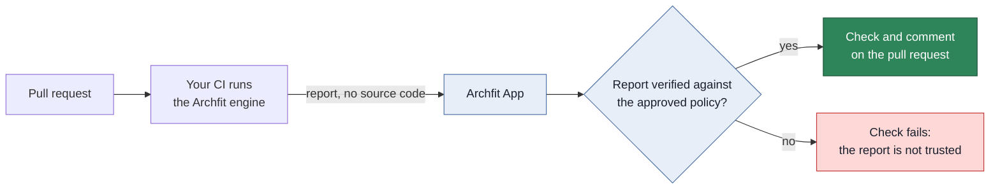
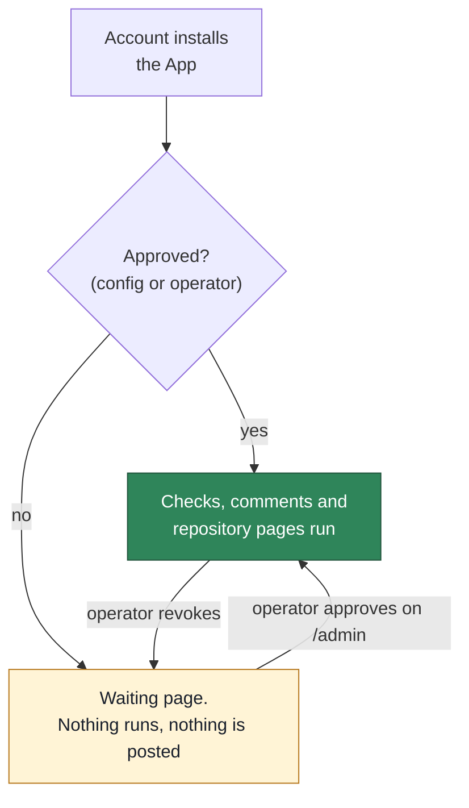
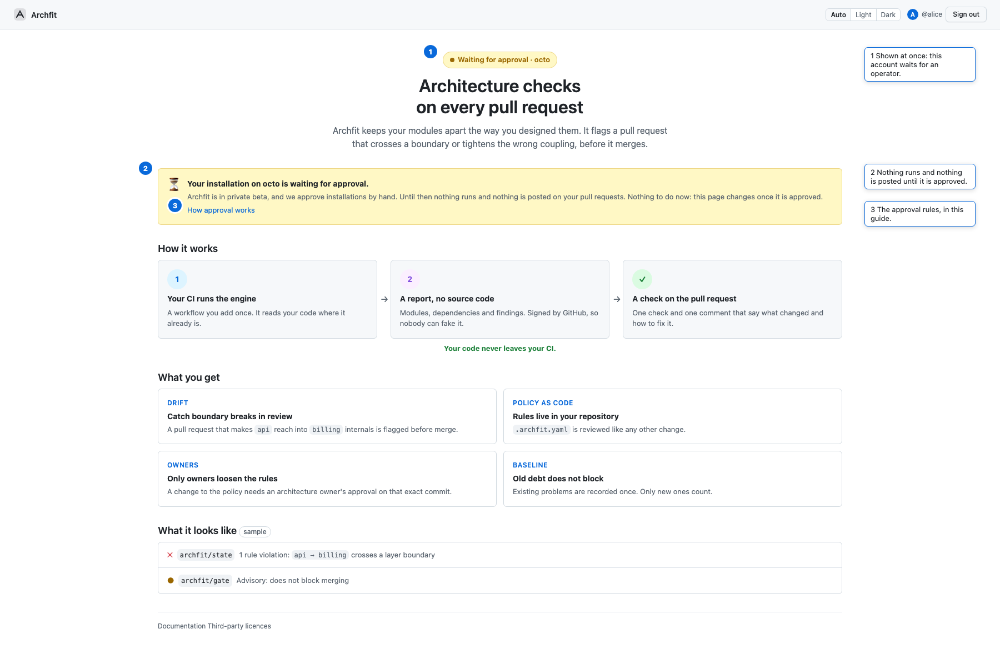
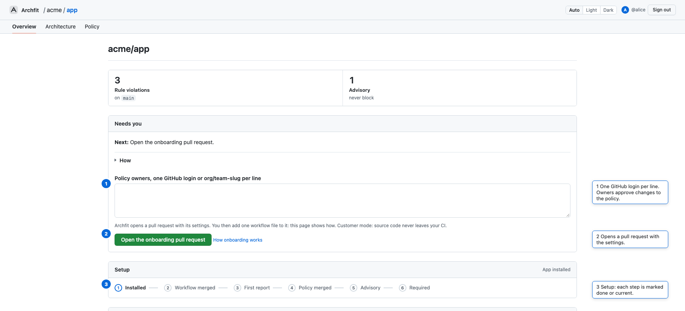
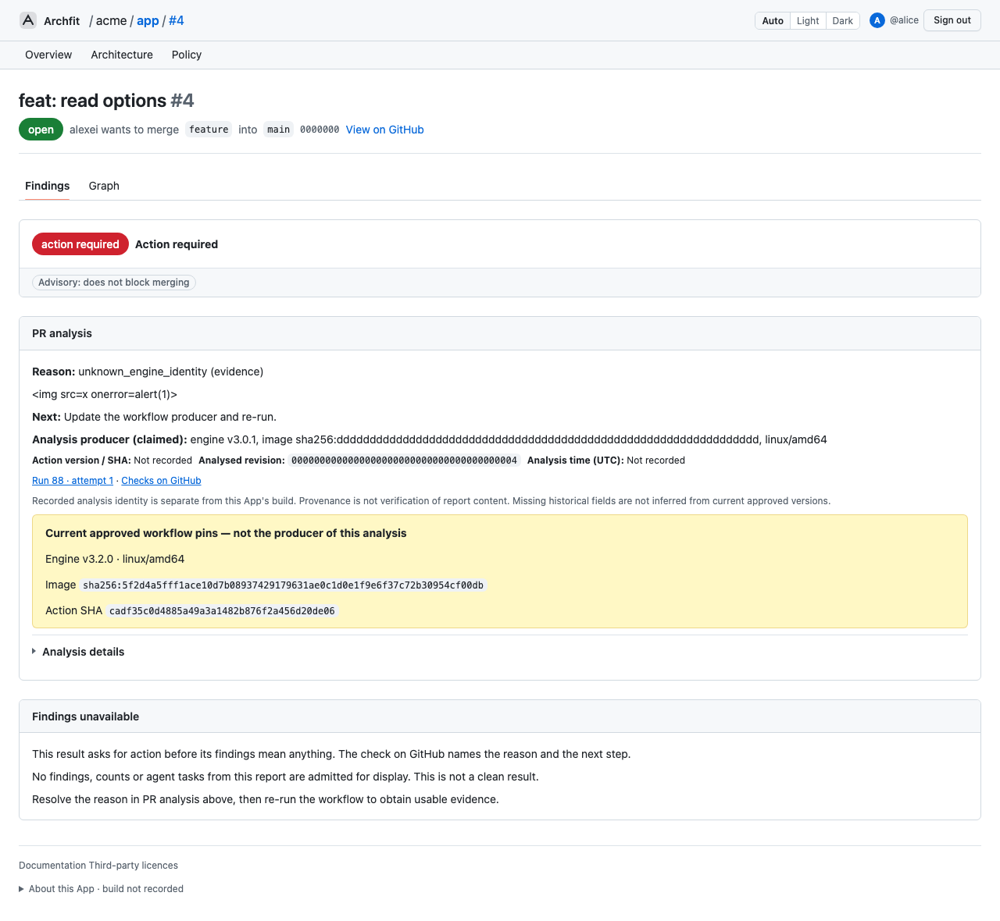
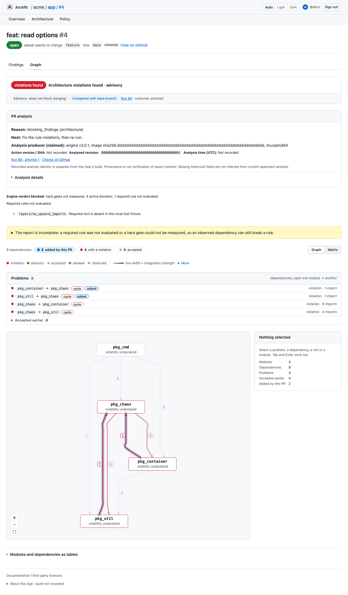

# User guide

This guide explains the App flows for repository admins, policy owners, developers, and operators.
Read [Architecture](architecture.md) for the service boundary, routes, and package structure.

> **Status.** Archfit is in private beta. An operator approves each account before the App runs for it: see
> [Who the App serves](#who-the-app-serves). Managed discovery is not available yet.

## What the App does

The Archfit engine runs in customer CI. It sends a report with no source code to the App.
The App verifies the report against the approved policy and publishes feedback on the pull request.



## Who the App serves

Archfit is in private beta. Anyone can install the App, but it runs only for accounts that an operator has approved.
While the beta lasts, an operator approves each account by hand.



- **Approved accounts** get everything in this guide.
- **An account waiting for approval** gets nothing: no check, no comment, no pull request. An upload from its
  workflow answers `403 installation_not_approved`. Every repository page shows the **Waiting** page: what Archfit
  does, and "Your installation on `<account>` is waiting for approval". There is nothing to do. The page changes once
  the account is approved.
- **A revoked account** is the same as one never approved, from its next event on. Checks already on GitHub stay.



_Numbers mark what to read: the status, the reason, and where the approval rules are explained._

The approval is per account (the user or organization that installed the App), never per repository. A repository
you add to an approved installation is served at once. The trial of an account with private repositories starts at
its approval, not at its install.

## GitHub App permissions

GitHub shows this list when you install the App. Each permission is here for one job. Issues is new with the release
that brings the repair issue: GitHub asks each account that installed the App earlier to accept it, and until then
there is no repair issue.

### Repository permissions

| Permission    | Access       | What the App does with it                                                                                                           | Without it                                                                                                            |
| ------------- | ------------ | ----------------------------------------------------------------------------------------------------------------------------------- | --------------------------------------------------------------------------------------------------------------------- |
| Checks        | Read & write | Posts `archfit/state` and `archfit/gate` on every pull request and default-branch push.                                             | No result on the pull request, and no gate.                                                                           |
| Pull requests | Read & write | Opens its own pull requests (onboarding, policy, baseline). Keeps one comment per pull request. Reads reviews for owner approval.   | No setup pull requests, no comment, and no way to see an owner's approval.                                            |
| Contents      | Read & write | Reads the policy and settings from the protected branch. Writes only branches named `archfit/…`, for its own pull requests.         | The App cannot read the approved policy or propose a change.                                                          |
| Actions       | Read & write | Reads the Archfit run and its report artifact. Re-runs the Archfit run when its inputs change. Starts discovery and AI assist runs. | After an owner approves, the gate stays red until someone re-runs the job by hand. No discovery button, no AI assist. |
| Metadata      | Read         | GitHub adds it to every App: repository name, default branch.                                                                       | Not optional.                                                                                                         |
| Issues        | Read & write | Added by the release that brings the [repair issue](#repair-issue-on-the-default-branch): opens, updates and closes one issue when a push breaks the default branch. | No repair issue. Checks and comments work as before; the App logs each refused issue call. |

### Organization permissions

| Permission | Access | What the App does with it                                               | Without it                          |
| ---------- | ------ | ----------------------------------------------------------------------- | ----------------------------------- |
| Members    | Read   | Checks that an approver is in an owner team, such as `acme/architects`. | Owners could only be single logins. |

### What the App never asks for

- **Workflows.** This permission lets an App change any file in `.github/workflows/`, so it could change your CI and
  reach its secrets. The App does not ask for it. You add the Archfit workflow file yourself, once, during onboarding.
- **Administration, Secrets, Environments, Deployments.** The App does not change repository settings, read secrets,
  or deploy.

### Limits you should know

- **Contents write covers the whole repository.** GitHub cannot limit it to `archfit/…` branches. The App writes only
  those branches and never merges. Protect the default branch with a ruleset so that a pull request and a review are
  needed for every change, including one from the App.
- **Actions write lets the App start any workflow that has `workflow_dispatch`.** The App starts only the Archfit
  workflow and the AI assist workflow. A workflow that deploys should need an approval in a GitHub environment.
- **Tokens are short-lived.** Each App token lasts at most one hour and is limited to the repositories you chose at
  install.

## Terms

| Term          | Meaning                                                                |
| ------------- | ---------------------------------------------------------------------- |
| Policy        | `.archfit.yaml`, the engine policy and its waivers                     |
| Settings file | `.archfit-app.yaml`, the App file with owners, gate mode, and workflow |
| Policy owner  | A GitHub login or team listed in `owners`                              |
| Agent         | A GitHub login or App account listed in `agents`; it never approves    |
| Protected ref | The pull request base branch, or the default branch for a push         |
| Gate          | The `archfit/gate` check that can block a merge                        |
| Waiver        | A policy entry that accepts one finding until a date                   |

## Roles

The App reads repository permission from GitHub and caches the answer briefly.

| GitHub permission | Actions                                                             |
| ----------------- | ------------------------------------------------------------------- |
| `read`            | Read the status, policy, and graph                                  |
| `write`           | Save a policy draft, ask for an AI proposal, and mark a draft ready |
| `admin`           | Start onboarding, run discovery, and allow or revoke data sharing   |

A policy owner is separate from GitHub permission. The settings file lists each policy owner.
An owner can be a login such as `alice` or a team such as `acme/architects`. An agent listed in `agents` never
approves, even when it is also an owner or a member of an owner team. Approving a pull request in the App needs both:
a policy owner with `write` permission.

## Onboard a repository

Use customer mode when source code must stay in customer CI. Use managed mode only after the App has a sandbox driver.

### Customer mode

Customer onboarding uses one pull request for setup and one pull request for the policy. You add one file to the
setup pull request yourself: the workflow. The App cannot write it (see
[GitHub App permissions](#github-app-permissions)).

```mermaid
flowchart LR
    INSTALL["Install the GitHub App"] --> START["Open the App and<br/>start onboarding"]
    START --> PR1["PR 1<br/>settings, CODEOWNERS"]
    PR1 -->|"you add the workflow"| PR1W["PR 1<br/>+ workflow"]
    PR1W -->|"merge"| DISCOVER["Run discovery<br/>in customer CI"]
    DISCOVER --> PR2["PR 2<br/>proposed policy"]
    PR2 -->|"merge"| ADVISORY["Advisory feedback<br/>is active"]
    ADVISORY -->|"owner-approved PR"| REQUIRED["Required gate<br/>is active"]

    classDef core fill:#2f855a,stroke:#22543d,color:#ffffff
    classDef control fill:#e8eef7,stroke:#4a6fa5,color:#1a202c
    classDef nottrusted fill:#fff4d6,stroke:#b7791f,color:#1a202c
    classDef neutral fill:#edf2f7,stroke:#718096,color:#1a202c

    class ADVISORY,REQUIRED core
    class START,DISCOVER control
    class PR1,PR1W,PR2 nottrusted
    class INSTALL neutral
```



Arrows show the order of the customer onboarding flow. A labeled arrow shows what you do before the next step.

1. Install the Archfit GitHub App on the repository.
2. Open the App URL.
3. Select **Sign in with GitHub**.
4. Select the repository on the **Repositories** page.
5. Enter one policy owner on each line under **Needs you**. The page starts customer mode: source code never leaves
   your CI.



_Numbers mark the owners box, the button that opens the onboarding pull request, and the setup steps._

6. Select **Open the onboarding pull request**.
7. Under **Add the Archfit workflow**, select **Add the file on GitHub**. GitHub opens a new file with the path and
   the content filled in, on the `archfit/onboarding` branch.
8. On GitHub, select **Commit changes** and keep **Commit directly to the `archfit/onboarding` branch**.
9. Come back and select **Check again**. The step changes to "Review and merge".
10. Review and merge the onboarding pull request on GitHub.
11. Select **Run discovery in your workflow** on the repository page.
12. Wait for the policy pull request.
13. Review and merge the policy pull request.

If GitHub does not fill in the file, select **Copy the file** and paste it into a new file named
`.github/workflows/archfit.yaml` on the `archfit/onboarding` branch. **Show the file** shows the content.

If you merge the onboarding pull request without the workflow, the page asks you to add the file to the default
branch instead. The same button opens GitHub on that branch. If the branch is protected, choose **Create a new
branch** on GitHub and merge that pull request.

A sign-in lasts 8 hours, the lifetime of the GitHub token behind it. When the token has expired or you revoked it on
GitHub, the next page asks you to sign in again and brings you back to the same page.

PR 1 adds these files:

- `.archfit-app.yaml` with the policy owners
- `CODEOWNERS` entries for the protected paths
- `.github/workflows/archfit.yaml`, added by you from the repository page

The workflow uses no repository secret. It uses the job GitHub OIDC token.
It runs on `pull_request`, `push` to the default branch, and `workflow_dispatch`. The Action refuses other events.
Pull request and push runs report the architecture state. A manual dispatch selects `mode`: `discovery` proposes a
policy, and `baseline` captures accepted debt. A dispatch with `mode: report` is refused. See
[Capture a baseline](#capture-a-baseline).
The `mode` input selects the run: `discovery`, `baseline` or `reanchor`. The status page button dispatches `mode: discovery`.
On a pull request, the Action reads `.archfit.yaml`, `.archfit-baseline.json`, and `.archfit-labels.yaml` per file:
from the pull request head when the pull request changes that file, otherwise from the tip of the base branch. The
App accepts a changed file only when an architecture owner approved the exact head commit.
Discovery can also run in an existing customer workflow that uploads from a default-branch push.

The status page derives its stage from GitHub on every read.

| Stage             | UI label              | Next action                              |
| ----------------- | --------------------- | ---------------------------------------- |
| `installed`       | App installed         | Start onboarding, then add the workflow  |
| `workflow_merged` | Workflow merged       | Run discovery                            |
| `report_received` | First report received | Review and merge the policy pull request |
| `policy_merged`   | Policy merged         | Wait for the first default-branch run    |
| `gate_advisory`   | Gate is advisory      | Enable the gate by pull request          |
| `gate_required`   | Gate is required      | None; GitHub requires `archfit/gate`     |

### Give it to a coding agent

A coding agent in Claude Code or Codex can do the repository part. The owner still does the App steps, signs in and
merges. Give the agent this text, and the owner's repository checkout:

```text
Help me onboard this repository to Archfit in customer mode. Do the repository steps only.

1. Ask me for the Archfit page of this repository, https://app.coupling.dev/r/<owner>/<repo>. I open it, sign in,
   and select "Open the onboarding pull request" under "Needs you". I give you the pull request URL.
2. Read that pull request with `gh pr view` and `gh pr diff`. It should add `.archfit-app.yaml` and
   `.github/CODEOWNERS` on the branch `archfit/onboarding`. Report what it adds and stop if it adds anything else.
3. The workflow file `.github/workflows/archfit.yaml` must come from that Archfit page, under "Show the file". Ask me
   to paste it. Add it to the `archfit/onboarding` branch only after I confirm.
4. Never merge a pull request, never install or change the GitHub App, and never ask for or store a token, a
   password or a session cookie. Ask me for each of those steps.
5. Tell me the next step after each change: review and merge the onboarding pull request, then run discovery
   on the Archfit page.
```

The agent uses the owner's own `gh` login. It cannot sign in to Archfit or install the App for you.

PR 1 adds these files:

- `.archfit-app.yaml` with the policy owners
- `CODEOWNERS` entries for the protected paths
- `.github/workflows/archfit.yaml`, added by you from the repository page

The workflow uses no repository secret. It uses the job GitHub OIDC token.
It runs on `pull_request`, `push` to the default branch, and `workflow_dispatch`. The Action refuses other events.
Pull request and push runs report the architecture state. A manual dispatch selects `mode`: `discovery` proposes a
policy, and `baseline` captures accepted debt. A dispatch with `mode: report` is refused. See
[Capture a baseline](#capture-a-baseline).
The `mode` input selects the run: `discovery`, `baseline` or `reanchor`. The status page button dispatches `mode: discovery`.
On a pull request, the Action reads `.archfit.yaml`, `.archfit-baseline.json`, and `.archfit-labels.yaml` per file:
from the pull request head when the pull request changes that file, otherwise from the tip of the base branch. The
App accepts a changed file only when an architecture owner approved the exact head commit.
Discovery can also run in an existing customer workflow that uploads from a default-branch push.

The status page derives its stage from GitHub on every read.

| Stage             | UI label              | Next action                              |
| ----------------- | --------------------- | ---------------------------------------- |
| `installed`       | App installed         | Start onboarding, then add the workflow  |
| `workflow_merged` | Workflow merged       | Run discovery                            |
| `report_received` | First report received | Review and merge the policy pull request |
| `policy_merged`   | Policy merged         | Wait for the first default-branch run    |
| `gate_advisory`   | Gate is advisory      | Enable the gate by pull request          |
| `gate_required`   | Gate is required      | None; GitHub requires `archfit/gate`     |

### Managed discovery

Managed discovery is not available in this build and is not offered by the onboarding form.
`ARCHFIT_SANDBOX=none` is the only sandbox driver. Customer discovery and optional managed AI assistance remain separate.

When a sandbox driver exists, an administrator must allow **Managed discovery** on the Data sharing page before source
processing. Until then the page offers no **Allow** for it; a consent given earlier can still be revoked.
The App then clones the repository into an ephemeral sandbox, runs discovery, and deletes the sandbox.
The sandbox does not run repository scripts and receives only a short-lived installation token.
Managed onboarding adds the proposed policy to the onboarding pull request.

## Settings file

The settings file lives on the default branch beside the policy.

```yaml
version: 1
owners:
  - alice
  - acme/architects
agents:
  - alice-agent
  - copilot-swe-agent[bot]
gate: advisory
workflow: .github/workflows/archfit.yaml
data_mode: customer
```

| Key         | Values                                       | Meaning                                           |
| ----------- | -------------------------------------------- | ------------------------------------------------- |
| `version`   | `1`                                          | Settings file format version                      |
| `owners`    | One or more logins or teams                  | Policy owners                                     |
| `agents`    | Logins or `app-slug[bot]` accounts; no teams | Coding-agent identities, which never approve      |
| `gate`      | `advisory`, `required`                       | `required` publishes the blocking check           |
| `workflow`  | A path under `.github/workflows/`            | The workflow that can upload reports              |
| `data_mode` | `customer`, `managed`                        | `customer` keeps source processing in customer CI |
| `policy_authority` | A mapping with `level`, optional `agents` and `tighten_auto` | Who approves a protected change; only `human` is in force |
| `integration` | A mapping with the one key `recheck`: `overlap` or `off` | Whether a passed pull request is re-examined after the default branch moved; absent means `overlap` |
| `repair_assignee` | One login; no team, no list | Who the [repair issue](#repair-issue-on-the-default-branch) is assigned to; absent assigns nobody |

Absent `gate` and `data_mode` keys use `advisory` and `customer`. An absent `agents` key, or `agents: []`, names no
agent.

`agents` lists the GitHub accounts your coding agents act as: a dedicated agent login, or a GitHub App, written as its
slug with or without `[bot]` (both mean the same account). Case does not matter. An agent never approves a protected
change, on GitHub or in the App, even when `owners` names it or an owner team contains it. Listing an owner here is
allowed; the owner then cannot approve. A pull request opened by an agent is marked on its App page.

`policy_authority` says who may approve a change to the protected files. An absent key means `human`:

```yaml
policy_authority:
  level: human # human, co-sign or delegated
```

Only `human` is in force in this release: an architecture owner approves every protected change. `co-sign` (an
architect agent plus one owner) and `delegated` (an architect agent alone for tightening changes) are later rungs of the
ladder. A file that names them stays valid, and the App holds them at `human` and says so in the policy change card.
Their keys are `agents`, the architect agents a later rung lets approve, and `tighten_auto`, a later rung's switch
that lets a tightening need no approval. Neither has an effect yet. A loosening never needs less than a human.

`integration` sets how a pull request that already passed is treated when the default branch moves after its report. An
absent key, or a block without `recheck`, means `overlap`:

```yaml
integration:
  recheck: overlap # overlap or off
```

With `overlap` the sweep withdraws a `success` as `target_moved` when the new default branch and the pull request
together close a module cycle that neither has alone. `off` keeps the result until the next run. The recheck runs only
with `gate: required`; an advisory repository never gets `target_moved`. See
[Merge safety when the target moves](#merge-safety-when-the-target-moves).

The App parses the settings file strictly: an unknown key makes the whole file unreadable, and every pull request then
gets `settings_missing`. Add `agents`, `policy_authority`, `integration` and `repair_assignee` only after the Archfit App release that
knows the keys serves your repository.

## Read the feedback

The App publishes these items on a pull request:

- `archfit/state`, an advisory check for each accepted report upload
- `archfit/gate`, the blocking check when `gate: required`
- One App comment that the App updates after each run

When the policy, baseline or labels change on the base branch, open pull requests show `stale_inputs` and their
workflow runs again, in advisory mode too. An old result never stays without that mark.

What each item shows:

- When architecture findings block (reason `blocking_findings`), the `archfit/gate` summary names each blocking
  finding: the rule, the module pair, the first location, the first eight characters of the finding ID, and the
  repair goal. It shows at most 20 and counts the rest.
- The `archfit/state` check annotates live findings on the files that the pull request changed. Accepted debt and
  fixed findings get no annotation. File-only locations stay in text; annotations require a nonempty file and an exact
  reported positive line. Blocking findings come first. The check shows at most 150 annotations. A new
  report or run attempt gets a new `archfit/state` check run with its own annotations, so annotations from an
  earlier report do not stay; GitHub shows the newest run. If the App cannot read the list of changed files, the
  check has no annotations for that upload.
- The comment leads with the configured Archfit merge effect, assessment and PR impact, or explicitly unknown
  impact. The assessment line names what the App checked the result with: the engine version of the approved
  producer and the first 12 characters of the policy digest the App accepted (compare it with the check's Inputs). Other GitHub protections still apply.
  Introduced means a new finding identity against a comparable Git base; it does not prove a new module pair or that
  every listed source site was added.
- At most three active findings/advisories, each led by its place (`path:line`) and rule, with the module pair. An
  active finding also gets the engine's **Why** (the rule's rationale) and **Fix** (its constraint), each cut to 300
  characters. An advisory gets no why on the first screen: its why is coupling arithmetic (strength, distance,
  volatility), which stays in the exact `archfit/state` check and on the App page, with accepted-debt detail,
  dimensions, full reasons and producer/input digests. The comment has no table wider than four columns, so it reads in
  a plain mail client. There is no comment diagram or separate Archfit email body; GitHub may notify this same text.
- **Repository attention (for the owner)**, a fold, lists the engine's coupling gate reasons when it reports any (at
  most ten; the `archfit/state` check shows up to fifty, and the run's report artifact all). They are chores for an
  architecture owner, not tasks for the pull request's author.
- **For coding agents**, a fold, opens with the result identity as the engine states it (engine, policy and baseline
  digests, head tree, base), so an agent that re-runs the check can compare what it measured. It is the engine's claim,
  not something the App checked.
- **Next** names the PR author/coding agent, architecture owner or CI maintainer as appropriate. Archfit does not
  invent validation flags or choose which cycle direction to remove. The exact emitted task JSON remains between
  `<!-- archfit:agent-tasks -->` markers; task values and validation flags are preserved. Whole omitted tasks are
  counted, with the unmodified report artifact for that run as fallback if retained.
- Visible links identify HEAD, workflow run/attempt and the actual state-check object. A check can be updated.
  **Details in Archfit** shows the current PR result/recovery diagnostics, not a historical snapshot.
- The declared-rule inventory is separate from implicit accepted-reference metric checks. All declared rules can
  be evaluated while metric checks lack a comparable reference. Reference recovery has one owner action when the
  structured report proves that it also explains the metric gap; independent missing-tool/rule actions remain.
- A passing, evaluated required scope can say **No required architecture change requested** even with accepted debt.
  This does not mean perfect architecture or zero findings. A fixed lifecycle entry means a previously accepted
  identity is no longer observed; resolution and historical endpoints are not established by that entry.
- Empty tasks are explained as **No automated source-repair task supplied**, not displayed as a health signal.
  Rejected producer/workflow/input authority withholds report claims, tasks and annotations. Safe recovery,
  claimed identity and the original check conclusion/receipt remain; the App's report-admission rules do not change.
- Evidence details on the state check list analyzers that did not run and required rules that were not evaluated.

The gate has three conclusions:

| Conclusion        | Meaning                                            | Action                 |
| ----------------- | -------------------------------------------------- | ---------------------- |
| `success`         | Trusted evidence has no blocking finding           | No action              |
| `failure`         | Trusted evidence has a blocking finding            | Fix the change         |
| `action_required` | Evidence, governance, or subscription needs action | Follow the reason code |

The gate never uses `neutral` or `skipped`. A missing report never becomes `success`.

The state check is never a required check. It uses these conclusions:

| State check       | When                                                                                       |
| ----------------- | ------------------------------------------------------------------------------------------ |
| `success`         | The gate result is `success` and the engine verdict is `healthy`                           |
| `neutral`         | The gate result is `success` with `attention_only`, or `failure`                           |
| `action_required` | The gate result is `action_required`. Errors and unverifiable evidence are never `neutral` |

### Repair issue on the default branch

The checks of a pull request can be bypassed: an admin merges anyway, or a push lands on the default branch without a
pull request. When the Archfit workflow runs on that push and its result is not a pass (a `failure`, or
`action_required`), the App opens one issue, **Architecture repair needed on main** (with your default branch's name).
It says what broke in words, names the commit and links the run, lists the blocking findings, and holds the
validation commands and the exact agent tasks between the `<!-- archfit:agent-tasks -->` markers, so a coding agent
can pick the repair up from the issue.

- **Opens** on the first push whose result is not a pass, in a repository with `gate: required` (an advisory repository
  gets no issue), assigned to `repair_assignee` when the settings name one.
  When GitHub refuses that login (for example, it has no access to the repository), the issue opens unassigned.
- **Updates** on the next push that is still not a pass, whatever broke this time. There is one open repair issue per
  default branch, never a second. An upload that changes nothing edits nothing.
- **Closes** on the next push that passes, with a comment that names the commit that fixed it.
- A result for a commit the default branch has already left, or of an older run, changes nothing.

The repair issue is a notification, never a gate: it blocks no merge and changes no check. It needs the Issues
permission, which the App asks for from the release that brings the issue. Until an owner grants it, the App logs each
refused issue call and publishes the checks exactly as before.

### Reason codes

The first reason controls the conclusion. The App keeps later reasons in the comment.

#### Architecture

| Reason              | Recovery                                                                                                 |
| ------------------- | -------------------------------------------------------------------------------------------------------- |
| `healthy`           | Nothing                                                                                                  |
| `attention_only`    | Nothing blocks. Advisories never block. Review the listed dimensions and diagnostics on the state check. |
| `blocking_findings` | Fix the rule violations, then run archfit check again.                                                   |

`attention_only` is a `success`. The engine verdict is `needs_attention`, and no evidence, governance, or subscription
reason applies. The detail lists the dimensions that are not fully measured and the count of active diagnostics.

#### Governance

| Reason                   | Recovery                                                                                                               |
| ------------------------ | ---------------------------------------------------------------------------------------------------------------------- |
| `owner_approval_missing` | Get a policy owner to approve the exact commit, on GitHub or with **Approve** on the App's pull request page.          |
| `settings_missing`       | Merge the onboarding pull request to add `.archfit-app.yaml`.                                                          |
| `policy_missing`         | Merge the Archfit policy pull request.                                                                                 |
| `policy_defect`          | Fix the selectors of the listed rules by owner-approved pull request, or mark an intentional guard rule `guard: true`. |
| `waiver_expired`         | Renew the waiver by owner-approved pull request or fix the finding.                                                    |

`policy_defect` names required rules whose selector matches nothing in the repository. The engine cannot evaluate
such a rule, so the gate asks for a policy fix instead of more evidence. The comment shows each rule with the selector
that matches nothing. Other rules that the engine could not evaluate keep `missing_required_coverage`.

#### Evidence

| Reason                        | Recovery                                                                                                                                                                                                            |
| ----------------------------- | ------------------------------------------------------------------------------------------------------------------------------------------------------------------------------------------------------------------- |
| `missing_upload`              | Read the workflow run and run the workflow again.                                                                                                                                                                   |
| `stale_inputs`                | The policy or baseline changed on the base branch. Run the workflow again if no rerun appears.                                                                                                                      |
| `target_moved`                | The default branch moved since this pull request was measured. The comment names the commits, and the modules when this pull request closes a module cycle with the new default branch. The pull request author updates the branch (**Update branch** on GitHub, `gh pr update-branch`, or merge the target); the new commit is measured again. No rerun is requested and rerunning the workflow does not help: a rerun would measure the old commit. |
| `policy_mismatch`             | Run the workflow with the policy from the base branch. Run it again if the base changed.                                                                                                                            |
| `baseline_mismatch`           | Run the workflow with the baseline from the base branch.                                                                                                                                                            |
| `labels_mismatch`             | Run the workflow with the labels file from the base branch.                                                                                                                                                         |
| `baseline_not_comparable`     | Capture a new baseline and open a baseline pull request that an architecture owner approves. The recovery line names the command.                                                                                   |
| `missing_required_coverage`   | Supply the missing evidence for the listed rules. Approval cannot clear this reason.                                                                                                                                |
| `workflow_not_approved`       | Upload from the workflow named in `.archfit-app.yaml`.                                                                                                                                                              |
| `unknown_engine_identity`     | Move the workflow to the Action commit and engine image the App approves now. See [Move an installed workflow to a new engine](#move-an-installed-workflow-to-a-new-engine).                                        |
| `measurement_profile_missing` | Move the workflow to the Action commit and engine image the App approves now. See [Move an installed workflow to a new engine](#move-an-installed-workflow-to-a-new-engine). The report has no measurement profile. |
| `engine_error`                | Read the workflow log. Use the pinned engine image. Run the workflow again.                                                                                                                                         |
| `envelope_mismatch`           | Run the workflow again. The upload did not match the GitHub run.                                                                                                                                                    |
| `report_invalid`              | Upload the unmodified engine report. Use the pinned Action version.                                                                                                                                                 |
| `unsupported_event`           | Run Archfit on a pull request into the default branch, or on a push to it. A pull request into another branch, and other events, are not checked. |
| `fork_unsupported`            | The comment asks the contributor to have a maintainer push the branch to this repository and run the workflow there. To merge a fork without that, a repository admin uses a separate GitHub ruleset with a bypass list for the required check: the App never reports a fork as success. |

#### Subscription

| Reason                   | Recovery                                                                     |
| ------------------------ | ---------------------------------------------------------------------------- |
| `subscription_suspended` | Contact the Archfit team or remove the Archfit requirement from the ruleset. |

The sweep requests a workflow rerun after stale inputs, an expired waiver, late owner approval, or restored subscription.
A rerun uses customer CI minutes. A fresh report is required for a new `success` result. `target_moved` requests no
rerun, because a rerun measures the commit the old run measured: the author updates the branch.
The sweep also requests none when the default branch moved since the check was measured, whatever the reason: a rerun
measures the old commit, and its upload would fail `envelope_mismatch`. The check says `target_moved` instead and the
author updates the branch.
When an owner approval that a passed check relied on is withdrawn, the review event sets `owner_approval_missing` at
once; the sweep does it within an hour if the event is lost. No rerun is requested until an owner approves again or
no approval is needed any more.

### Engine versions

The locked manifest approves engine v3.2.3 on Linux amd64 and arm64. New workflows pin archfit-action at commit
`e168b961824b6801e74f0f0938b49be7e1286819`, which measures a pull request as it would land (the merge with the target)
and states `analyzed_sha`, `integration` and, for a policy change, its classification in the upload. Only the v3.2.3 amd64 row is Current for new workflows and
recovery pins.

- The v3.2.2 and v3.2.0 tuples are no longer approved: the Actions that carried them predate the new envelope. Retired or
  unknown pins give `action_required` with `unknown_engine_identity`; move the workflow to the pinned Action.
- Historical v3.0.0/v3.0.1 reports remain readable because their state schema matches v3.2.0/v3.2.2/v3.2.3.
  Reading an old report does not approve its identity. Unknown report releases give `report_invalid`.
- The policy editor uses the byte-identical v3.2.3 config schema. The engine's check remains the authority for policy semantics.
- Pull-request origin comes from `--base <merge base>`. It is display evidence, never an exemption from a blocker.

#### Move an installed workflow to a new engine

After the App release approves the new tuple, open an owner-reviewed pull request changing only these pins:

```yaml
- uses: alexei-led/archfit-action@dd835da5025fd6e54707521434a41767c3ec4ddb
  with:
    # endpoint, audience and mode stay as they are
    engine-version: "v3.2.3"
    image-digest: "sha256:87323e8d80d519531338ff7a36ce750d337ecf6560e48493bdeb10b864e7b772"
```

This example is for an amd64 Linux runner. Use the manifest's arm64 digest on an arm64 runner.
This Action commit accepts v3.2.3 only. Pass that engine version and its exact platform digest explicitly. Keep the repository's settings, policy owners, and gate mode unchanged.
The App does not update installed workflow files automatically.

Run a fresh scan after moving the pins. Missing compiler or required-rule evidence cannot be repaired by a baseline approval.
If the engine reports `baseline_not_comparable`, review the reference migration separately and
[re-anchor](#re-anchor-after-an-engine-or-profile-change) on the default branch. Preserve accepted debt and inspect every dropped or unaccepted finding.
Do not replace the baseline with an unchecked capture.

The baseline format remains `archfit.baseline.v3`. Historical `state.dimensions` and `state.hard_gate_finding_ids`
are ignored, as since v3.0.1. Tool versions and producer semantics are part of comparability.
An unchanged `archfit.measurement.v2` format identifier alone does not make old and new measurements comparable.

### Report limits

The App reads a complete report or no report. It never shortens a report to make it fit.

| Limit                           | Maximum                                       | Above the maximum                                  |
| ------------------------------- | --------------------------------------------- | -------------------------------------------------- |
| Upload body                     | 5 MiB                                         | `413 payload_too_large`; the App publishes nothing |
| Findings, agent tasks           | 10 000 each                                   | `report_invalid`                                   |
| Seams                           | 50 000                                        | `report_invalid`                                   |
| Locations in one finding        | 10 000                                        | `report_invalid`                                   |
| Files in one agent task         | 10 002                                        | `report_invalid`                                   |
| Why and constraint of a finding | 2 000 characters on one line                  | `report_invalid`                                   |
| Constraints in one agent task   | 35, each at most 4 096 characters on one line | `report_invalid`                                   |
| Goal of one agent task          | 4 096 characters on one line                  | `report_invalid`                                   |
| Tool version of one producer    | 128 printable characters on one line          | `report_invalid`                                   |

With `gate: required`, an upload over 5 MiB leaves the `archfit/gate` check pending. The sweep sets it to
`action_required` with `missing_upload` after 60 minutes. A report of about 3 000 seams with one advisory each is
larger than 5 MiB. The compact comment gives the first supplied location for up to three findings. The detailed
check shows at most 10 locations per finding and 3 per table row, with omitted counts. The engine lists at most 50 locations of one dependency; counts use the full number it
reports.

Engine v3.0.0 adds a rule's `rationale` and `docs` to the why and the constraint of each finding of that rule. Write
both on one line and keep them short: a plain or quoted YAML string, or `>-`. A `|` or `>` block ends with a line
break, and a why over 2 000 characters is too long. Both make the report `report_invalid`.

## Change the policy

All policy changes use a pull request. The App never writes to the default branch.

1. Open **Policy** for the repository.
2. Edit the YAML text. **Check** lists problems without saving.
3. Select **Save to draft PR**.
4. Read the Archfit check on the draft pull request.
5. Select **Ready for review**.
6. Get a policy owner approval of the head commit: on GitHub, or with **Approve** on the pull request's App page.
7. Merge the pull request on GitHub.

The editor verifies YAML and policy schema rules. The Archfit check verifies engine rules.
The merge on GitHub publishes the policy. The **Draft** box shows where the draft is: saved, checked, ready for
review, owner approval, merged.

- Problems are listed above the editor and marked in it. Select a problem's line to go there. A link from the graph
  (`#L12`) opens the policy at that line.
- The editor has YAML highlighting, line numbers, folding, undo and search (Ctrl+F or Cmd+F). Tab is not an indent:
  it moves to the next control, as YAML takes no tabs.
- The editor has a fixed height and scrolls on its own, so the buttons stay close on a long policy.
- **Save**, **Ready for review** and the AI box need `write` permission. With `read`, the page shows the policy and
  **Check** only.
- **Ready for review** needs the edits saved first. Leaving the page with unsaved edits asks first.

If the draft changed on GitHub after the page loaded, the App refuses the save and keeps your text. Select
**Discard my edits and load the draft**, then apply the edit again.

### Policy change card

When a pull request changes `.archfit.yaml`, the comment and the `archfit/state` check show a **Policy change** card:
whether the change tightens or loosens the policy, and each change the engine found in the two policies'
declarations: rules removed, loosened, added or tightened; waivers added or removed; allowlists widened or narrowed;
coverage lost or gained (code the analysis stops or starts reading, such as an added `exclude`); and declarations it
cannot order, which count as loosening. A change that "fixes" a violation by excluding its source shows as coverage
lost. The App derives the direction from those lists and refuses a classification that states another. The card
informs the owner who approves; it decides nothing.

The classification comes from the Action: with engine v3.4.0 or later it states it in the upload, and the App shows it
only for a pull request whose changed files, which the App reads from GitHub itself, include `.archfit.yaml`. No card
means "not classified" (an older engine, a change that orders nothing, an upload the App could not read), never "no
change": read the diff of `.archfit.yaml` yourself.

### Owner approval

A protected-path change needs the approval of a policy owner on the exact head commit. A policy owner approves in
one of two ways:

- An approving review on that commit on GitHub.
- **Approve this exact commit** on the pull request's App page (`/r/<owner>/<repo>/pull/<number>`). GitHub does not
  let an author approve their own pull request, so this is how a sole owner changes a protected file. The page lists
  each protected file the pull request changes with a short digest of its content at the head, or says that the
  commit deletes it. Approve records your approval of exactly that commit and those contents; when the files changed
  since the page loaded, the App refuses and asks you to reload. The button needs `write` permission and shows only
  for a policy owner who is not listed in `agents`.


_The box lists each protected file and its digest at the head, and shows **Approve this exact commit** only to a policy
owner. Sample data._


_A pull request opened by an account in `agents` is marked, so the owner reviews its changes to the protected files
before approving. An account in `agents` signed in to the App never sees the button. Sample data._

Pushing a commit is not an approval, whoever pushes it. A local coding agent pushes with its owner's credentials, so
a push from an owner account says nothing about who decided.

Owners are the ones named in `.archfit-app.yaml` on the base branch. An approval by anyone else counts for nothing,
and so does an approval by an account listed in `agents`. A pull request from a fork cannot be approved in the App.
An App approval also stops counting when its approver is no longer an owner, or when the base branch moves so that the
pull request changes another set of protected files.

A new commit needs a new approval: an approval holds only for the commit it names. A dismissed review, or a later
request for changes from the same owner, also cancels a review's approval. The required check then returns to
`action_required` with `owner_approval_missing` within the review event, or within an hour if the event is lost. No
new commit is needed. A new owner approval, on GitHub or in the App, reruns the workflow, and a fresh report sets the
result again.

The protected paths are:

- `.archfit.yaml`
- `.archfit-baseline.json`
- `.archfit-labels.yaml`
- `.archfit-app.yaml`
- The workflow file named by `.archfit-app.yaml`

This rule also applies when one pull request changes code and policy together.

### Ask AI for a proposal

AI assistance is optional and runs only after an explicit request.
The proposal arrives as a commit on the draft pull request. Nothing is published automatically.

1. Enter an instruction in **Ask AI for a proposal**. The text in the editor is saved first.
2. Select a mode.
3. Select **Propose**.

In `managed` mode the proposal replaces the text in the editor. In `customer` mode the page shows the run in your CI;
select **Check again** to see whether it finished.

| Mode       | Execution                            | Conditions                                                   |
| ---------- | ------------------------------------ | ------------------------------------------------------------ |
| `customer` | A workflow runs in customer CI       | The draft branch contains the assist workflow                |
| `managed`  | The App calls the Anthropic provider | `data_mode: managed`, Managed AI consent, and a provider key |

Managed AI receives the draft policy text and the instruction. It receives no source code and no report.
AI output never affects the gate result.

When managed mode is not offered, the form says why: the default branch has no valid settings file, its settings say
`data_mode: customer`, the App could not read whether Managed AI is allowed, or Managed AI is not allowed for the owner.
In the last case an administrator also gets **Allow managed AI**, which records the consent as Data sharing does, and
a link to Data sharing.

## Data sharing

Archfit runs in customer CI, so source code and reports stay there. Two managed features send data out of that
environment, and each stays off until a repository administrator allows it on **Data sharing**. An administrator opens it
from **Administration** on the repository overview, or at `/r/{owner}/{repo}/data-sharing`.

| Feature           | What leaves your environment                                                    | Also needs                 |
| ----------------- | ------------------------------------------------------------------------------- | -------------------------- |
| Managed AI        | The draft policy text and the instruction, when someone asks for a proposal     | `data_mode: managed`       |
| Managed discovery | The repository, cloned into a short-lived sandbox that is deleted after the job | Not started by the App yet |

- A choice applies to every repository of the owner that the Archfit App can access, not only to the repository the page
  was opened from.
- The page shows who allowed each feature and when, and a checklist of what the feature still needs.
- **Revoke** turns a feature off at once. Allowing a feature that is already allowed keeps who allowed it and when.
- A feature the App does not run yet (Managed discovery) has no **Allow**; a consent given earlier keeps its
  **Revoke**.
- If the App cannot read the record, the page shows an error and never "not allowed".
- The old `/consent` address redirects here.

## Capture a baseline

The baseline `.archfit-baseline.json` lists the findings the repository accepts as existing debt. It is a protected
path. The App never commits it to the default branch.

1. Run the Archfit workflow on the default branch with `mode: baseline`.
2. The Action runs `archfit baseline` in the pinned engine image and uploads the file to the App.
3. The App opens a draft pull request from `archfit/baseline`, or updates the open one. It changes only
   `.archfit-baseline.json`.
4. Read the pull request body. It counts the accepted findings that the capture adds and removes, and lists their rule
   IDs and finding IDs. Approval accepts every added finding.
5. Select **Ready for review**. A policy owner approves the exact head commit on GitHub.
6. Merge the pull request.

The App accepts the upload only from the workflow named in `.archfit-app.yaml`, from a run at the current head of the
default branch, from an engine image in the locked manifest, and for a capture made with the policy and labels file on
the default branch. A capture equal to the current baseline opens nothing.

| Refusal                   | Recovery                                                                                                                                                                     |
| ------------------------- | ---------------------------------------------------------------------------------------------------------------------------------------------------------------------------- |
| `stale_head`              | The default branch moved during the capture. Run the workflow again.                                                                                                         |
| `not_default_branch`      | Run the workflow on the default branch.                                                                                                                                      |
| `workflow_not_approved`   | Run the workflow named in `.archfit-app.yaml`.                                                                                                                               |
| `unknown_engine_identity` | Move the workflow to the Action commit and engine image the App approves now. See [Move an installed workflow to a new engine](#move-an-installed-workflow-to-a-new-engine). |
| `policy_mismatch`         | Run the workflow again. The capture did not use the policy on the branch tip.                                                                                                |
| `labels_mismatch`         | Run the workflow again. The capture did not use the labels on the branch tip.                                                                                                |
| `baseline_invalid`        | Use the unmodified file from `archfit baseline` of the pinned engine.                                                                                                        |
| `baseline_too_large`      | The file is larger than 1 MiB. Reduce the accepted debt or split the policy.                                                                                                 |

The generated workflow sets `endpoint`, so the Action uploads the file. It also keeps the file as the
`archfit-baseline` workflow artifact. A `409` answer (`stale_head` or `stale_attempt`) fails the job: dispatch the
capture again on the current default-branch head. Without `endpoint` the Action sends nothing; commit the artifact
as `.archfit-baseline.json` in a pull request that a policy owner approves.

### Re-anchor after an engine or profile change

A change of engine or measurement profile makes the stored baseline non-comparable. The Next line of the gate names the
action. For a profile or scoring change, re-anchor instead of capturing: a re-anchor keeps the debt the protected
baseline already accepts, and accepts nothing new.

1. Run the Archfit workflow on the default branch with `mode: reanchor`.
2. The Action runs `archfit baseline --reanchor` against the protected baseline, and uploads the new file.
3. The App checks the upload against the protected baseline. It opens the same pull request as a baseline capture.
4. Read the pull request body. It states what the re-anchor keeps and drops, the seams that stop qualifying, and the
   metric values that reset. Approving resets those metric values.
5. Select **Ready for review**, approve the exact head commit, and merge.

| Refusal                     | Recovery                                                                                                                                                 |
| --------------------------- | -------------------------------------------------------------------------------------------------------------------------------------------------------- |
| `reanchor_baseline_missing` | The default branch has no readable baseline. Capture a baseline with `mode: baseline` instead.                                                           |
| `reanchor_digest_mismatch`  | The protected baseline changed during the run. Run the re-anchor again.                                                                                  |
| `reanchor_not_subset`       | The capture accepts debt or a seam that the protected baseline does not accept. Fix the findings, or capture a full baseline and approve the added debt. |

## Enable the gate

1. Open a pull request that sets `gate: required` in the settings file.
2. Get a policy owner approval and merge the pull request.
3. Add `archfit/gate` as a required check in the GitHub ruleset.

The status page shows `gate_required` only when GitHub requires `archfit/gate` on the default branch. The App reads
the branch's rulesets for this. If the settings say `gate: required` and no ruleset requires the check, the page stays
at `gate_advisory`, says "Gate is required in settings, not enforced by GitHub", and names the rule to add. If the App
cannot tell, it says "enforcement not confirmed" and never shows `gate_required`. The App reads classic branch
protection only when GitHub lists its required checks to the App. When GitHub does not, a protected branch shows "not
confirmed" until you add the check to a ruleset.


_The step stays at Advisory, and Needs you names the ruleset to add. Sample data._

> **CAUTION:** Do not require `archfit/gate` while the settings file has `gate: advisory`.
> The App does not publish that check in advisory mode. The pull request stays blocked.

## Merge safety when the target moves

Two pull requests can each pass alone and still break the architecture together: the second was measured on a default
branch that did not yet hold the first. A merge queue or "require branches to be up to date" closes that gap by
measuring every merge. Archfit's check on its own is cheaper and weaker, and this section says where the line is.

**What it catches.** In `gate: required` mode with `integration.recheck: overlap` (the default), the sweep compares each
passed pull request that was measured on an older default branch with the report of the default branch's new tip. Both
reports list module-to-module dependencies. When the two together contain a cycle of two or more modules that neither
report has alone (a pull request that adds `b → a` to a default branch that gained `a → b`, or one that grows a cycle
the default branch already has), the pull request's check changes to `action_required` with `target_moved`. The comment
names the modules and the commits. The author updates the branch and the new commit is measured on the new default
branch, which then reports the cycle as a finding.

**Re-runs cannot help once the target moved.** A workflow re-run measures the commit the first run measured, and the
App holds every upload to the default branch as it is now. When the default branch has moved, the sweep therefore
requests no rerun, for a changed policy or baseline, an expired waiver, a late owner approval or a restored
subscription: it sets `target_moved`, without a cycle in the comment, and the author updates the branch. Rerunning the
workflow by hand ends in `envelope_mismatch`.

A pull request that only touches the same modules, or depends on a module the default branch changed, keeps its result:
no new cycle, no stale check.

**What it misses.** It compares module cycles only. It does not see a package-level cycle inside one module, an aggregate
gate such as `max_new_seams` or a dimension delta, or a budget: those need a measurement of the merged code. Two pull
requests that break one of these together both stay green until they merge. Archfit's repair issue on a broken default
branch is the net for them: it opens when the default branch itself fails, after the merge.

**The window.** The comparison needs the default branch's report, so it starts when the workflow run of the push to the
default branch has uploaded. The window in which a stale pass can be merged is that run's CI time plus the sweep
interval (hourly). While the default branch's check has no provable report, nothing is decided for 60 minutes; after
that a passed pull request is marked `target_moved` rather than left green. A default branch that never gets a report
check is not covered. Where the window matters, require branches to be up to date or use a merge queue, and keep
Archfit as the check they run.

Set `integration.recheck: off` to keep results until the next run.

## See a repository

Open `/r/<owner>/<repo>`. The page always shows the setup steps with the current one marked. "Needs you" says what to
do next in one sentence (**How** folds the details) and, for a repository admin, holds the button that starts
onboarding or discovery, only when that is the step's action. After the first report it also shows:

- the Archfit result of the default branch at the top of the page, and when it reads "attention", why, in the latest
  report's terms (advisories, a rule not evaluated, dimensions partially or not measured). An advisory repository's
  check is neutral, so every page reads its headline: a check that found violations reads "violations found" on the overview, the repository
  list, the open pull requests and the pull request page alike, never "attention";
- three counts: rule violations and advisories in the latest default-branch report, and the open pull requests whose
  Archfit result needs attention. They are counts, never a score;
- the open pull requests, newest first, each with its result and a link to its page (up to 20);
- **Findings on** the default branch: its violations, advisories and accepted debt, grouped as on a pull request page.

The tabs under the header open the graph (Architecture) and the policy editor (Policy). The header switches between
the light and the dark theme, or follows the system (Auto); the choice is kept in this browser. The App needs a
browser with JavaScript.

## See a pull request

Open `/r/<owner>/<repo>/pull/<number>` for the Archfit result of the pull request's head commit. The Archfit comment
on the pull request links to this page ("Details in Archfit").

- The headline is the title of the `archfit/state` check, with the gate mode beside it. In advisory mode the check does
  not block merging. When a report is available, the engine's verdict appears in the comment's words, for example "Engine verdict
  blocked: hard gates fail, 3 active blockers, every required rule evaluated".
- Rule violations are open. Each dependency cycle has an existing App drawing and a text table. Arrow styles
  describe finding identity origin, not which source sites were added. On a phone a two-module cycle stacks;
  longer cycles scroll within their card. Locations and supplied constraints remain available as text.
  **Inspect … in the authenticated graph** opens the selected reported pair in the existing graph. No new public
  graph or remote image is created.
- Advisories and accepted debt remain separate. A seam's suggested move is an **unselected hypothesis**, not a
  prescribed extraction or repair. Fixed lifecycle entries have an explicit resolution/evidence limit rather
  than fabricated old endpoints. With no emitted tasks, the page explains their absence and offers no Copy button.
- GitHub's **Details** link on the Archfit checks opens this page.
- Badges under the result say whether the gate is required or advisory, whether this run had a baseline, whether it
  compared against the base branch, and which run it is (a link to the checks), with its report `customer-attested`:
  Reports are customer-attested. Upload authentication does not independently verify report content. Hover a badge for its meaning. A required gate blocks merging
  only where a GitHub ruleset requires `archfit/gate`.
  **New** means not accepted in a baseline, even when the run compared with the base. It does not mean "added by this
  pull request": an origin badge describes a finding identity, not each dependency or source site. Without a baseline, older debt also counts as new.
  An advisory never blocks, even with critical severity. Severity is the rule's priority, not a runtime incident.
- **Evidence** has one row per dimension: how many the engine measured, then what it counted in its own words, quoted
  as on the comment (`3 of 3 ("classified source files")`), its confidence, and its **Result**: pass, warn or fail.
- **For coding agents** holds the exact repair tasks of the run; **Copy** puts them on the clipboard.
- **Owner approval** appears when the pull request changes a protected file: the files with their short digests,
  who approved which commit, or the **Approve this exact commit** button for a policy owner. Anyone else sees why
  they cannot approve. A pull request opened by an agent says so. See [Owner approval](#owner-approval).
- The **Graph** tab draws the same report as a graph. See [The graph of a pull request](#the-graph-of-a-pull-request).
- The page shows a report only when it is the one the check was computed from. Under a result that asks for action it
  shows the report only when every reason the check records comes from the report itself (missing required coverage,
  a baseline that is not comparable, a policy defect), as the comment does; a withdrawn result, an unknown engine
  identity or a missing approval never shows one. Otherwise it says why: no result yet, action required, no upload, the report expired, the report does
  not match the check, or the report could not be read.

### PR analysis and unavailable reports

Both tabs keep the primary **PR analysis** visible: reason, detail, next action, additional reasons, check HEAD and
workflow run/attempt/check links. Native **Analysis details** holds the recorded producer claim, technical identity,
input digests, measurement profile, report digest and, only with a readable admitted artifact, its schema. Metadata
starts collapsed so it does not displace the assessment and recovery; keyboard users can open the same disclosure.

The UI does not reconstruct missing history. Action version/SHA, analysis time and base revision are **Not recorded**
in the existing check format. Check-start time is labelled separately; it is not analysis time. A new App deployment
does not turn its current Engine/Action pins into the producer of an older report. For producer/workflow rejections,
the current approved pins appear as recovery guidance, separately from the recorded producer claim.

Historical check summaries are also projected for source authority. Primary and additional reason codes/categories
are checked together: independent producer/workflow/input/owner diagnostics remain, but rejected report claims and
repair actions are withheld. Unknown or malformed recovery is not promoted into current guidance. Supported
reference/coverage/selector recovery remains available for an approved but incomplete source. The original stored
check, its historical outcome, recorded identity and links are not rewritten.

A withdrawn result, or an action-required result with any reason that does not come from the report (stale inputs,
an expired waiver, a suspension, a missing approval, an unknown engine identity, a mismatch of the policy or the
baseline), shows diagnostics but no report findings, tasks or graph. An action-required result whose reasons all come
from the report (missing required coverage, a baseline that is not comparable, a policy defect) shows the report with
the recovery action, the same as the comment. Findings explains that no findings are admitted; Graph explains that an empty view would not prove an absence of dependencies or
violations. Neither is a clean result. A report admitted for display can still be blocked or partial: the Findings
tab marks partial evidence, and the Graph tab marks incomplete graph evidence. Missing evidence is never a pass.
Provenance authenticates the producer, not the correctness of its report.

The signed-in footer's **About this App** identifies the serving App build, not the analysis producer. It shows the
recorded Go module version/source revision, build time and runtime revision. Missing fields stay explicit. See the operator's
[metadata sources and release validation](design/cloud/operations.md#pr-ui-provenance-and-build-metadata).



_Local Chromium capture: the real Go UI/session/API and embedded SPA, with seeded OAuth/GitHub fixtures.
The literal HTML-like text is an escaping test. This is not live production data or a content-verification claim._



_The graph is available, but the engine's missing required rule remains visible. This report is admitted for display,
not declared complete or safe to merge. Test-binary build fields that were not recorded stay explicit in About._


_Missing required coverage ends the check as `action required`, and the report is what explains it, so the page shows
the findings with the recovery action, as the pull request comment does. Sample data._

## See the graph

Open **Architecture** for the repository, or `/r/<owner>/<repo>/graph`. The page is read-only. It draws the modules of
the policy and the dependencies between them in the latest default-branch report, problems first.

- Colour is the status of a dependency, line width its integration strength: contract coupling thinnest, then model,
  functional, and intrusive coupling thickest. A dashed line is a dependency whose strength no seam of the report
  measured. The label on a line is the number of imports behind the dependency. A dashed module is not in the
  policy. The legend above the graph is one line, colours and line width; **More** folds the rest.
- The unit on the graph is a **dependency**: one module that depends on another (A → B). A cycle between two modules
  is two dependencies. Status chips count the dependencies per status ("2 with a violation", "1 with an advisory") and
  filter them; the Findings tab counts findings. The **Problems** list above the
  graph holds the violations, then the advisories, one row each (a cycle's rows say "cycle"); on the repository graph
  its number is the sum of those two chips. On a pull request graph it also holds every other dependency the pull
  request added, accepted or not. Accepted debt is no problem: it sits in **Accepted earlier**, folded under the list,
  and is drawn thin and faint. A repository with no violation or advisory shows no problem.
- Select a problem, a line, a matrix cell or a module (click, or Tab and Enter) to see it in the panel on the right.
  A dependency shows its status, its integration strength, distance, volatility and balance (the engine's low and none
  bands read "balanced"; medium and worse "imbalanced"), up to 5 current findings that name it by rule name, the strongest first, and a link to its module in the policy. Its volatility is the engine's for that
  dependency: on functional coupling, the more volatile of the two modules. A source other than the declaration is
  named, for example `high (cascade)`. A module shows its layer, the volatility or subdomain the policy declares for it
  (`volatility undeclared` when it declares neither), its line in the policy and the modules it depends on and is
  used by. When the policy is not the one the report was computed from, a module shows no volatility.
- Modules come from the policy. Declared layers are drawn top to bottom in policy order. Position never means a
  dependency is permitted: only the policy permits one.
- Over 15 modules the graph starts with only the modules and dependencies that have a problem. **Show all** draws
  everything. **Matrix** shows every pair: rows depend on columns.
- **Modules and dependencies as tables**, under the graph, lists the same facts with a filter. Over 300 modules it
  is the only view.
- Each dependency has a status. The report gives the status of each seam (`seams[].policy`), and the graph starts from
  it. The findings for the module pair add what the seam status leaves out: an advisory, or debt the baseline or a
  waiver accepts. If a seam has no policy, the status comes from those findings alone.

  | Status      | Meaning                                                                                                              |
  | ----------- | -------------------------------------------------------------------------------------------------------------------- |
  | `violation` | An active gate finding, or a gate finding of an unknown status, names the dependency. Red                            |
  | `accepted`  | A finding names the dependency, and the baseline or a waiver accepts it: `accepted violation` or `accepted advisory` |
  | `advisory`  | A finding that does not block names the dependency                                                                   |
  | `allowed`   | A blocking allowlist or layer rule permits the dependency                                                            |
  | `observed`  | No current finding names the dependency, and no blocking rule permits it                                             |

- Only the engine can mark a dependency `allowed`. A forbidden dependency in the baseline shows as `accepted
violation`, never as `allowed`. A dependency the overview counts as accepted shows as accepted, unless a violation
  on the same pair outranks it.
- A warning says when the policy differs from the one the report was computed from (module names and lines may not
  match), and when the report is incomplete: the engine did not evaluate a required rule, or a dimension the gate
  applies to measured nothing. Then an `observed` dependency can still break a rule that was not evaluated. A failed
  hard gate shows no such warning: the violations are the message. Open a warning for the reason.

GitHub keeps report artifacts for a limited time. Run Archfit on the default branch when no report is available.

### The graph of a pull request

Open the **Graph** tab on a pull request page, or `/r/<owner>/<repo>/pull/<number>/graph`. It draws the report of the
pull request's head, the same report the pull request page shows, never the default-branch report. It shows the same
states when there is no report.

- The header is the pull request page's: the pull request, its head commit, the `archfit/state` result, and a link
  to GitHub.
- A highlighted pair **contains introduced findings** against a comparable Git base. A cycle-only finding also
  counts; a mixed pair can contain both introduced and pre-existing findings. This does not establish a new
  dependency, a newly added module pair or the origin of each source site. Fixed lifecycle entries do not set origin.
- The **N with introduced findings** chip emphasizes those pairs and puts them first without changing their status.
  Accepted debt remains accepted, not allowed or resolved. Turn emphasis off to draw all pairs without the halo.
- Without comparable Git-base finding-origin evidence, every origin stays unknown. Neither baseline status nor
  an observed edge without a current finding establishes PR origin.
- Module names and lines come from the policy at the head when the pull request changed it, else from the base branch.

## Plans and trial

These are code defaults. They can change before launch.

| Plan        | When                                       | Gate effect                                     |
| ----------- | ------------------------------------------ | ----------------------------------------------- |
| `public`    | The installation has no private repository | None                                            |
| `trial`     | 30 days from the first private repository  | None                                            |
| `grace`     | 7 days after the trial                     | Feedback shows a notice                         |
| `granted`   | The operator sets a grant date             | None                                            |
| `suspended` | Grace ends without an active grant         | `action_required` with `subscription_suspended` |

A notice starts seven days before the date that ends the current access period.
A suspended subscription is not an architecture failure and never becomes `success`.
A grant that restores a suspended installation triggers a workflow rerun. Only a new report can produce `success`.
If the App cannot read the subscription record, it treats the installation as not suspended.

When the GitHub App is uninstalled, the App deletes all stored data for the installation.

## For the operator

The `/internal/*` routes need `Authorization: Bearer <token>`.
See [Architecture configuration](architecture.md#configuration) for environment variables.

### Approve an installation

Operators are the GitHub users whose user IDs are in `ARCHFIT_OPERATORS` (default `1898375` alexei-led and `1788671`
vladikk). IDs, not logins: a login can be renamed and registered again by someone else. An operator sees **Admin** in
the header, with the count of installations waiting. Any other signed-in user gets "Not found" at `/admin`. A signed-out visitor is sent to sign in, as on every page.

`/admin` lists two groups:

- **Waiting**: each account with its type, install date and repositories (private ones marked). **Approve** lets
  Archfit run for it from its next event: the next pull request or push, or a re-run of the Archfit workflow.
- **Approved**: who approved and when, and **Revoke**, which asks once before it stops Archfit for the account.
  Accounts marked **auto** come from `ARCHFIT_APPROVED_ACCOUNTS` (default `alexei-led`, `vladikk`, `coupling-dev`).
  They have no Revoke: change the list by pull request and release.

An approval is a Firestore record of the installation (`admission`: account, operator login and ID, time). Uninstalling
the App deletes it with the rest of the installation's data, so a reinstall waits again. So does suspending the App on
GitHub: the hourly sweep no longer sees a suspended installation and deletes its data. When the record cannot be read,
nothing runs for the account and the work is retried: a webhook is redelivered, an upload answers
`503 admission_unavailable`, which the Action retries. Configured accounts need no read and keep working.

The header's count reads every waiting installation's record in turn. Upgrade trigger: if `/admin` or the header gets
slow with many waiting installations, read them in parallel or uninstall the stale ones.

Limit: configured accounts are matched by login. If one renamed and someone registered the old login, that account
would be served. It grants nothing else: operator rights are by user ID.

### Run the sweep

Call the sweep from an external scheduler once each hour.

```sh
curl -X POST -H "Authorization: Bearer $TOKEN" "$ARCHFIT_BASE_URL/internal/sweep"
```

The response is a JSON summary. The status is `500` when the gate sweep fails.

### Set or clear a grant

Set a grant until a future date.

```sh
curl -X POST -H "Authorization: Bearer $TOKEN" \
  -d '{"installation_id": 12345, "until": "2027-01-01T00:00:00Z"}' \
  "$ARCHFIT_BASE_URL/internal/grants"
```

Clear a grant by omitting `until` or sending `null`. A successful request returns `204`.

### Build the web app

The App's pages, except the policy editor and the consent page, are a web app in `web/`, built into the binary. The release image builds it
(`Dockerfile`, stage `web`). For a local binary, build it first with Node 24:

```sh
make web    # npm ci and the build into internal/control/ui/spa
make build
```

A binary built without it serves a page that says to run `make web`. `make all` also runs the web app's checks when
Node is installed; the browser smoke test needs Playwright's Chromium once: `cd web && npx playwright install chromium`.

The Waiting and onboarding screenshots come from the smoke test's sample data. After a change to either page,
regenerate them with `cd web && npm run docs:shots`, check the images, and commit them with the change. PR diagnostics
captures use the real Go UI/session/API with seeded OAuth/GitHub fixtures in isolated Chromium. Keep captures tied
to the tested source and label their fixture boundary; never copy production cookies to regenerate them.

### Health

```sh
curl -s "$ARCHFIT_BASE_URL/health"
```

The response is `{"status":"ok"}`.
