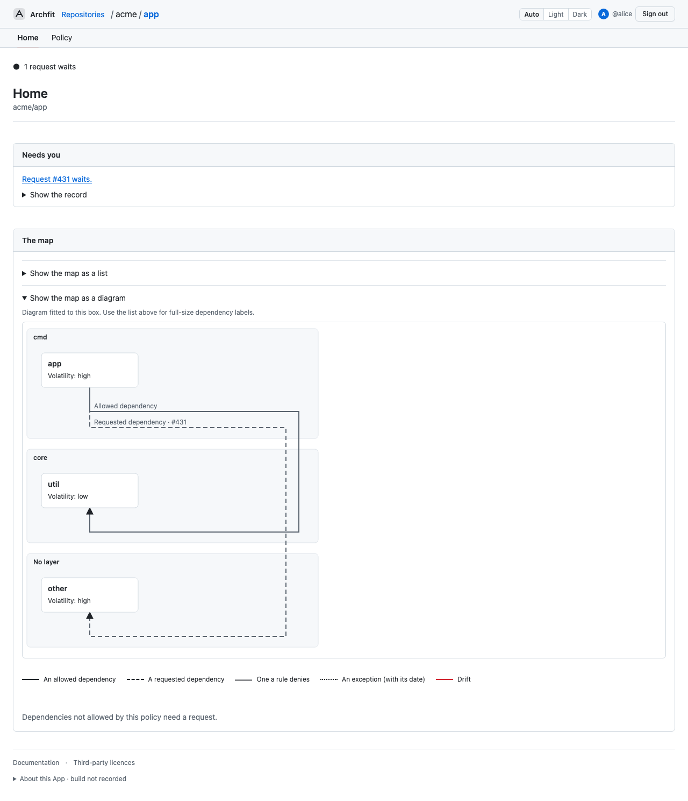
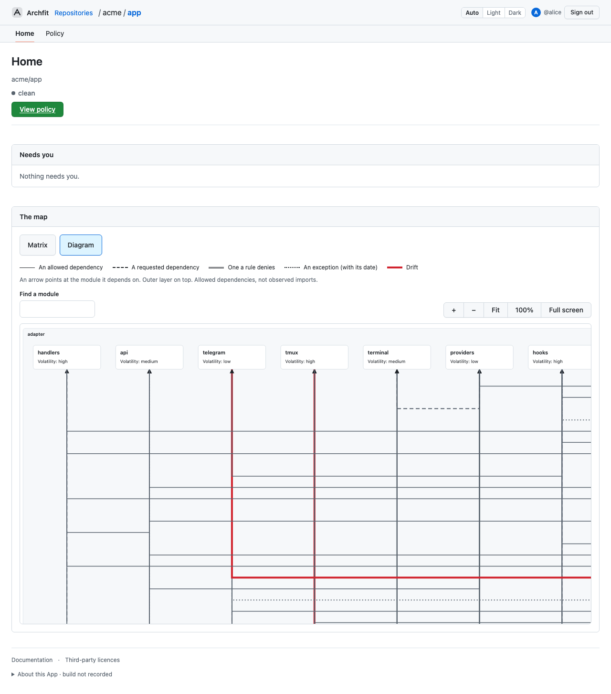
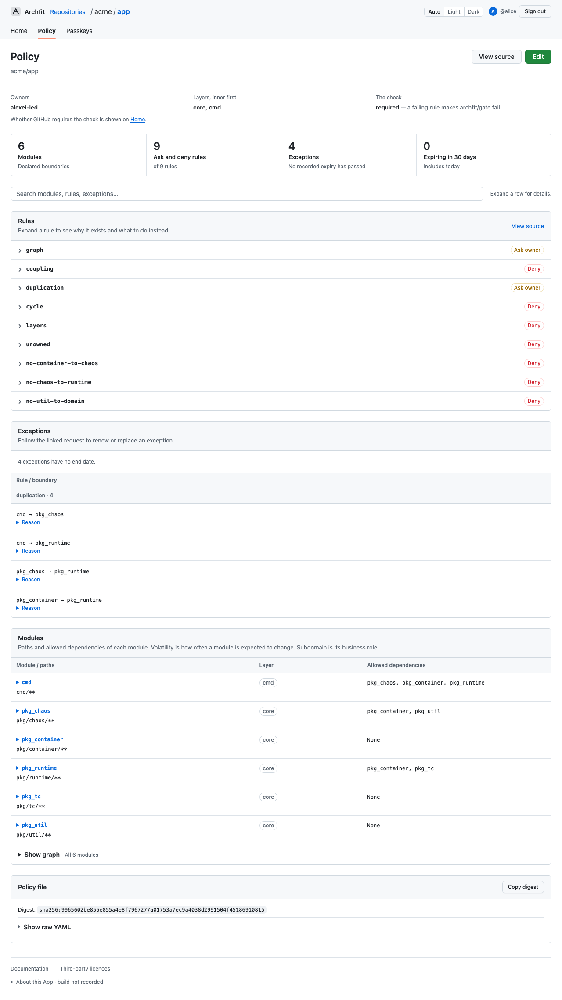
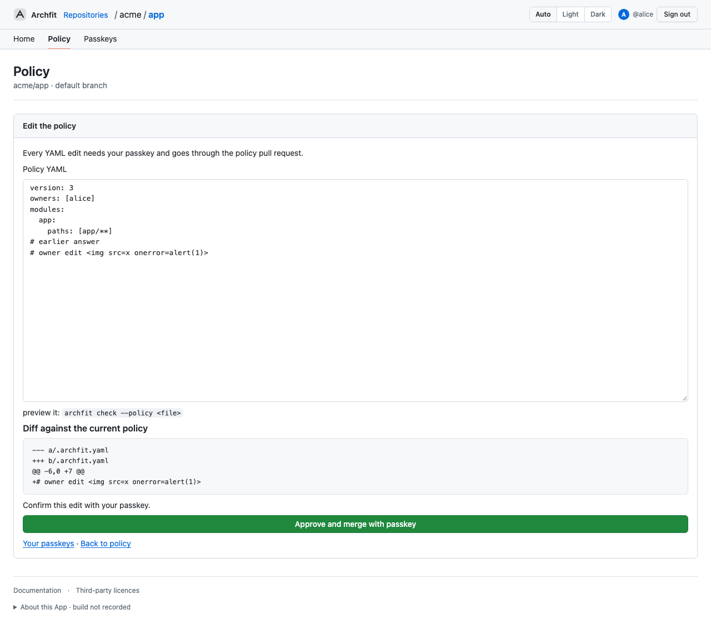
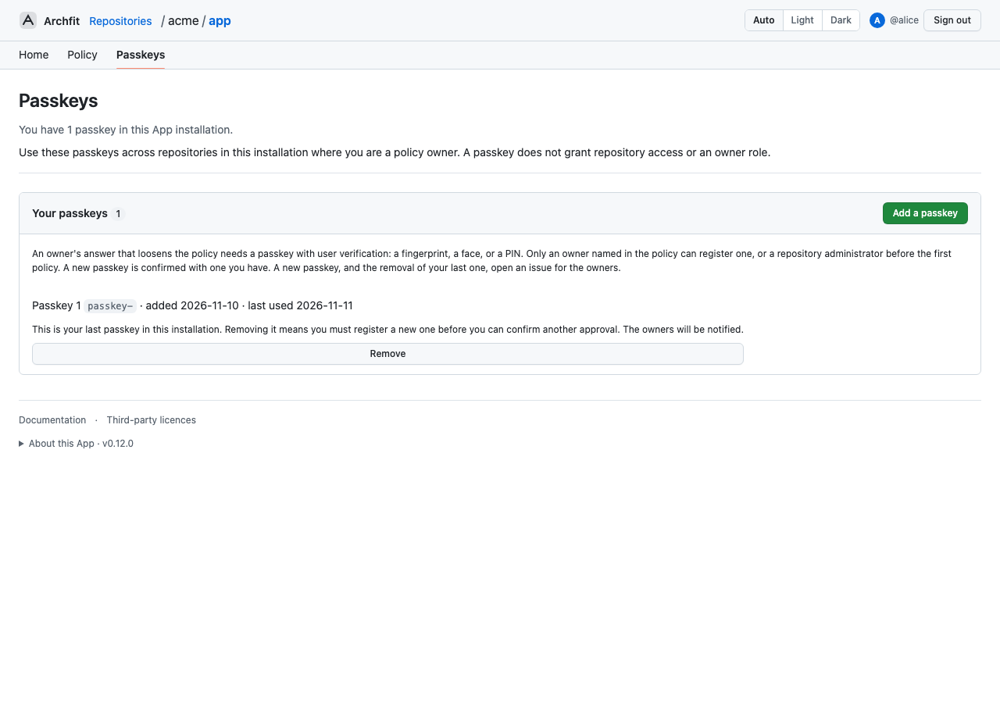
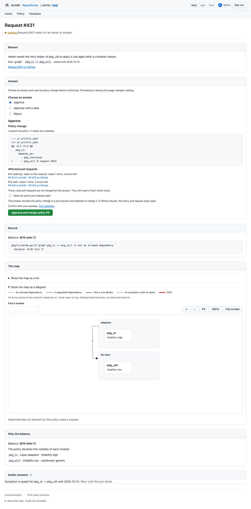
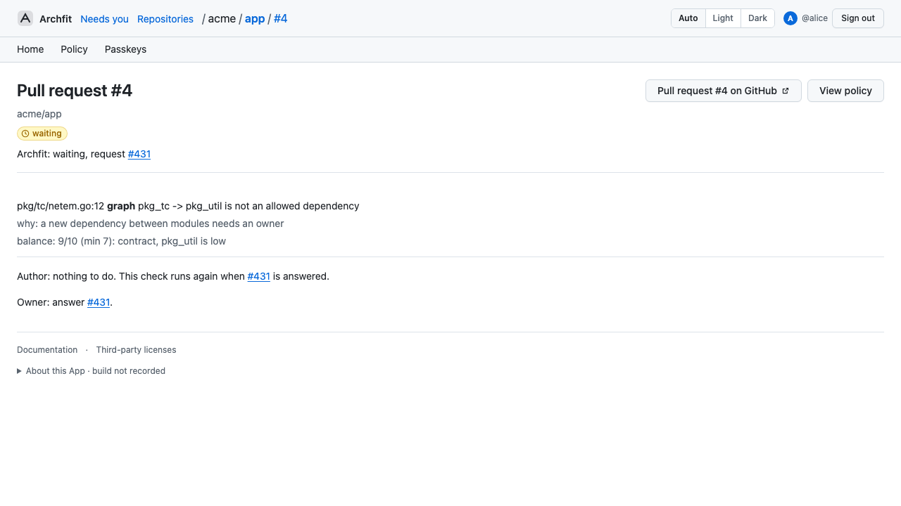

# User guide

This guide is for repository administrators and policy owners using Archfit 4. The App checks changes against `.archfit.yaml` on the protected default branch. It records owner answers and carries policy changes in a pull request. See [architecture](architecture.md) for the trust boundary and failure handling.

The checked-in [release manifest](../internal/wire/manifest/manifest4.json) approves engine v4.0.0 and Action v4.0.0 by their exact identities.

## Install and set up

1. Install the GitHub App for the repository. An account not on the operator's approved list waits for operator admission.
2. Put a schema 3 `.archfit.yaml` and `.github/workflows/archfit.yaml` in the repository. Read them before the first approval. The App does not generate these files.
3. Sign in to the App and register a passkey as a repository administrator. See [Register a passkey](#register-a-passkey).
4. A repository administrator named as an owner in the proposed policy must approve the first policy with a passkey. The owner action supports a same-repository open pull request when the default branch has no schema 3 policy, or the current default-branch policy otherwise. Follow **Review and approve** from Home when you have a passkey, or **Review proposed files** without one. The pull page uses **Review first policy**. The App resolves the correct destination for eligible viewers; other viewers see which role can act.
5. Configure the branch ruleset below and verify the workflow and engine are approved in the App's release manifest.

After an owner approves the onboarding pull request, the App sets `archfit/gate` to success on that exact head, bound to the approved policy and workflow digests. This is the owner's approval, not an engine pass; run diagnostics remain visible in the pull request comment. Merge the pull request to activate change control. You can require `archfit/gate` before or after activation. A new head needs a new approval.

The App's setup API reads the policy and workflow at one default-branch commit and reports admission, first approval and ruleset advice. It does not change GitHub rulesets. Home keeps setup visible until the applicable required-check settings are confirmed, even after owner approval. A proposed policy or workflow is labelled as present in its PR, not yet on the default branch. Unavailable ruleset features do not block setup progress; unknown settings still need an administrator to check them. Setup progress is not an enforcement verdict.

**Owner approval** distinguishes a signed PR from active default-branch files. **Approved for PR #N.
Waiting for merge.** means the current head and both file digests match the recorded signature; no
second approval is offered. After a known merge, **Approval recorded; checking activation** remains
until push processing confirms activation. A changed head needs a new review. **Could not confirm
approval** is not success. A first approval of an existing default-branch policy can take effect without
a PR merge. **Require the gate** remains actionable independently of these approval stages.

**Require the gate** is **On** when the App confirms both required pull requests and the `archfit/gate` check on the default branch. Missing enforcement facts keep the step incomplete; unreadable rulesets show **Check with an admin**. Bypass settings, policy-push restrictions, and GitHub approval-count advice do not hold this step back. **Verify yourself** marks advice the App could not verify, not a successful check. The App deliberately lacks Administration permission: inspect each default-branch ruleset's **Bypass list** yourself and keep it empty or administrators-only for emergencies. Each row links to the relevant GitHub settings and names the values to set. **Does not apply** means no action is needed for that feature. After saving GitHub changes, select **Check** to reload setup; it does not change GitHub settings.

With no passkey, **Register a passkey to approve** does not prevent reading the review. An unreadable
passkey inventory is shown separately from an empty inventory. **Manage passkeys** is a secondary link.

The setup heading shows one **Next** action. Amber chips need action, neutral chips indicate waiting or an unavailable feature, and green chips mark completed steps. **Policy and workflow pull request** is complete when an existing setup PR is **Ready for review**. It is also complete when both files are already present on the default branch. This step does not mean that the PR is approved or merged. **View PR #N on GitHub** opens an existing workflow PR. The separate PR link opens its App page. When no setup PR exists and files are missing, **Create a pull request on GitHub** opens the compare page. An administrator must enable the required check in the repository settings: the App cannot change rulesets without Administration permission.

For a workflow change, an owner named in the approved policy can follow the review action from Home or **Review workflow change** from the pull page. Being a repository administrator alone does not qualify. You can read either review before registering a passkey; the final approval still requires one.

## Repositories

Open `/` after signing in to choose a repository or continue setup. The **Repositories** link in the header always returns here. `/repos` is not an alias; it shows **Page not available** with a link back to `/`.

## Home and the map

Open `/r/<owner>/<repo>` for **Home**. The title is the repository. Under it, one status shows the repository
state (`clean`, `drift`, `expired`, `changed outside the flow`, `not set up` or `unknown`) and one sentence that
says what it means. Next to the title sit at most two buttons. The primary button is the oldest item that waits
for you, such as **Review workflow change**, or else the action of the setup step you are on, such as
**Create a pull request on GitHub** or **Open ruleset settings**. With nothing to do there is no primary
button. **View policy** appears only when the default branch has a policy. A button that leaves for GitHub
shows an external-link icon.

**Needs you** comes directly after the head and appears only when something waits. It lists open requests,
exceptions near their date, drift and owner actions, one row each with an icon for its kind. Each item opens its
page, or its GitHub issue. A request's record folds away. Setup comes after **Needs you**. Before the first
policy is approved, Home shows the setup steps, what is missing and the ruleset advice instead of the map.
The review link opens a read-only page; the note under the status says that approval needs your passkey.
Owner actions open the pages below.



**The map** starts with **Matrix**, including on phones. **Diagram** is the second view; the browser remembers
your explicit choice when local storage is available. Matrix needs no diagram layout worker.

The matrix shows **Policy and review status**, not observed imports. Rows are sources and columns are targets:
**row depends on column**. Both axes use the same order: policy layer order (outer first), then module name.

| Symbol | Meaning                                                                     |
| ------ | --------------------------------------------------------------------------- |
| ✓      | Explicit allow in the policy.                                               |
| ×      | Explicit deny reported for a touched, requested or drift pair.              |
| ?      | A request.                                                                  |
| !      | Drift.                                                                      |
| ◷      | An exception; select the cell for its expiry and server-reported days left. |

From 12 modules the matrix is compact: 32 px cells, vertical column names and a 220 px row header, so 24 modules fit
a laptop page without horizontal scrolling. Names break only after `_` and `-`; hover a name for the full text.
A cell shows its strongest status (drift, deny, request, allow) and, when it has several statuses, how many. An
exception that ends within seven days (or has ended) is ringed and ranks just below deny; a later exception is grey
and does not change the symbol. An exception with no date is never read as a pass: it shows ◷ in the usual colour. Every status remains in the cell's accessible name and in its details, including
multiple rules, requests and exceptions. A blank means
**no explicit relationship in this payload**, not “no imports” or “permitted”. Deny status is not fully evaluated
for all pairs. Select a cell for all rules, request links, exception dates and evidence scope. Tab enters the
table; arrow keys move between cells (the shaded diagonal is skipped), Enter opens details, and Escape closes details
and returns focus. A repository with one module shows "One module is declared, so there is nothing to draw."

Headers stay visible while the table scrolls in either direction. At 50 or more modules, search names or layers,
focus on explicit inbound/outbound neighbors, collapse layers, or use **Needs attention** to show modules
with denies, requests, drift or exceptions. Filters use the same modules on both axes; **Reset filters** restores all.

**Diagram** loads the SVG and its layout worker only when selected, including on phones. It shows declared
volatility. Its line precedence is drift, deny, request, exception, allow: unlike Matrix, it draws only one
status per pair. Use Matrix for complete pair details, including when the diagram cannot load.



The diagram sits in a box of fixed height, so the page does not grow with it. It opens with module names at
least 11 px high. Layers with many modules wrap into rows, so a large repository still fits about one page wide.

Until you pick a module, the diagram draws one line for each pair of layers, in the margin on the left, with
the number of dependencies it stands for. The line takes the strongest kind among them (drift first). Picking a
module draws its own lines.

- **Move:** drag, or use the arrow keys on the focused diagram.
- **Zoom:** Ctrl or Cmd with the mouse wheel, pinch, double-click, the **+** and **−** buttons, or the **+** and
  **-** keys. A plain wheel keeps scrolling the page.
- **Fit** and **100%** reset the zoom; **0** fits from the keyboard. **Full screen** fills the screen where the
  browser allows it.
- **Focus a module:** click it, or Tab to it. Its own lines appear, the rest dim, and each line is named by
  both ends, for example `handlers → api · exception until 2027-01-15`. Click it again or press Esc to clear.
- **Find a module:** type or pick a name; the diagram moves to it and focuses it.

An arrow points at the module it depends on. The outer layer is on top. The lines are allowed dependencies,
not observed imports.

On request pages, the map has **Show the map as a list** and **Show the map as a diagram** disclosures.
The diagram is closed at every width, so no layout worker loads until you open it. Below 720px the list opens
first. The list remains available if the layout worker fails.

Use **Skip to main content** (the first keyboard link) to bypass the header. Theme and action controls have
larger hit areas on narrow screens and touch devices. Request fields use the selected light or dark theme.

## Policy

The repository tabs are **Home**, **Policy** and **Passkeys**. Policy starts with owners, layers in inner-first order, **The check**,
and counts. **The check** is the `gate` key: `advisory` means rules are reported and `archfit/gate` does not fail; `required`
means a failing rule makes `archfit/gate` fail. Whether GitHub requires the check is shown on Home.
**Ask and deny rules** counts the rules set to `ask` or `deny`, not off settings or notes.

A repository with no `.archfit.yaml` on its default branch shows **No policy on the default branch yet.** with
**Continue setup**, which opens Home. A repository you cannot see shows **Page not available**.

Search filters rules, exceptions, and modules without changing the totals. Each rule is named by its id, as on the
pull request and request pages. Expand a rule for its scope, **Why**, and **Instead**. A note is **Not checked**: it
tells the reader what to do.

Exceptions are grouped by rule, largest group first, with a count for each (for example **coupling · 62**). The first
20 rows show, then **Show all**. A column appears only when a shown row has its fact: **Expiry** when an end date
exists, **Request** when a request link exists. Exceptions without an end date say so once above the table. Exceptions
show server-supplied days remaining, including today in the next 30 days. Bars appear only when a shown row has an end
date and show the remaining days capped at 30, not exception age.
Request links appear only when the response supplies a safe destination.

The module table follows the rules and exceptions. Expand a module for public paths, volatility, and subdomain.
**Show graph** is closed by default at every width. It draws allowed dependencies, not measured imports, and keeps the
whole policy visible during search. Select a node to clear search and open that module's details. Large maps scroll
vertically; dependency targets missing from the module list are reported, not invented.

**View source** opens **Show raw YAML**. **Copy digest** copies the complete digest; clipboard refusal leaves the value
selectable. **Edit** appears only when change control is available. The existing edit and passkey flow is unchanged.

Additional examples: [phone](images/policy-mobile.png), [dark phone](images/policy-mobile-dark.png),
[expanded graph](images/policy-graph.png), [phone graph](images/policy-graph-mobile.png), and [expiry states](images/policy-expiry.png).



### Edit the policy YAML



Open **Edit** to start from the open policy proposal's file, or from the default branch when no proposal is open.
The editor accepts a whole file up to 32 KiB. **Preview the edit** lists every decoder error by line and shows
the App's text diff against the current default-branch policy. Check path globs locally before approval:
`archfit check --policy <file>`.

Text diffs show separate hunks with old/new line ranges and three unchanged lines of context.
`-` means removed, `+` means added, and a leading space means unchanged. Line-ending annotations
identify LF/CRLF changes and a missing final newline. Tabs, backslashes and non-printing characters
use visible escapes; file content is text, not HTML. Very large replacements can show the whole
changed block instead of a minimal diff; no changed bytes are omitted.

If an earlier branch write was not recorded, **Reload the policy** restores only the recorded proposal under the App's proposal lock.
It does not approve or merge new bytes. Preview and confirm the edit again after reload.

Every edit needs your passkey, even one that tightens the policy. **Approve and merge with passkey** appends it
as the last change in the App's `archfit/policy` pull request. Its comment names the owner and the passkey.
The merge push consumes the approval once.

If the starting file changed, the App says **the policy changed; reload**. Reload and read the preview again.
Any default-branch tip movement before the merge, including a code-only push, voids the edit's approval.
The App does not replay its YAML on the new tip; edit and confirm again. This is the fail-closed reading of D9,
not a comparison of whether the new policy loosens or tightens a rule.

## Configure the ruleset

On the default branch, require pull requests and the `archfit/gate` check from this App's integration. Set required GitHub approvals to **0**. Do not make the App a bypass actor on the branch ruleset: bypass would also bypass the required check. Keep an administrator bypass covering each applicable branch ruleset as an emergency path. The App cannot always read bypass actors; an unknown result is not confirmation. Ask an administrator to check them.

For an organization-owned private or internal repository, a supported push ruleset can restrict `.archfit.yaml`. The App needs an **always** bypass on that separate push ruleset to write approved policy proposals. This does not grant it a branch-ruleset bypass. The setup API reports the rules it can read; it does not apply them.

## Merge queue

The App accepts a `merge_group` upload and binds it to GitHub queue authority. Require `archfit/gate` on the default branch ruleset for the queue as well. The workflow must run for merge-group events.

## Owner actions

Each page is titled with its action, such as **Approve the first policy**, and names the repository and the pull request
when there is one. It then shows the status, as `unknown — <why>`, and the files. The GitHub pull request and
**View policy** links are secondary navigation. The button after the files (**Approve with passkey**, **Confirm with
passkey** or **Revert with passkey**) is the only strong action and asks for your passkey before it submits. GitHub
issue links and direct loads use the same pages.

A policy changed outside the flow is one the default branch received without an owner's approval. **Confirm the
policy** keeps that change and makes it the approved policy. **Revert the policy** restores the approved policy. Each
page links to the other.

For a workflow change, **unknown** means no verdict until the change is approved: the App cannot use the
changed workflow's result without your approval. The workflow diff compares with the named default-branch
commit; the policy diff compares with the named pull-request base commit. Added and removed lines have
`+` and `-` signs and green and red backgrounds, with a legend. An unchanged policy appears as a compact
row, but its bytes are still included in the approval. Unchanged from the pull-request base does not mean
previously approved. The confirmation names both files, the pull request number and its head commit.

**Full files and approval details** opens the complete file versions, grouped by file and labelled by version
and commit. Use these to inspect unchanged lines or compare another copy. Each version's **Technical details**
contains its SHA-256 fingerprint, which identifies its bytes; you do not need to compare fingerprints to approve.

**Why a passkey?** explains that GitHub sign-in identifies your account, which an agent can also use.
Your passkey adds a separate confirmation for these file versions. Read both files before confirming a workflow
change. Approval does not mean the check passed. If a passkey is unavailable, use a second registered passkey;
GitHub sign-in alone cannot replace this confirmation.

| Action                                                 | Path after `/r/<owner>/<repo>`  |
| ------------------------------------------------------ | ------------------------------- |
| Approve the first policy on the default branch         | `/owner/first`                  |
| Approve the first policy in an onboarding pull request | `/owner/first?pull=<number>`    |
| Approve a workflow change                              | `/owner/workflow?pull=<number>` |
| Confirm a policy changed outside the flow              | `/owner/confirm`                |
| Revert a policy changed outside the flow               | `/owner/revert`                 |

The first approval has no previously approved policy: every policy line is shown as an addition.
Only a repository administrator named in that policy can make it. Other actions require an owner
of the previously approved policy, not an owner added by an outside-flow change.
A revert shows the exact policy it will write, including earlier approved answers kept from the open
policy pull request. It also shows those answers relative to the approved policy and names that pull request.
An approval does not mean the check passed. For first-policy and workflow pull-request approvals, the outcome
says whether a new run was requested, is pending, or could not be started. First approval on the default
branch and confirm do not report each re-run outcome.

**Known limits:** Submit re-reads the displayed files, refs and open proposal answers before the passkey is
consumed. A difference refuses the action and asks you to reload. GitHub and the Store do not provide one
atomic snapshot: a ref can still move after the last read. Proposal consumption re-checks its files and
digest, and outside-flow reconciliation surfaces a later default-branch policy change. The passkey binds
the displayed view; it does not remove this residual window or prove that the owner read the files. A file
that is not valid UTF-8 cannot be displayed or acted on from these pages; use the existing M2 owner-action
API flow referenced by the GitHub issue instead.

### Unavailable policy or owner action

If the policy cannot be read, **View current setup** leads back to Home. The Policy page does not infer
whether an invalid policy is still being prepared in a first-policy pull request. An unavailable
editor leaves the policy read-only and shows the server's reason. It does not ask you to fix YAML
just because setup has not finished.

An old owner-action link keeps its title and says why there is nothing to do, in one notice with one button. For
example: **The first policy is already approved.**, **Nothing to confirm: the policy has not changed outside the
flow.**, **Nothing to revert: the policy has not changed outside the flow.** or **Nothing to approve: pull request
#213 is merged.** A merged pull request is a normal state, not an error. **Open the repository** (or **Open pull
request #213**) is the next step; do not reload the action. A changed artifact still prevents submission; **Reload
the change** fetches the new contents before you confirm anything. Policy and Owner read/service failures offer **Try
again**; not-found and stale-action states do not.

**Page not available** uses the same message for a missing resource and one your account cannot access.
Its **Repositories** link returns to `/`; no repository-specific recovery link is shown.

## Register a passkey



Open `/r/<owner>/<repo>/passkeys` after signing in. Passkeys belong to your account in this App installation, not just the repository used to register them. They do not grant access or an owner role in other repositories. A policy owner can register a passkey; before the first policy, a repository administrator can register one. Follow the browser's registration prompt. Registration opens a GitHub issue notifying the user and owners. A second passkey and each removal require an existing passkey. The App uses user verification for the assertion; it does not prove that the owner read the request.

Removing your last passkey requires a confirmation with an existing passkey and notifies the owners. The warning beside **Remove** explains that you must register a new key before confirming another approval.

The Owner and Policy editor links preserve their return path. After successful registration, the App returns to that page, where you must still read and confirm the action. The passkey page also accepts `?return=` with an encoded same-repository request, owner action, or policy-editor path. Other destinations are ignored; failed registration never redirects.

## Installation administration

Operators use `/admin` to admit or revoke installations, separately from policy approval. **Managed by configuration** means the row cannot be approved or revoked here; an operator must change the App settings by pull request. Revocation help appears only when at least one row can be revoked. Revocation still asks for confirmation and stops checks from the account's next event; existing GitHub checks remain.

Repository names become App links only when the signed-in user's repository list grants access. Installation visibility alone does not grant repository access. An empty or unreadable access list leaves names as text.

## Answer a request



A worker can comment `/archfit request <reason>` on a pull request, or file a request through the CLI. The App creates or joins request issues. CLI-filed measurements are marked **as reported**, not verified.

1. Open `/r/<owner>/<repo>/requests/<number>`. Read the reason and follow the request issue link for its discussion. The record, map, declared volatility and earlier answers remain below the decision panel. Numbers without a confirming pull request remain **as reported**.
2. Choose **Approve**, **Approve until a date**, or **Reject**. Approval previews load on opening the page. For a dated approval or rejection, enter the expiry date or what to do instead, then select **Preview**. An expiry date must be in the future and at most 365 days away.
3. Review the selected answer's diff, exception date and affected pull requests beside its confirmation button. Each affected PR links to Archfit and GitHub. Editing an input removes its old preview and confirmation until you preview again. Previewing, changing your selection and leaving the page do not submit an answer.
4. If the answer changes policy, choose whether to **Keep the policy pull request open**. This applies to rejection rules too. The confirmation label states whether the App will attempt to merge or keep the policy PR open. Answers with no policy change have no merge control.
5. Confirm the selected answer. Approvals require your passkey; rejection does not. Check the result: if GitHub refuses a merge, the policy PR stays open. A change kept open takes effect only when that PR merges. The affected code PRs are not merged by answering, and a cleared error is not a passing check.

An answered request shows its recorded answer and links to the GitHub issue that names the owner and passkey. Older records without an approval pointer show the issue link only, with no answer buttons.

Only an owner named in the current policy can answer. The requester may answer if also an owner. Several answers can join one policy pull request. After consumption, the App attempts to re-check affected pull requests; a fresh result is needed before they can pass.

## Pull request and comment

Open `/r/<owner>/<repo>/pull/<number>` to see the check result. The page and the GitHub comment use the same status,
records, and instructions for the author and owner. A result can be **pass**, **fail**, **waiting**, or **unknown**.
Unknown is not a pass. A request number links to the request page.



For example, the comment for this fixture says:

```markdown
## Archfit: waiting, request #431

`pkg/tc/netem.go:12` **graph** pkg_tc -> pkg_util is not an allowed dependency

- why: a new dependency between modules needs an owner
- balance: 9/10 (min 7)

**Author:** nothing to do. This check runs again when #431 is answered.
**Owner:** answer #431.
```

## Expiry and drift

An exception is valid through its expiry date, in UTC. From seven days before expiry the App maintains an `archfit-expiry` issue for the exception. Fix the code or ask an owner to extend the exception. After expiry an old pull-request result is withdrawn and the App attempts a fresh check; if it cannot re-run, it can publish an expired-exception failure.

An accepted default-branch result that reports drift opens or updates an `archfit-drift` issue for owners. Fix the reported drift and run the workflow again. The App closes the issue only when the accepted result reports no drift and no unread places. Missing or unread evidence is not a clean result.

## Troubleshooting

| Situation                                  | Action                                                                                                           |
| ------------------------------------------ | ---------------------------------------------------------------------------------------------------------------- |
| The check is `unknown`                     | Read its reason and restore the named authority or input. Unknown is not a pass.                                 |
| A policy changed outside the approval flow | An owner must confirm or revert it with a passkey. Read the issue and the policy before acting.                  |
| A workflow changed                         | An owner must approve the workflow change with a passkey unless only the Action ref moved to an approved commit. |
| A request shows **as reported**            | Treat its measurements as a claim. Read the source and a current pull-request result.                            |
| The App cannot confirm a ruleset or bypass | Ask a repository administrator to inspect the ruleset in GitHub.                                                 |
| A passkey prompt fails or the policy moved | Start the action again and read the new preview. A passkey confirmation is bound to one action and expires.      |

For operators, see [configuration](architecture.md#configuration) and [cloud operations](design/cloud/operations.md).
