# User guide

This guide explains the App flows for repository admins, policy owners, developers, and operators.
Read [Architecture](architecture.md) for the service boundary, routes, and package structure.

> **Status.** The App is not deployed and no GitHub App is registered.
> This guide describes behavior in this repository.
> Managed discovery is not available because no sandbox driver exists.

## What the App does

The Archfit engine runs in customer CI. It sends a report with no source code to the App.
The App verifies the report against the approved policy and publishes feedback on the pull request.

## Who the App serves

Anyone can install the App, but it runs only for accounts that an operator approved. Archfit is an experiment on a
budget, so installations are approved by hand.

- **Approved accounts** get everything in this guide.
- **An account waiting for approval** gets nothing: no check, no comment, no pull request. An upload from its
  workflow answers `403 installation_not_approved`. Every repository page shows the **Waiting** page: what Archfit
  does, and "Your installation on `<account>` is waiting for approval". There is nothing to do. The page changes once
  the account is approved.
- **A revoked account** is the same as one never approved, from its next event on. Checks already on GitHub stay.

The approval is per account (the user or organization that installed the App), never per repository. A repository
you add to an approved installation is served at once. The trial of an account with private repositories starts at
its approval, not at its install.

## GitHub App permissions

GitHub shows this list when you install the App. Each permission is here for one job.

### Repository permissions

| Permission    | Access       | What the App does with it                                                                                                   | Without it                                                                                       |
| ------------- | ------------ | --------------------------------------------------------------------------------------------------------------------------- | ------------------------------------------------------------------------------------------------ |
| Checks        | Read & write | Posts `archfit/state` and `archfit/gate` on every pull request and default-branch push.                                     | No result on the pull request, and no gate.                                                      |
| Pull requests | Read & write | Opens its own pull requests (onboarding, policy, baseline). Keeps one comment per pull request. Reads reviews for owner approval. | No setup pull requests, no comment, and no way to see an owner's approval.                       |
| Contents      | Read & write | Reads the policy and settings from the protected branch. Writes only branches named `archfit/…`, for its own pull requests. | The App cannot read the approved policy or propose a change.                                     |
| Actions       | Read & write | Reads the Archfit run and its report artifact. Re-runs the Archfit run when its inputs change. Starts discovery and AI assist runs. | After an owner approves, the gate stays red until someone re-runs the job by hand. No discovery button, no AI assist. |
| Metadata      | Read         | GitHub adds it to every App: repository name, default branch.                                                               | Not optional.                                                                                    |

### Organization permissions

| Permission | Access | What the App does with it                                                | Without it                                    |
| ---------- | ------ | ------------------------------------------------------------------------ | --------------------------------------------- |
| Members    | Read   | Checks that an approver is in an owner team, such as `acme/architects`.  | Owners could only be single logins.           |

### What the App never asks for

- **Workflows.** This permission lets an App change any file in `.github/workflows/`, so it could change your CI and
  reach its secrets. The App does not ask for it. You add the Archfit workflow file yourself, once, during onboarding.
- **Administration, Secrets, Environments, Deployments.** The App does not change repository settings, read secrets,
  or deploy.

### Limits you should know

- **Contents write covers the whole repository.** GitHub cannot limit it to `archfit/…` branches. The App writes only
  those branches and never merges. Protect the default branch with a ruleset so that a pull request and a review are
  needed for every change, including one from the App.
- **Actions write lets the App start any workflow that has `workflow_dispatch`.** The App starts only the Archfit
  workflow and the AI assist workflow. A workflow that deploys should need an approval in a GitHub environment.
- **Tokens are short-lived.** Each App token lasts at most one hour and is limited to the repositories you chose at
  install.

## Terms

| Term          | Meaning                                                                |
| ------------- | ---------------------------------------------------------------------- |
| Policy        | `.archfit.yaml`, the engine policy and its waivers                     |
| Settings file | `.archfit-app.yaml`, the App file with owners, gate mode, and workflow |
| Policy owner  | A GitHub login or team listed in `owners`                              |
| Protected ref | The pull request base branch, or the default branch for a push         |
| Gate          | The `archfit/gate` check that can block a merge                        |
| Waiver        | A policy entry that accepts one finding until a date                   |

## Roles

The App reads repository permission from GitHub and caches the answer briefly.

| GitHub permission | Actions                                                             |
| ----------------- | ------------------------------------------------------------------- |
| `read`            | Read the status, policy, and graph                                  |
| `write`           | Save a policy draft, ask for an AI proposal, and mark a draft ready |
| `admin`           | Start onboarding, run discovery, and allow or revoke data sharing   |

A policy owner is separate from GitHub permission. The settings file lists each policy owner.
An owner can be a login such as `alice` or a team such as `acme/architects`.

## Onboard a repository

Use customer mode when source code must stay in customer CI. Use managed mode only after the App has a sandbox driver.

### Customer mode

Customer onboarding uses one pull request for setup and one pull request for the policy. You add one file to the
setup pull request yourself: the workflow. The App cannot write it (see
[GitHub App permissions](#github-app-permissions)).

```mermaid
flowchart LR
    INSTALL["Install the GitHub App"] --> START["Open the App and<br/>start onboarding"]
    START --> PR1["PR 1<br/>settings, CODEOWNERS"]
    PR1 -->|"you add the workflow"| PR1W["PR 1<br/>+ workflow"]
    PR1W -->|"merge"| DISCOVER["Run discovery<br/>in customer CI"]
    DISCOVER --> PR2["PR 2<br/>proposed policy"]
    PR2 -->|"merge"| ADVISORY["Advisory feedback<br/>is active"]
    ADVISORY -->|"owner-approved PR"| REQUIRED["Required gate<br/>is active"]

    classDef core fill:#2f855a,stroke:#22543d,color:#ffffff
    classDef control fill:#e8eef7,stroke:#4a6fa5,color:#1a202c
    classDef nottrusted fill:#fff4d6,stroke:#b7791f,color:#1a202c
    classDef neutral fill:#edf2f7,stroke:#718096,color:#1a202c

    class ADVISORY,REQUIRED core
    class START,DISCOVER control
    class PR1,PR1W,PR2 nottrusted
    class INSTALL neutral
```



Arrows show the order of the customer onboarding flow. A labeled arrow shows what you do before the next step.

1. Install the Archfit GitHub App on the repository.
2. Open the App URL.
3. Select **Sign in with GitHub**.
4. Select the repository on the **Repositories** page.
5. Enter one policy owner on each line under **Needs you**. The page starts customer mode: source code never leaves
   your CI.
6. Select **Open the onboarding pull request**.
7. Under **Add the Archfit workflow**, select **Add the file on GitHub**. GitHub opens a new file with the path and
   the content filled in, on the `archfit/onboarding` branch.
8. On GitHub, select **Commit changes** and keep **Commit directly to the `archfit/onboarding` branch**.
9. Come back and select **Check again**. The step changes to "Review and merge".
10. Review and merge the onboarding pull request on GitHub.
11. Select **Run discovery in your workflow** on the repository page.
12. Wait for the policy pull request.
13. Review and merge the policy pull request.

If GitHub does not fill in the file, select **Copy the file** and paste it into a new file named
`.github/workflows/archfit.yaml` on the `archfit/onboarding` branch. **Show the file** shows the content.

If you merge the onboarding pull request without the workflow, the page asks you to add the file to the default
branch instead. The same button opens GitHub on that branch. If the branch is protected, choose **Create a new
branch** on GitHub and merge that pull request.

A sign-in lasts 8 hours, the lifetime of the GitHub token behind it. When the token has expired or you revoked it on
GitHub, the next page asks you to sign in again and brings you back to the same page.

PR 1 adds these files:

- `.archfit-app.yaml` with the policy owners
- `CODEOWNERS` entries for the protected paths
- `.github/workflows/archfit.yaml`, added by you from the repository page

The workflow uses no repository secret. It uses the job GitHub OIDC token.
It runs on `pull_request`, `push` to the default branch, and `workflow_dispatch`. The Action refuses other events.
Pull request and push runs report the architecture state. A manual dispatch selects `mode`: `discovery` proposes a
policy, and `baseline` captures accepted debt. A dispatch with `mode: report` is refused. See
[Capture a baseline](#capture-a-baseline).
The `mode` input selects the run: `discovery`, `baseline` or `reanchor`. The status page button dispatches `mode: discovery`.
On a pull request, the Action reads `.archfit.yaml`, `.archfit-baseline.json`, and `.archfit-labels.yaml` per file:
from the pull request head when the pull request changes that file, otherwise from the tip of the base branch. The
App accepts a changed file only when an architecture owner approved the exact head commit.
Discovery can also run in an existing customer workflow that uploads from a default-branch push.

The status page derives its stage from GitHub on every read.

| Stage             | UI label              | Next action                              |
| ----------------- | --------------------- | ---------------------------------------- |
| `installed`       | App installed         | Start onboarding, then add the workflow  |
| `workflow_merged` | Workflow merged       | Run discovery                            |
| `report_received` | First report received | Review and merge the policy pull request |
| `policy_merged`   | Policy merged         | Wait for the first default-branch run    |
| `gate_advisory`   | Gate is advisory      | Enable the gate by pull request          |
| `gate_required`   | Gate is required      | None                                     |

### Managed discovery

Managed discovery is not available in this build and is not offered by the onboarding form.
`ARCHFIT_SANDBOX=none` is the only sandbox driver. Customer discovery and optional managed AI assistance remain separate.

When a sandbox driver exists, an administrator must allow **Managed discovery** on the Data sharing page before source
processing. Until then the page offers no **Allow** for it; a consent given earlier can still be revoked.
The App then clones the repository into an ephemeral sandbox, runs discovery, and deletes the sandbox.
The sandbox does not run repository scripts and receives only a short-lived installation token.
Managed onboarding adds the proposed policy to the onboarding pull request.

## Settings file

The settings file lives on the default branch beside the policy.

```yaml
version: 1
owners:
  - alice
  - acme/architects
gate: advisory
workflow: .github/workflows/archfit.yaml
data_mode: customer
```

| Key         | Values                            | Meaning                                           |
| ----------- | --------------------------------- | ------------------------------------------------- |
| `version`   | `1`                               | Settings file format version                      |
| `owners`    | One or more logins or teams       | Policy owners                                     |
| `gate`      | `advisory`, `required`            | `required` publishes the blocking check           |
| `workflow`  | A path under `.github/workflows/` | The workflow that can upload reports              |
| `data_mode` | `customer`, `managed`             | `customer` keeps source processing in customer CI |

Absent `gate` and `data_mode` keys use `advisory` and `customer`.

## Read the feedback

The App publishes these items on a pull request:

- `archfit/state`, an advisory check for each accepted report upload
- `archfit/gate`, the blocking check when `gate: required`
- One App comment that the App updates after each run

When the policy, baseline or labels change on the base branch, open pull requests show `stale_inputs` and their
workflow runs again, in advisory mode too. An old result never stays without that mark.

What each item shows:

- When architecture findings block (reason `blocking_findings`), the `archfit/gate` summary names each blocking
  finding: the rule, the module pair, the first location, the first eight characters of the finding ID, and the
  repair goal. It shows at most 20 and counts the rest.
- The `archfit/state` check annotates live findings on the files that the pull request changed. Accepted debt and
  fixed findings get no annotation. Blocking findings come first. The check shows at most 150 annotations. A new
  report or run attempt gets a new `archfit/state` check run with its own annotations, so annotations from an
  earlier report do not stay; GitHub shows the newest run. If the App cannot read the list of changed files, the
  check has no annotations for that upload.
- The comment starts with the verdict as a heading. With a base comparison, one plain sentence follows: what this pull
  request changed (for example "adds 2 dependencies that close a dependency cycle among `a`, `b` and `c`"). A
  dependency cycle is then one picture: a diagram of the modules with the location count of each direction, and one
  line that says what the colours mean. With a base comparison, a direction this pull request added is red and
  `added` in the table, and one that existed before is grey and `existing`; the App knows this from other findings on
  the same pair of modules, and leaves a direction unmarked when the report does not say. The table lists each
  direction with where it occurs. A column that is the same on every row (integration strength, distance,
  volatility) is written once under the table. **Why** says why the directions form a cycle, and **Fix** is the
  engine's own repair. **Next** is a command you can run in your checkout, for example
  `archfit check --base origin/<base branch>`. An advisory on a dependency that a violation already lists is shown on that
  row ("Also reported as"), not as a second item. The other advisories (each with a suggested move in the words of
  Balanced Coupling: introduce a contract, move the functionality, accept, declare the volatility), known issues that
  were accepted earlier, and fixed issues are each folded into a table; an explanation that repeats across findings is shown once.
  A tripped metric ratchet reads "metric `name`: before → after (threshold)". The folded evidence starts with a
  Decision section: the engine's verdict, its hard gates and active blockers, and the reason codes with their
  details; an advisory repository still shows a blocked verdict there. The evidence gaps, the dimensions (with the
  tight cross-module seams at high volatility the drift dimension counts as new and resolved since the baseline), the validation commands as the Archfit
  workflow ran them, and a JSON block of agent tasks between `<!-- archfit:agent-tasks -->` markers are folded too.
  A coding agent on the pull request can act on that block.
- The evidence gaps show analyzers that did not run (absent or disabled) on one line.

The gate has three conclusions:

| Conclusion        | Meaning                                            | Action                 |
| ----------------- | -------------------------------------------------- | ---------------------- |
| `success`         | Trusted evidence has no blocking finding           | No action              |
| `failure`         | Trusted evidence has a blocking finding            | Fix the change         |
| `action_required` | Evidence, governance, or subscription needs action | Follow the reason code |

The gate never uses `neutral` or `skipped`. A missing report never becomes `success`.

The state check is never a required check. It uses these conclusions:

| State check       | When                                                                                       |
| ----------------- | ------------------------------------------------------------------------------------------ |
| `success`         | The gate result is `success` and the engine verdict is `healthy`                           |
| `neutral`         | The gate result is `success` with `attention_only`, or `failure`                           |
| `action_required` | The gate result is `action_required`. Errors and unverifiable evidence are never `neutral` |

### Reason codes

The first reason controls the conclusion. The App keeps later reasons in the comment.

#### Architecture

| Reason              | Recovery                                                                                                 |
| ------------------- | -------------------------------------------------------------------------------------------------------- |
| `healthy`           | Nothing                                                                                                  |
| `attention_only`    | Nothing blocks. Advisories never block. Review the listed dimensions and diagnostics on the state check. |
| `blocking_findings` | Fix the rule violations, then run archfit check again.                                                    |

`attention_only` is a `success`. The engine verdict is `needs_attention`, and no evidence, governance, or subscription
reason applies. The detail lists the dimensions that are not fully measured and the count of active diagnostics.

#### Governance

| Reason                   | Recovery                                                                                                               |
| ------------------------ | ---------------------------------------------------------------------------------------------------------------------- |
| `owner_approval_missing` | Get a policy owner to approve the exact commit, or push it from a policy owner account.                                |
| `settings_missing`       | Merge the onboarding pull request to add `.archfit-app.yaml`.                                                          |
| `policy_missing`         | Merge the Archfit policy pull request.                                                                                 |
| `policy_defect`          | Fix the selectors of the listed rules by owner-approved pull request, or mark an intentional guard rule `guard: true`. |
| `waiver_expired`         | Renew the waiver by owner-approved pull request or fix the finding.                                                    |

`policy_defect` names required rules whose selector matches nothing in the repository. The engine cannot evaluate
such a rule, so the gate asks for a policy fix instead of more evidence. The comment shows each rule with the selector
that matches nothing. Other rules that the engine could not evaluate keep `missing_required_coverage`.

#### Evidence

| Reason                        | Recovery                                                                                       |
| ----------------------------- | ---------------------------------------------------------------------------------------------- |
| `missing_upload`              | Read the workflow run and run the workflow again.                                              |
| `stale_inputs`                | The policy or baseline changed on the base branch. Run the workflow again if no rerun appears. |
| `policy_mismatch`             | Run the workflow with the policy from the base branch. Run it again if the base changed.       |
| `baseline_mismatch`           | Run the workflow with the baseline from the base branch.                                       |
| `labels_mismatch`             | Run the workflow with the labels file from the base branch.                                    |
| `baseline_not_comparable`     | Capture a new baseline and open a baseline pull request that an architecture owner approves. The recovery line names the command. |
| `missing_required_coverage`   | Supply the missing evidence for the listed rules. Approval cannot clear this reason.           |
| `workflow_not_approved`       | Upload from the workflow named in `.archfit-app.yaml`.                                         |
| `unknown_engine_identity`     | Move the workflow to the Action commit and engine image the App approves now. See [Move an installed workflow to a new engine](#move-an-installed-workflow-to-a-new-engine). |
| `measurement_profile_missing` | Move the workflow to the Action commit and engine image the App approves now. See [Move an installed workflow to a new engine](#move-an-installed-workflow-to-a-new-engine). The report has no measurement profile. |
| `engine_error`                | Read the workflow log. Use the pinned engine image. Run the workflow again.                    |
| `envelope_mismatch`           | Run the workflow again. The upload did not match the GitHub run.                               |
| `report_invalid`              | Upload the unmodified engine report. Use the pinned Action version.                            |
| `unsupported_event`           | Run Archfit on `pull_request` or on `push` to the default branch.                              |
| `fork_unsupported`            | Push the branch to this repository or use the documented ruleset bypass.                       |

#### Subscription

| Reason                   | Recovery                                                                     |
| ------------------------ | ---------------------------------------------------------------------------- |
| `subscription_suspended` | Contact the Archfit team or remove the Archfit requirement from the ruleset. |

The sweep requests a workflow rerun after stale inputs, an expired waiver, late owner approval, or restored subscription.
A rerun uses customer CI minutes. A fresh report is required for a new `success` result.
When an owner approval that a passed check relied on is withdrawn, the review event sets `owner_approval_missing` at
once; the sweep does it within an hour if the event is lost. No rerun is requested until an owner approves again or
no approval is needed any more.

### Engine versions

The App approves engine images in a locked manifest. It approves one engine release: v3.0.1. New workflows pin
v3.0.1 and `archfit-action` commit `7efc29b5a2785fb0537a2617cddf3873b7d27e10` (v2.1.0).

- The manifest approves engine v3.0.1 only. A report from any other engine gives `action_required`.
  Use the engine image that the onboarding workflow pins.
- A report from an image that the manifest does not list gives `unknown_engine_identity`. This includes engine
  v3.0.0, which the App approved before v3.0.1. A report that the App cannot read gives `report_invalid`. Both end
  `action_required`.
- The policy editor validates with the config schema of engine v3.0.1. The Archfit check on the draft
  pull request shows that error.
- On a pull request the Action compares the head with the merge base (`--base`), so each finding shows whether the
  pull request introduced it. Origin is for display only: the conclusion does not change. A pull request run takes
  about two engine passes.

#### Move an installed workflow to a new engine

You add `.github/workflows/archfit.yaml` once, during onboarding. The App never writes or updates it. After an
App release that approves a new engine, a repository on the old pin gets `action_required` with
`unknown_engine_identity` on every report, and a baseline or re-anchor upload is refused with the same code. Open a
pull request that changes three values of the Archfit step, and nothing else:

```yaml
      - uses: alexei-led/archfit-action@7efc29b5a2785fb0537a2617cddf3873b7d27e10
        with:
          # endpoint, audience and mode stay as they are
          engine-version: "v3.0.1"
          image-digest: "sha256:9aac269fa350e643054cbe5ced58426b4ed46000f30d60f49564aa605ece2408"
```

The Action and the engine move together: Action `7efc29b` refuses engine v3.0.0, and the v3.0.0 Action
(`dbc3c1e`) refuses v3.0.1. The workflow file is a protected path, so an architecture owner approves the pull
request. Its own run uses the new pin and passes the identity check.

The stored baseline still loads: the App ignores `state.dimensions` and `state.hard_gate_finding_ids`, which engine
v3.0.1 no longer writes. It does not compare. The measurement profile records the tool versions inside the engine
image, and the Go toolchain in the image changed between v3.0.0 and v3.0.1. After the move, every report ends
`baseline_not_comparable` until the baseline is re-anchored. Merge the pin change first, then
[re-anchor](#re-anchor-after-an-engine-or-profile-change) on the default branch and merge the baseline pull request.

### Report limits

The App reads a complete report or no report. It never shortens a report to make it fit.

| Limit                         | Maximum                                       | Above the maximum                                  |
| ----------------------------- | --------------------------------------------- | -------------------------------------------------- |
| Upload body                   | 5 MiB                                         | `413 payload_too_large`; the App publishes nothing |
| Findings, agent tasks         | 10 000 each                                   | `report_invalid`                                   |
| Seams                         | 50 000                                        | `report_invalid`                                   |
| Locations in one finding      | 10 000                                        | `report_invalid`                                   |
| Files in one agent task       | 10 002                                        | `report_invalid`                                   |
| Why and constraint of a finding | 2 000 characters on one line                | `report_invalid`                                   |
| Constraints in one agent task | 35, each at most 4 096 characters on one line | `report_invalid`                                   |
| Goal of one agent task        | 4 096 characters on one line                  | `report_invalid`                                   |
| Tool version of one producer  | 128 printable characters on one line          | `report_invalid`                                   |

With `gate: required`, an upload over 5 MiB leaves the `archfit/gate` check pending. The sweep sets it to
`action_required` with `missing_upload` after 60 minutes. A report of about 3 000 seams with one advisory each is
larger than 5 MiB. The comment shows at most 10 locations for each listed finding and 3 for each table row, and gives
the count of the others. The engine lists at most 50 locations of one dependency; counts use the full number it
reports.

Engine v3.0.0 adds a rule's `rationale` and `docs` to the why and the constraint of each finding of that rule. Write
both on one line and keep them short: a plain or quoted YAML string, or `>-`. A `|` or `>` block ends with a line
break, and a why over 2 000 characters is too long. Both make the report `report_invalid`.

## Change the policy

All policy changes use a pull request. The App never writes to the default branch.

1. Open **Policy** for the repository.
2. Edit the YAML text. **Check** lists problems without saving.
3. Select **Save to draft PR**.
4. Read the Archfit check on the draft pull request.
5. Select **Ready for review**.
6. Get a policy owner approval on GitHub.
7. Merge the pull request on GitHub.

The editor verifies YAML and policy schema rules. The Archfit check verifies engine rules.
The merge on GitHub publishes the policy. The **Draft** box shows where the draft is: saved, checked, ready for
review, owner approval, merged.

- Problems are listed above the editor and marked in it. Select a problem's line to go there. A link from the graph
  (`#L12`) opens the policy at that line.
- The editor has YAML highlighting, line numbers, folding, undo and search (Ctrl+F or Cmd+F). Tab is not an indent:
  it moves to the next control, as YAML takes no tabs.
- The editor has a fixed height and scrolls on its own, so the buttons stay close on a long policy.
- **Save**, **Ready for review** and the AI box need `write` permission. With `read`, the page shows the policy and
  **Check** only.
- **Ready for review** needs the edits saved first. Leaving the page with unsaved edits asks first.

If the draft changed on GitHub after the page loaded, the App refuses the save and keeps your text. Select
**Discard my edits and load the draft**, then apply the edit again.

### Owner approval

A protected-path change needs authorization from a policy owner on the exact head commit. A policy owner authorizes it in
one of two ways:

- An approving review on that commit.
- Pushing that commit from the owner's own GitHub account. GitHub does not let an author approve their own pull
  request, so this is how a sole owner changes a protected file. The App reads the pusher from the signed `push`
  webhook, never from the git author or committer. If you open the pull request from a branch that someone else
  pushed, the owner who opens it does not authorize those commits; the pusher does.

Owners are the ones named in `.archfit-app.yaml` on the base branch. A push by anyone else authorizes nothing, and a
pull request from a fork gets no authorization by push. Pushing someone else's commits from an owner account endorses
them.

A new push cancels the authorization: the next commit has its own pusher. A dismissed review, or a later request for changes from the same owner, also
cancels it. The required check then returns to `action_required` with `owner_approval_missing` within the review
event, or within an hour if the event is lost. No new commit is needed. A new owner approval reruns the workflow,
and a fresh report sets the result again.

The protected paths are:

- `.archfit.yaml`
- `.archfit-baseline.json`
- `.archfit-labels.yaml`
- `.archfit-app.yaml`
- The workflow file named by `.archfit-app.yaml`

This rule also applies when one pull request changes code and policy together.

### Ask AI for a proposal

AI assistance is optional and runs only after an explicit request.
The proposal arrives as a commit on the draft pull request. Nothing is published automatically.

1. Enter an instruction in **Ask AI for a proposal**. The text in the editor is saved first.
2. Select a mode.
3. Select **Propose**.

In `managed` mode the proposal replaces the text in the editor. In `customer` mode the page shows the run in your CI;
select **Check again** to see whether it finished.

| Mode       | Execution                            | Conditions                                                   |
| ---------- | ------------------------------------ | ------------------------------------------------------------ |
| `customer` | A workflow runs in customer CI       | The draft branch contains the assist workflow                |
| `managed`  | The App calls the Anthropic provider | `data_mode: managed`, Managed AI consent, and a provider key |

Managed AI receives the draft policy text and the instruction. It receives no source code and no report.
AI output never affects the gate result.

When managed mode is not offered, the form says why: the default branch has no valid settings file, its settings say
`data_mode: customer`, the App could not read whether Managed AI is allowed, or Managed AI is not allowed for the owner.
In the last case an administrator also gets **Allow managed AI**, which records the consent as Data sharing does, and
a link to Data sharing.

## Data sharing

Archfit runs in customer CI, so source code and reports stay there. Two managed features send data out of that
environment, and each stays off until a repository administrator allows it on **Data sharing**. An administrator opens it
from **Administration** on the repository overview, or at `/r/{owner}/{repo}/data-sharing`.

| Feature           | What leaves your environment                                                    | Also needs                 |
| ----------------- | ------------------------------------------------------------------------------- | -------------------------- |
| Managed AI        | The draft policy text and the instruction, when someone asks for a proposal     | `data_mode: managed`       |
| Managed discovery | The repository, cloned into a short-lived sandbox that is deleted after the job | Not started by the App yet |

- A choice applies to every repository of the owner that the Archfit App can access, not only to the repository the page
  was opened from.
- The page shows who allowed each feature and when, and a checklist of what the feature still needs.
- **Revoke** turns a feature off at once. Allowing a feature that is already allowed keeps who allowed it and when.
- A feature the App does not run yet (Managed discovery) has no **Allow**; a consent given earlier keeps its
  **Revoke**.
- If the App cannot read the record, the page shows an error and never "not allowed".
- The old `/consent` address redirects here.


## Capture a baseline

The baseline `.archfit-baseline.json` lists the findings the repository accepts as existing debt. It is a protected
path. The App never commits it to the default branch.

1. Run the Archfit workflow on the default branch with `mode: baseline`.
2. The Action runs `archfit baseline` in the pinned engine image and uploads the file to the App.
3. The App opens a draft pull request from `archfit/baseline`, or updates the open one. It changes only
   `.archfit-baseline.json`.
4. Read the pull request body. It counts the accepted findings that the capture adds and removes, and lists their rule
   IDs and finding IDs. Approval accepts every added finding.
5. Select **Ready for review**. A policy owner approves the exact head commit on GitHub.
6. Merge the pull request.

The App accepts the upload only from the workflow named in `.archfit-app.yaml`, from a run at the current head of the
default branch, from an engine image in the locked manifest, and for a capture made with the policy and labels file on
the default branch. A capture equal to the current baseline opens nothing.

| Refusal                   | Recovery                                                                      |
| ------------------------- | ----------------------------------------------------------------------------- |
| `stale_head`              | The default branch moved during the capture. Run the workflow again.          |
| `not_default_branch`      | Run the workflow on the default branch.                                       |
| `workflow_not_approved`   | Run the workflow named in `.archfit-app.yaml`.                                |
| `unknown_engine_identity` | Move the workflow to the Action commit and engine image the App approves now. See [Move an installed workflow to a new engine](#move-an-installed-workflow-to-a-new-engine). |
| `policy_mismatch`         | Run the workflow again. The capture did not use the policy on the branch tip. |
| `labels_mismatch`         | Run the workflow again. The capture did not use the labels on the branch tip. |
| `baseline_invalid`        | Use the unmodified file from `archfit baseline` of the pinned engine.         |
| `baseline_too_large`      | The file is larger than 1 MiB. Reduce the accepted debt or split the policy.  |

The generated workflow sets `endpoint`, so the Action uploads the file. It also keeps the file as the
`archfit-baseline` workflow artifact. A `409` answer (`stale_head` or `stale_attempt`) fails the job: dispatch the
capture again on the current default-branch head. Without `endpoint` the Action sends nothing; commit the artifact
as `.archfit-baseline.json` in a pull request that a policy owner approves.

### Re-anchor after an engine or profile change

A change of engine or measurement profile makes the stored baseline non-comparable. The Next line of the gate names the
action. For a profile or scoring change, re-anchor instead of capturing: a re-anchor keeps the debt the protected
baseline already accepts, and accepts nothing new.

1. Run the Archfit workflow on the default branch with `mode: reanchor`.
2. The Action runs `archfit baseline --reanchor` against the protected baseline, and uploads the new file.
3. The App checks the upload against the protected baseline. It opens the same pull request as a baseline capture.
4. Read the pull request body. It states what the re-anchor keeps and drops, the seams that stop qualifying, and the
   metric values that reset. Approving resets those metric values.
5. Select **Ready for review**, approve the exact head commit, and merge.

| Refusal                      | Recovery                                                                                                 |
| ---------------------------- | -------------------------------------------------------------------------------------------------------- |
| `reanchor_baseline_missing`  | The default branch has no readable baseline. Capture a baseline with `mode: baseline` instead.           |
| `reanchor_digest_mismatch`   | The protected baseline changed during the run. Run the re-anchor again.                                  |
| `reanchor_not_subset`        | The capture accepts debt or a seam that the protected baseline does not accept. Fix the findings, or capture a full baseline and approve the added debt. |

## Enable the gate

1. Open a pull request that sets `gate: required` in the settings file.
2. Get a policy owner approval and merge the pull request.
3. Add `archfit/gate` as a required check in the GitHub ruleset.

> **CAUTION:** Do not require `archfit/gate` while the settings file has `gate: advisory`.
> The App does not publish that check in advisory mode. The pull request stays blocked.

## See a repository

Open `/r/<owner>/<repo>`. The page always shows the setup steps with the current one marked. "Needs you" says what to
do next in one sentence (**How** folds the details) and, for a repository admin, holds the button that starts
onboarding or discovery, only when that is the step's action. After the first report it also shows:

- the Archfit result of the default branch at the top of the page, and when it reads "attention", why, in the latest
  report's terms (advisories, a rule not evaluated, dimensions partially or not measured). An advisory repository's
  check is neutral, so every page reads its headline: a check that found violations reads "violations found" on the overview, the repository
  list, the open pull requests and the pull request page alike, never "attention";
- three counts: rule violations and advisories in the latest default-branch report, and the open pull requests whose
  Archfit result needs attention. They are counts, never a score;
- the open pull requests, newest first, each with its result and a link to its page (up to 20);
- **Findings on** the default branch: its violations, advisories and accepted debt, grouped as on a pull request page.

The tabs under the header open the graph (Architecture) and the policy editor (Policy). The header switches between
the light and the dark theme, or follows the system (Auto); the choice is kept in this browser. The App needs a
browser with JavaScript.

## See a pull request

Open `/r/<owner>/<repo>/pull/<number>` for the Archfit result of the pull request's head commit. The Archfit comment
on the pull request links to this page ("Details in Archfit").

- The headline is the title of the `archfit/state` check, with the gate mode beside it. In advisory mode the check does
  not block merging. Under it, always, the engine's verdict in the comment's words, for example "Engine verdict
  blocked: hard gates fail, 3 active blockers, every required rule evaluated".
- Rule violations are open. Each dependency cycle is one card with the same drawing as the comment: one arrow per
  direction with its location count, red and wide when this pull request added it, grey and thin when it existed
  before; a legend under the drawing names the arrows it uses. On a phone a cycle of two modules stacks top to
  bottom, and a longer one keeps its size and scrolls sideways, so the labels stay readable. On a phone the tables show each dependency, and each dimension, as one labelled block. A table under the drawing lists each direction with its locations and, when the report has them, its
  integration strength, distance and volatility. An advisory on the same dependency as a violation is shown in that
  violation's row ("Also reported as"), as on the comment, and is not counted again; the rest are "Advisories on
  other dependencies". The advisories, the known issues accepted earlier and the known issues fixed are folded tables,
  with each dependency's strength, distance and volatility. Only an advisory carries a suggested move. **Evidence** lists
  the dimensions and, folded, what the engine could not measure ("To measure more").
- GitHub's **Details** link on the Archfit checks opens this page.
- Badges under the result say whether the gate is required or advisory, whether this run had a baseline, whether it
  compared against the base branch, and which run it is (a link to the checks), with its report `customer-attested`:
  Archfit authenticates the producer, not the content. Hover a badge for its meaning. A required gate blocks merging
  only where a GitHub ruleset requires `archfit/gate`.
  Without that comparison, "new" means not accepted in a baseline, not "added by this pull request".
- **Evidence** has one row per dimension: how many the engine measured, then what it counted in its own words, quoted
  as on the comment (`3 of 3 ("classified source files")`), its confidence, and its **Result**: pass, warn or fail.
- **For coding agents** holds the exact repair tasks of the run; **Copy** puts them on the clipboard.
- The **Graph** tab draws the same report as a graph. See [The graph of a pull request](#the-graph-of-a-pull-request).
- The page shows a report only when it is the one the check was computed from, and never under a result that asks
  for action. Otherwise it says why: no result yet, action required, no upload, the report expired, the report does
  not match the check, or the report could not be read.

## See the graph

Open **Architecture** for the repository, or `/r/<owner>/<repo>/graph`. The page is read-only. It draws the modules of
the policy and the dependencies between them in the latest default-branch report, problems first.

- Colour is the status of a dependency, line width its integration strength: contract coupling thinnest, then model,
  functional, and intrusive coupling thickest. A dashed line is a dependency whose strength no seam of the report
  measured. The label on a line is the number of imports behind the dependency. A dashed module is not in the
  policy. The legend above the graph is one line, colours and line width; **More** folds the rest.
- The unit on the graph is a **dependency**: one module that depends on another (A → B). A cycle between two modules
  is two dependencies. Status chips count the dependencies per status ("2 with a violation", "1 with an advisory") and
  filter them; the Findings tab counts findings. The **Problems** list above the
  graph holds the violations, then the advisories, one row each (a cycle's rows say "cycle"); on the repository graph
  its number is the sum of those two chips. On a pull request graph it also holds every other dependency the pull
  request added, accepted or not. Accepted debt is no problem: it sits in **Accepted earlier**, folded under the list,
  and is drawn thin and faint. A repository with no violation or advisory shows no problem.
- Select a problem, a line, a matrix cell or a module (click, or Tab and Enter) to see it in the panel on the right.
  A dependency shows its status, its integration strength, distance, volatility and balance (the engine's low and none
  bands read "balanced"; medium and worse "imbalanced"), up to 5 current findings that name it by rule name, the strongest first, and a link to its module in the policy. Its volatility is the engine's for that
  dependency: on functional coupling, the more volatile of the two modules. A source other than the declaration is
  named, for example `high (cascade)`. A module shows its layer, the volatility or subdomain the policy declares for it
  (`volatility undeclared` when it declares neither), its line in the policy and the modules it depends on and is
  used by. When the policy is not the one the report was computed from, a module shows no volatility.
- Modules come from the policy. Declared layers are drawn top to bottom in policy order. Position never means a
  dependency is permitted: only the policy permits one.
- Over 15 modules the graph starts with only the modules and dependencies that have a problem. **Show all** draws
  everything. **Matrix** shows every pair: rows depend on columns.
- **Modules and dependencies as tables**, under the graph, lists the same facts with a filter. Over 300 modules it
  is the only view.
- Each dependency has a status. The report gives the status of each seam (`seams[].policy`), and the graph starts from
  it. The findings for the module pair add what the seam status leaves out: an advisory, or debt the baseline or a
  waiver accepts. If a seam has no policy, the status comes from those findings alone.

  | Status      | Meaning                                                                   |
  | ----------- | ------------------------------------------------------------------------- |
  | `violation` | An active gate finding, or a gate finding of an unknown status, names the dependency. Red |
  | `accepted`  | A finding names the dependency, and the baseline or a waiver accepts it: `accepted violation` or `accepted advisory` |
  | `advisory`  | A finding that does not block names the dependency                                        |
  | `allowed`   | A blocking allowlist or layer rule permits the dependency                                 |
  | `observed`  | No current finding names the dependency, and no blocking rule permits it                  |

- Only the engine can mark a dependency `allowed`. A forbidden dependency in the baseline shows as `accepted
  violation`, never as `allowed`. A dependency the overview counts as accepted shows as accepted, unless a violation
  on the same pair outranks it.
- A warning says when the policy differs from the one the report was computed from (module names and lines may not
  match), and when the report is incomplete: the engine did not evaluate a required rule, or a dimension the gate
  applies to measured nothing. Then an `observed` dependency can still break a rule that was not evaluated. A failed
  hard gate shows no such warning: the violations are the message. Open a warning for the reason.

GitHub keeps report artifacts for a limited time. Run Archfit on the default branch when no report is available.

### The graph of a pull request

Open the **Graph** tab on a pull request page, or `/r/<owner>/<repo>/pull/<number>/graph`. It draws the report of the
pull request's head, the same report the pull request page shows, never the default-branch report. It shows the same
states when there is no report.

- The header is the pull request page's: the pull request, its head commit, the `archfit/state` result, and a link
  to GitHub.
- A dependency is **added by this PR** when the comment says so: a finding this pull request introduced names it, off
  a dependency cycle, and no finding names it from before. A new finding on a dependency the base already had does not
  make it added. Cycle findings cannot say which direction is new, so a cycle that only its own findings name is drawn
  without a halo. The dependency keeps its status: a new forbidden dependency is still a red `violation`, with a halo.
- The **N added by this PR** chip is on by default. It highlights the added dependencies and mutes the rest, which
  stay visible so the change reads against the existing architecture, and puts added ones first in the problem list.
  Turn it off to draw every dependency alike; added ones stay listed and marked "added".
- When the run did not compare with the base branch, a warning says so and no dependency is marked added. "Added"
  never comes from a finding's status.
- Module names and lines come from the policy at the head when the pull request changed it, else from the base branch.

## Plans and trial

These are code defaults. They can change before launch.

| Plan        | When                                       | Gate effect                                     |
| ----------- | ------------------------------------------ | ----------------------------------------------- |
| `public`    | The installation has no private repository | None                                            |
| `trial`     | 30 days from the first private repository  | None                                            |
| `grace`     | 7 days after the trial                     | Feedback shows a notice                         |
| `granted`   | The operator sets a grant date             | None                                            |
| `suspended` | Grace ends without an active grant         | `action_required` with `subscription_suspended` |

A notice starts seven days before the date that ends the current access period.
A suspended subscription is not an architecture failure and never becomes `success`.
A grant that restores a suspended installation triggers a workflow rerun. Only a new report can produce `success`.
If the App cannot read the subscription record, it treats the installation as not suspended.

When the GitHub App is uninstalled, the App deletes all stored data for the installation.

## For the operator

The `/internal/*` routes need `Authorization: Bearer <token>`.
See [Architecture configuration](architecture.md#configuration) for environment variables.

### Approve an installation

Operators are the GitHub users whose user IDs are in `ARCHFIT_OPERATORS` (default `1898375` alexei-led and `1788671`
vladikk). IDs, not logins: a login can be renamed and registered again by someone else. An operator sees **Admin** in
the header, with the count of installations waiting. Any other signed-in user gets "Not found" at `/admin`. A signed-out visitor is sent to sign in, as on every page.

`/admin` lists two groups:

- **Waiting**: each account with its type, install date and repositories (private ones marked). **Approve** lets
  Archfit run for it from its next event: the next pull request or push, or a re-run of the Archfit workflow.
- **Approved**: who approved and when, and **Revoke**, which asks once before it stops Archfit for the account.
  Accounts marked **auto** come from `ARCHFIT_APPROVED_ACCOUNTS` (default `alexei-led`, `vladikk`, `coupling-dev`).
  They have no Revoke: change the list by pull request and release.

An approval is a Firestore record of the installation (`admission`: account, operator login and ID, time). Uninstalling
the App deletes it with the rest of the installation's data, so a reinstall waits again. So does suspending the App on
GitHub: the hourly sweep no longer sees a suspended installation and deletes its data. When the record cannot be read,
nothing runs for the account and the work is retried: a webhook is redelivered, an upload answers
`503 admission_unavailable`, which the Action retries. Configured accounts need no read and keep working.

The header's count reads every waiting installation's record in turn. Upgrade trigger: if `/admin` or the header gets
slow with many waiting installations, read them in parallel or uninstall the stale ones.

Limit: configured accounts are matched by login. If one renamed and someone registered the old login, that account
would be served. It grants nothing else: operator rights are by user ID.

### Run the sweep

Call the sweep from an external scheduler once each hour.

```sh
curl -X POST -H "Authorization: Bearer $TOKEN" "$ARCHFIT_BASE_URL/internal/sweep"
```

The response is a JSON summary. The status is `500` when the gate sweep fails.

### Set or clear a grant

Set a grant until a future date.

```sh
curl -X POST -H "Authorization: Bearer $TOKEN" \
  -d '{"installation_id": 12345, "until": "2027-01-01T00:00:00Z"}' \
  "$ARCHFIT_BASE_URL/internal/grants"
```

Clear a grant by omitting `until` or sending `null`. A successful request returns `204`.

### Build the web app

The App's pages, except the policy editor and the consent page, are a web app in `web/`, built into the binary. The release image builds it
(`Dockerfile`, stage `web`). For a local binary, build it first with Node 24:

```sh
make web    # npm ci and the build into internal/control/ui/spa
make build
```

A binary built without it serves a page that says to run `make web`. `make all` also runs the web app's checks when
Node is installed; the browser smoke test needs Playwright's Chromium once: `cd web && npx playwright install chromium`.

### Health

```sh
curl -s "$ARCHFIT_BASE_URL/health"
```

The response is `{"status":"ok"}`.
