# User guide

This guide explains the App flows for repository admins, policy owners, developers, and operators.
Read [Architecture](architecture.md) for the service boundary, routes, and package structure.

> **Status.** The App is not deployed and no GitHub App is registered.
> This guide describes behavior in this repository.
> Managed discovery is not available because no sandbox driver exists.

## What the App does

The Archfit engine runs in customer CI. It sends a report with no source code to the App.
The App verifies the report against the approved policy and publishes feedback on the pull request.

## Terms

| Term          | Meaning                                                                |
| ------------- | ---------------------------------------------------------------------- |
| Policy        | `.archfit.yaml`, the engine policy and its waivers                     |
| Settings file | `.archfit-app.yaml`, the App file with owners, gate mode, and workflow |
| Policy owner  | A GitHub login or team listed in `owners`                              |
| Protected ref | The pull request base branch, or the default branch for a push         |
| Gate          | The `archfit/gate` check that can block a merge                        |
| Waiver        | A policy entry that accepts one finding until a date                   |

## Roles

The App reads repository permission from GitHub and caches the answer briefly.

| GitHub permission | Actions                                                             |
| ----------------- | ------------------------------------------------------------------- |
| `read`            | Read the status, policy, and graph                                  |
| `write`           | Save a policy draft, ask for an AI proposal, and mark a draft ready |
| `admin`           | Start onboarding, run discovery, and record or revoke consent       |

A policy owner is separate from GitHub permission. The settings file lists each policy owner.
An owner can be a login such as `alice` or a team such as `acme/architects`.

## Onboard a repository

Use customer mode when source code must stay in customer CI. Use managed mode only after the App has a sandbox driver.

### Customer mode

Customer onboarding uses one pull request for setup and one pull request for the policy.

```mermaid
flowchart LR
    INSTALL["Install the GitHub App"] --> START["Open the App and<br/>start onboarding"]
    START --> PR1["PR 1<br/>workflow, settings, CODEOWNERS"]
    PR1 -->|"merge"| DISCOVER["Run discovery<br/>in customer CI"]
    DISCOVER --> PR2["PR 2<br/>proposed policy"]
    PR2 -->|"merge"| ADVISORY["Advisory feedback<br/>is active"]
    ADVISORY -->|"owner-approved PR"| REQUIRED["Required gate<br/>is active"]

    classDef core fill:#2f855a,stroke:#22543d,color:#ffffff
    classDef control fill:#e8eef7,stroke:#4a6fa5,color:#1a202c
    classDef nottrusted fill:#fff4d6,stroke:#b7791f,color:#1a202c
    classDef neutral fill:#edf2f7,stroke:#718096,color:#1a202c

    class ADVISORY,REQUIRED core
    class START,DISCOVER control
    class PR1,PR2 nottrusted
    class INSTALL neutral
```



Arrows show the order of the customer onboarding flow. A labeled arrow shows the required merge or approval.

1. Install the Archfit GitHub App on the repository.
2. Open the App URL.
3. Select **Sign in with GitHub**.
4. Select the repository on the **Repositories** page.
5. Enter one policy owner on each line in **Start onboarding**.
6. Select **Customer mode**.
7. Select **Open the onboarding pull request**.
8. Review and merge the pull request on GitHub.
9. Select **Run discovery in your workflow** on the status page.
10. Wait for the policy pull request.
11. Review and merge the policy pull request.

PR 1 adds these files:

- `.github/workflows/archfit.yaml`
- `.archfit-app.yaml` with the policy owners
- `CODEOWNERS` entries for the protected paths

The workflow uses no repository secret. It uses the job GitHub OIDC token.
Discovery can also run in an existing customer workflow that uploads from a default-branch push.

The status page derives its stage from GitHub on every read.

| Stage             | UI label              | Next action                              |
| ----------------- | --------------------- | ---------------------------------------- |
| `installed`       | App installed         | Start onboarding                         |
| `workflow_merged` | Workflow merged       | Run discovery                            |
| `report_received` | First report received | Review and merge the policy pull request |
| `policy_merged`   | Policy merged         | Wait for the first default-branch run    |
| `gate_advisory`   | Gate is advisory      | Enable the gate by pull request          |
| `gate_required`   | Gate is required      | None                                     |

### Managed discovery

Managed discovery is not available in this build. `ARCHFIT_SANDBOX=none` is the only sandbox driver.

When a sandbox driver exists, an administrator must record **Managed discovery** consent before source processing.
The App then clones the repository into an ephemeral sandbox, runs discovery, and deletes the sandbox.
The sandbox does not run repository scripts and receives only a short-lived installation token.
Managed onboarding adds the proposed policy to the onboarding pull request.

## Settings file

The settings file lives on the default branch beside the policy.

```yaml
version: 1
owners:
  - alice
  - acme/architects
gate: advisory
workflow: .github/workflows/archfit.yaml
data_mode: customer
```

| Key         | Values                            | Meaning                                           |
| ----------- | --------------------------------- | ------------------------------------------------- |
| `version`   | `1`                               | Settings file format version                      |
| `owners`    | One or more logins or teams       | Policy owners                                     |
| `gate`      | `advisory`, `required`            | `required` publishes the blocking check           |
| `workflow`  | A path under `.github/workflows/` | The workflow that can upload reports              |
| `data_mode` | `customer`, `managed`             | `customer` keeps source processing in customer CI |

Absent `gate` and `data_mode` keys use `advisory` and `customer`.

## Read the feedback

The App publishes these items on a pull request:

- `archfit/state`, an advisory check for each accepted report upload
- `archfit/gate`, the blocking check when `gate: required`
- One App comment that the App updates after each run

The gate has three conclusions:

| Conclusion        | Meaning                                            | Action                 |
| ----------------- | -------------------------------------------------- | ---------------------- |
| `success`         | Trusted evidence has no blocking finding           | No action              |
| `failure`         | Trusted evidence has a blocking finding            | Fix the change         |
| `action_required` | Evidence, governance, or subscription needs action | Follow the reason code |

The gate never uses `neutral` or `skipped`. A missing report never becomes `success`.
The state check can use `neutral` because it is never a required check.

### Reason codes

The first reason controls the conclusion. The App keeps later reasons in the comment.

#### Architecture

| Reason              | Recovery                                                  |
| ------------------- | --------------------------------------------------------- |
| `healthy`           | Nothing                                                   |
| `blocking_findings` | Fix the blocking findings and run the validation command. |

#### Governance

| Reason                   | Recovery                                                            |
| ------------------------ | ------------------------------------------------------------------- |
| `owner_approval_missing` | Get a policy owner to approve the exact commit.                     |
| `settings_missing`       | Merge the onboarding pull request to add `.archfit-app.yaml`.       |
| `policy_missing`         | Merge the Archfit policy pull request.                              |
| `waiver_expired`         | Renew the waiver by owner-approved pull request or fix the finding. |

#### Evidence

| Reason                        | Recovery                                                                                       |
| ----------------------------- | ---------------------------------------------------------------------------------------------- |
| `missing_upload`              | Read the workflow run and run the workflow again.                                              |
| `stale_inputs`                | The policy or baseline changed on the base branch. Run the workflow again if no rerun appears. |
| `policy_mismatch`             | Run the workflow with the policy from the base branch. Run it again if the base changed.       |
| `baseline_mismatch`           | Run the workflow with the baseline from the base branch.                                       |
| `labels_mismatch`             | Run the workflow with the labels file from the base branch.                                    |
| `baseline_not_comparable`     | Open a baseline pull request and get a policy owner approval.                                  |
| `missing_required_coverage`   | Supply the missing evidence for the listed rules. Approval cannot clear this reason.           |
| `workflow_not_approved`       | Upload from the workflow named in `.archfit-app.yaml`.                                         |
| `unknown_engine_identity`     | Use the engine image pinned by the onboarding workflow.                                        |
| `measurement_profile_missing` | Use engine v2.3.1 or later. The report has no measurement profile.                             |
| `engine_error`                | Read the workflow log. Use the pinned engine image. Run the workflow again.                    |
| `envelope_mismatch`           | Run the workflow again. The upload did not match the GitHub run.                               |
| `report_invalid`              | Upload the unmodified engine report. Use the pinned Action version.                            |
| `unsupported_event`           | Run Archfit on `pull_request` or on `push` to the default branch.                              |
| `fork_unsupported`            | Push the branch to this repository or use the documented ruleset bypass.                       |

#### Subscription

| Reason                   | Recovery                                                                     |
| ------------------------ | ---------------------------------------------------------------------------- |
| `subscription_suspended` | Contact the Archfit team or remove the Archfit requirement from the ruleset. |

The sweep requests a workflow rerun after stale inputs, an expired waiver, late owner approval, or restored subscription.
A rerun uses customer CI minutes. A fresh report is required for a new `success` result.

### Engine versions

The App approves engine images in a locked manifest. It reads a report with the key set of the engine release
that the upload names.

- The manifest approves engine v2.3.1. The App is ready to read v2.4.0 reports, because v2.4.0 adds no report
  key. It approves v2.4.0 after the v2.4.0 images are published.
- During an upgrade the App approves two releases: the new release and the release before it. Change the pin
  in your workflow by pull request.
- A report from an engine release that the App cannot read gives `report_invalid`. A report from an image that
  the manifest does not list gives `unknown_engine_identity`. Both end `action_required`. Use the engine image
  that the onboarding workflow pins.
- The policy editor validates with the config schema of the release that new workflows pin. If your repository
  uses the release before it, the editor can accept a key that your engine rejects. The Archfit check on the draft
  pull request shows that error.

### Report limits

The App reads a complete report or no report. It never shortens a report to make it fit.

| Limit                         | Maximum                                       | Above the maximum                                  |
| ----------------------------- | --------------------------------------------- | -------------------------------------------------- |
| Upload body                   | 5 MiB                                         | `413 payload_too_large`; the App publishes nothing |
| Findings, agent tasks         | 10 000 each                                   | `report_invalid`                                   |
| Seams                         | 50 000                                        | `report_invalid`                                   |
| Locations in one finding      | 10 000                                        | `report_invalid`                                   |
| Files in one agent task       | 10 002                                        | `report_invalid`                                   |
| Constraints in one agent task | 34, each at most 4 096 characters on one line | `report_invalid`                                   |
| Goal of one agent task        | 4 096 characters on one line                  | `report_invalid`                                   |
| Tool version of one producer  | 128 printable characters on one line          | `report_invalid`                                   |

With `gate: required`, an upload over 5 MiB leaves the `archfit/gate` check pending. The sweep sets it to
`action_required` with `missing_upload` after 60 minutes. A report of about 3 000 seams with one advisory each is
larger than 5 MiB. The comment shows at most 10 locations for each finding and gives the count of the others.

## Change the policy

All policy changes use a pull request. The App never writes to the default branch.

1. Open **Policy** for the repository.
2. Edit the YAML text.
3. Select **Save to the draft pull request**.
4. Read the Archfit check on the draft pull request.
5. Select **Mark ready for review**.
6. Get a policy owner approval on GitHub.
7. Merge the pull request on GitHub.

The editor verifies YAML and policy schema rules. The Archfit check verifies engine rules.
The merge on GitHub publishes the policy.

If the draft changed after the page loaded, the App refuses the save.
Select **Reload the draft**, then apply the edit again.

### Owner approval

A protected-path change needs approval from a policy owner on the exact head commit.
A new push cancels the approval.

The protected paths are:

- `.archfit.yaml`
- `.archfit-baseline.json`
- `.archfit-labels.yaml`
- `.archfit-app.yaml`
- The workflow file named by `.archfit-app.yaml`

This rule also applies when one pull request changes code and policy together.

### Ask AI for a proposal

AI assistance is optional and runs only after an explicit request.
The proposal arrives as a commit on the draft pull request. Nothing is published automatically.

1. Save the current policy draft.
2. Enter an instruction in **Ask AI for a proposal**.
3. Select a mode.
4. Select **Propose**.

| Mode       | Execution                            | Conditions                                                   |
| ---------- | ------------------------------------ | ------------------------------------------------------------ |
| `customer` | A workflow runs in customer CI       | The draft branch contains the assist workflow                |
| `managed`  | The App calls the Anthropic provider | `data_mode: managed`, Managed AI consent, and a provider key |

Managed AI receives the draft policy text and the instruction. It receives no source code and no report.
AI output never affects the gate result.

## Enable the gate

1. Open a pull request that sets `gate: required` in the settings file.
2. Get a policy owner approval and merge the pull request.
3. Add `archfit/gate` as a required check in the GitHub ruleset.

> **CAUTION:** Do not require `archfit/gate` while the settings file has `gate: advisory`.
> The App does not publish that check in advisory mode. The pull request stays blocked.

## See the graph

Open **Graph** for the repository. The page is read-only.

- Modules come from the policy and are grouped by layer.
- Links come from the latest default-branch report artifact.
- A red link is a dependency that the policy does not permit.
- A **Stale** banner appears when the policy differs from the latest report.

GitHub keeps report artifacts for a limited time. Run Archfit on the default branch when no report is available.

## Plans and trial

These are code defaults. They can change before launch.

| Plan        | When                                       | Gate effect                                     |
| ----------- | ------------------------------------------ | ----------------------------------------------- |
| `public`    | The installation has no private repository | None                                            |
| `trial`     | 30 days from the first private repository  | None                                            |
| `grace`     | 7 days after the trial                     | Feedback shows a notice                         |
| `granted`   | The operator sets a grant date             | None                                            |
| `suspended` | Grace ends without an active grant         | `action_required` with `subscription_suspended` |

A notice starts seven days before the date that ends the current access period.
A suspended subscription is not an architecture failure and never becomes `success`.
A grant that restores a suspended installation triggers a workflow rerun. Only a new report can produce `success`.
If the App cannot read the subscription record, it treats the installation as not suspended.

When the GitHub App is uninstalled, the App deletes all stored data for the installation.

## For the operator

The `/internal/*` routes need `Authorization: Bearer <token>`.
See [Architecture configuration](architecture.md#configuration) for environment variables.

### Run the sweep

Call the sweep from an external scheduler once each hour.

```sh
curl -X POST -H "Authorization: Bearer $TOKEN" "$ARCHFIT_BASE_URL/internal/sweep"
```

The response is a JSON summary. The status is `500` when the gate sweep fails.

### Set or clear a grant

Set a grant until a future date.

```sh
curl -X POST -H "Authorization: Bearer $TOKEN" \
  -d '{"installation_id": 12345, "until": "2027-01-01T00:00:00Z"}' \
  "$ARCHFIT_BASE_URL/internal/grants"
```

Clear a grant by omitting `until` or sending `null`. A successful request returns `204`.

### Health

```sh
curl -s "$ARCHFIT_BASE_URL/healthz"
```

The response is `{"status":"ok"}`.
