# User guide

This guide explains the App flows for repository admins, policy owners, developers, and operators.
Read [Architecture](architecture.md) for the service boundary, routes, and package structure.

> **Status.** The App is not deployed and no GitHub App is registered.
> This guide describes behavior in this repository.
> Managed discovery is not available because no sandbox driver exists.

## What the App does

The Archfit engine runs in customer CI. It sends a report with no source code to the App.
The App verifies the report against the approved policy and publishes feedback on the pull request.

## Terms

| Term          | Meaning                                                                |
| ------------- | ---------------------------------------------------------------------- |
| Policy        | `.archfit.yaml`, the engine policy and its waivers                     |
| Settings file | `.archfit-app.yaml`, the App file with owners, gate mode, and workflow |
| Policy owner  | A GitHub login or team listed in `owners`                              |
| Protected ref | The pull request base branch, or the default branch for a push         |
| Gate          | The `archfit/gate` check that can block a merge                        |
| Waiver        | A policy entry that accepts one finding until a date                   |

## Roles

The App reads repository permission from GitHub and caches the answer briefly.

| GitHub permission | Actions                                                             |
| ----------------- | ------------------------------------------------------------------- |
| `read`            | Read the status, policy, and graph                                  |
| `write`           | Save a policy draft, ask for an AI proposal, and mark a draft ready |
| `admin`           | Start onboarding, run discovery, and record or revoke consent       |

A policy owner is separate from GitHub permission. The settings file lists each policy owner.
An owner can be a login such as `alice` or a team such as `acme/architects`.

## Onboard a repository

Use customer mode when source code must stay in customer CI. Use managed mode only after the App has a sandbox driver.

### Customer mode

Customer onboarding uses one pull request for setup and one pull request for the policy.

```mermaid
flowchart LR
    INSTALL["Install the GitHub App"] --> START["Open the App and<br/>start onboarding"]
    START --> PR1["PR 1<br/>workflow, settings, CODEOWNERS"]
    PR1 -->|"merge"| DISCOVER["Run discovery<br/>in customer CI"]
    DISCOVER --> PR2["PR 2<br/>proposed policy"]
    PR2 -->|"merge"| ADVISORY["Advisory feedback<br/>is active"]
    ADVISORY -->|"owner-approved PR"| REQUIRED["Required gate<br/>is active"]

    classDef core fill:#2f855a,stroke:#22543d,color:#ffffff
    classDef control fill:#e8eef7,stroke:#4a6fa5,color:#1a202c
    classDef nottrusted fill:#fff4d6,stroke:#b7791f,color:#1a202c
    classDef neutral fill:#edf2f7,stroke:#718096,color:#1a202c

    class ADVISORY,REQUIRED core
    class START,DISCOVER control
    class PR1,PR2 nottrusted
    class INSTALL neutral
```



Arrows show the order of the customer onboarding flow. A labeled arrow shows the required merge or approval.

1. Install the Archfit GitHub App on the repository.
2. Open the App URL.
3. Select **Sign in with GitHub**.
4. Select the repository on the **Repositories** page.
5. Enter one policy owner on each line in **Start onboarding**.
6. Select **Customer mode**.
7. Select **Open the onboarding pull request**.
8. Review and merge the pull request on GitHub.
9. Select **Run discovery in your workflow** on the status page.
10. Wait for the policy pull request.
11. Review and merge the policy pull request.

PR 1 adds these files:

- `.github/workflows/archfit.yaml`
- `.archfit-app.yaml` with the policy owners
- `CODEOWNERS` entries for the protected paths

The workflow uses no repository secret. It uses the job GitHub OIDC token.
It runs on `pull_request`, `push` to the default branch, and `workflow_dispatch`. The Action refuses other events.
Pull request and push runs report the architecture state. A manual dispatch selects `mode`: `discovery` proposes a
policy, and `baseline` captures accepted debt. A dispatch with `mode: report` is refused. See
[Capture a baseline](#capture-a-baseline).
The `mode` input selects the run: `discovery`, `baseline` or `reanchor`. The status page button dispatches `mode: discovery`.
On a pull request, the Action reads `.archfit.yaml`, `.archfit-baseline.json`, and `.archfit-labels.yaml` per file:
from the pull request head when the pull request changes that file, otherwise from the tip of the base branch. The
App accepts a changed file only when an architecture owner approved the exact head commit.
Discovery can also run in an existing customer workflow that uploads from a default-branch push.

The status page derives its stage from GitHub on every read.

| Stage             | UI label              | Next action                              |
| ----------------- | --------------------- | ---------------------------------------- |
| `installed`       | App installed         | Start onboarding                         |
| `workflow_merged` | Workflow merged       | Run discovery                            |
| `report_received` | First report received | Review and merge the policy pull request |
| `policy_merged`   | Policy merged         | Wait for the first default-branch run    |
| `gate_advisory`   | Gate is advisory      | Enable the gate by pull request          |
| `gate_required`   | Gate is required      | None                                     |

### Managed discovery

Managed discovery is not available in this build and is not offered by the onboarding form.
`ARCHFIT_SANDBOX=none` is the only sandbox driver. Customer discovery and optional managed AI assistance remain separate.

When a sandbox driver exists, an administrator must record **Managed discovery** consent before source processing.
The App then clones the repository into an ephemeral sandbox, runs discovery, and deletes the sandbox.
The sandbox does not run repository scripts and receives only a short-lived installation token.
Managed onboarding adds the proposed policy to the onboarding pull request.

## Settings file

The settings file lives on the default branch beside the policy.

```yaml
version: 1
owners:
  - alice
  - acme/architects
gate: advisory
workflow: .github/workflows/archfit.yaml
data_mode: customer
```

| Key         | Values                            | Meaning                                           |
| ----------- | --------------------------------- | ------------------------------------------------- |
| `version`   | `1`                               | Settings file format version                      |
| `owners`    | One or more logins or teams       | Policy owners                                     |
| `gate`      | `advisory`, `required`            | `required` publishes the blocking check           |
| `workflow`  | A path under `.github/workflows/` | The workflow that can upload reports              |
| `data_mode` | `customer`, `managed`             | `customer` keeps source processing in customer CI |

Absent `gate` and `data_mode` keys use `advisory` and `customer`.

## Read the feedback

The App publishes these items on a pull request:

- `archfit/state`, an advisory check for each accepted report upload
- `archfit/gate`, the blocking check when `gate: required`
- One App comment that the App updates after each run

What each item shows:

- When architecture findings block (reason `blocking_findings`), the `archfit/gate` summary names each blocking
  finding: the rule, the module pair, the first location, the first eight characters of the finding ID, and the
  repair goal. It shows at most 20 and counts the rest.
- The `archfit/state` check annotates live findings on the files that the pull request changed. Accepted debt and
  fixed findings get no annotation. Blocking findings come first. The check shows at most 150 annotations. A new
  report or run attempt gets a new `archfit/state` check run with its own annotations, so annotations from an
  earlier report do not stay; GitHub shows the newest run. If the App cannot read the list of changed files, the
  check has no annotations for that upload.
- The comment lists all findings, the evidence gaps, the validation commands, and a JSON block of agent tasks
  between `<!-- archfit:agent-tasks -->` markers. A coding agent on the pull request can act on that block.
- The evidence gaps show analyzers that did not run (absent or disabled) on one line.

The gate has three conclusions:

| Conclusion        | Meaning                                            | Action                 |
| ----------------- | -------------------------------------------------- | ---------------------- |
| `success`         | Trusted evidence has no blocking finding           | No action              |
| `failure`         | Trusted evidence has a blocking finding            | Fix the change         |
| `action_required` | Evidence, governance, or subscription needs action | Follow the reason code |

The gate never uses `neutral` or `skipped`. A missing report never becomes `success`.

The state check is never a required check. It uses these conclusions:

| State check       | When                                                                                       |
| ----------------- | ------------------------------------------------------------------------------------------ |
| `success`         | The gate result is `success` and the engine verdict is `healthy`                           |
| `neutral`         | The gate result is `success` with `attention_only`, or `failure`                           |
| `action_required` | The gate result is `action_required`. Errors and unverifiable evidence are never `neutral` |

### Reason codes

The first reason controls the conclusion. The App keeps later reasons in the comment.

#### Architecture

| Reason              | Recovery                                                                                                 |
| ------------------- | -------------------------------------------------------------------------------------------------------- |
| `healthy`           | Nothing                                                                                                  |
| `attention_only`    | Nothing blocks. Advisories never block. Review the listed dimensions and diagnostics on the state check. |
| `blocking_findings` | Remove the rule violations, then run the validation command.                                             |

`attention_only` is a `success`. The engine verdict is `needs_attention`, and no evidence, governance, or subscription
reason applies. The detail lists the dimensions that are not fully measured and the count of active diagnostics.

#### Governance

| Reason                   | Recovery                                                                                                               |
| ------------------------ | ---------------------------------------------------------------------------------------------------------------------- |
| `owner_approval_missing` | Get a policy owner to approve the exact commit, or push it from a policy owner account.                                |
| `settings_missing`       | Merge the onboarding pull request to add `.archfit-app.yaml`.                                                          |
| `policy_missing`         | Merge the Archfit policy pull request.                                                                                 |
| `policy_defect`          | Fix the selectors of the listed rules by owner-approved pull request, or mark an intentional guard rule `guard: true`. |
| `waiver_expired`         | Renew the waiver by owner-approved pull request or fix the finding.                                                    |

`policy_defect` names required rules whose selector matches nothing in the repository. The engine cannot evaluate
such a rule, so the gate asks for a policy fix instead of more evidence. The comment shows each rule with the selector
that matches nothing. Other rules that the engine could not evaluate keep `missing_required_coverage`.

#### Evidence

| Reason                        | Recovery                                                                                       |
| ----------------------------- | ---------------------------------------------------------------------------------------------- |
| `missing_upload`              | Read the workflow run and run the workflow again.                                              |
| `stale_inputs`                | The policy or baseline changed on the base branch. Run the workflow again if no rerun appears. |
| `policy_mismatch`             | Run the workflow with the policy from the base branch. Run it again if the base changed.       |
| `baseline_mismatch`           | Run the workflow with the baseline from the base branch.                                       |
| `labels_mismatch`             | Run the workflow with the labels file from the base branch.                                    |
| `baseline_not_comparable`     | Capture a new baseline and open a baseline pull request that an architecture owner approves. The recovery line names the command. |
| `missing_required_coverage`   | Supply the missing evidence for the listed rules. Approval cannot clear this reason.           |
| `workflow_not_approved`       | Upload from the workflow named in `.archfit-app.yaml`.                                         |
| `unknown_engine_identity`     | Use the engine image pinned by the onboarding workflow.                                        |
| `measurement_profile_missing` | Use the engine image that the onboarding workflow pins. The report has no measurement profile. |
| `engine_error`                | Read the workflow log. Use the pinned engine image. Run the workflow again.                    |
| `envelope_mismatch`           | Run the workflow again. The upload did not match the GitHub run.                               |
| `report_invalid`              | Upload the unmodified engine report. Use the pinned Action version.                            |
| `unsupported_event`           | Run Archfit on `pull_request` or on `push` to the default branch.                              |
| `fork_unsupported`            | Push the branch to this repository or use the documented ruleset bypass.                       |

#### Subscription

| Reason                   | Recovery                                                                     |
| ------------------------ | ---------------------------------------------------------------------------- |
| `subscription_suspended` | Contact the Archfit team or remove the Archfit requirement from the ruleset. |

The sweep requests a workflow rerun after stale inputs, an expired waiver, late owner approval, or restored subscription.
A rerun uses customer CI minutes. A fresh report is required for a new `success` result.
When an owner approval that a passed check relied on is withdrawn, the review event sets `owner_approval_missing` at
once; the sweep does it within an hour if the event is lost. No rerun is requested until an owner approves again or
no approval is needed any more.

### Engine versions

The App approves engine images in a locked manifest. It reads one engine release: v3.0.0. New workflows pin v3.0.0.

- The manifest approves engine v3.0.0 only. A report from any other engine gives `action_required`.
  Use the engine image that the onboarding workflow pins.
- A report from an image that the manifest does not list gives `unknown_engine_identity`. A report that the App
  cannot read gives `report_invalid`. Both end `action_required`.
- The policy editor validates with the config schema of engine v3.0.0. The Archfit check on the draft
  pull request shows that error.

### Report limits

The App reads a complete report or no report. It never shortens a report to make it fit.

| Limit                         | Maximum                                       | Above the maximum                                  |
| ----------------------------- | --------------------------------------------- | -------------------------------------------------- |
| Upload body                   | 5 MiB                                         | `413 payload_too_large`; the App publishes nothing |
| Findings, agent tasks         | 10 000 each                                   | `report_invalid`                                   |
| Seams                         | 50 000                                        | `report_invalid`                                   |
| Locations in one finding      | 10 000                                        | `report_invalid`                                   |
| Files in one agent task       | 10 002                                        | `report_invalid`                                   |
| Why and constraint of a finding | 2 000 characters on one line                | `report_invalid`                                   |
| Constraints in one agent task | 35, each at most 4 096 characters on one line | `report_invalid`                                   |
| Goal of one agent task        | 4 096 characters on one line                  | `report_invalid`                                   |
| Tool version of one producer  | 128 printable characters on one line          | `report_invalid`                                   |

With `gate: required`, an upload over 5 MiB leaves the `archfit/gate` check pending. The sweep sets it to
`action_required` with `missing_upload` after 60 minutes. A report of about 3 000 seams with one advisory each is
larger than 5 MiB. The comment shows at most 10 locations for each finding and gives the count of the others.

Engine v3.0.0 adds a rule's `rationale` and `docs` to the why and the constraint of each finding of that rule. Write
both on one line and keep them short: a plain or quoted YAML string, or `>-`. A `|` or `>` block ends with a line
break, and a why over 2 000 characters is too long. Both make the report `report_invalid`.

## Change the policy

All policy changes use a pull request. The App never writes to the default branch.

1. Open **Policy** for the repository.
2. Edit the YAML text.
3. Select **Save to the draft pull request**.
4. Read the Archfit check on the draft pull request.
5. Select **Mark ready for review**.
6. Get a policy owner approval on GitHub.
7. Merge the pull request on GitHub.

The editor verifies YAML and policy schema rules. The Archfit check verifies engine rules.
The merge on GitHub publishes the policy.

If the draft changed after the page loaded, the App refuses the save.
Select **Reload the draft**, then apply the edit again.

### Owner approval

A protected-path change needs authorization from a policy owner on the exact head commit. A policy owner authorizes it in
one of two ways:

- An approving review on that commit.
- Pushing that commit from the owner's own GitHub account. GitHub does not let an author approve their own pull
  request, so this is how a sole owner changes a protected file. The App reads the pusher from the signed `push`
  webhook, never from the git author or committer. If you open the pull request from a branch that someone else
  pushed, the owner who opens it does not authorize those commits; the pusher does.

Owners are the ones named in `.archfit-app.yaml` on the base branch. A push by anyone else authorizes nothing, and a
pull request from a fork gets no authorization by push. Pushing someone else's commits from an owner account endorses
them.

A new push cancels the authorization: the next commit has its own pusher. A dismissed review, or a later request for changes from the same owner, also
cancels it. The required check then returns to `action_required` with `owner_approval_missing` within the review
event, or within an hour if the event is lost. No new commit is needed. A new owner approval reruns the workflow,
and a fresh report sets the result again.

The protected paths are:

- `.archfit.yaml`
- `.archfit-baseline.json`
- `.archfit-labels.yaml`
- `.archfit-app.yaml`
- The workflow file named by `.archfit-app.yaml`

This rule also applies when one pull request changes code and policy together.

### Ask AI for a proposal

AI assistance is optional and runs only after an explicit request.
The proposal arrives as a commit on the draft pull request. Nothing is published automatically.

1. Save the current policy draft.
2. Enter an instruction in **Ask AI for a proposal**.
3. Select a mode.
4. Select **Propose**.

| Mode       | Execution                            | Conditions                                                   |
| ---------- | ------------------------------------ | ------------------------------------------------------------ |
| `customer` | A workflow runs in customer CI       | The draft branch contains the assist workflow                |
| `managed`  | The App calls the Anthropic provider | `data_mode: managed`, Managed AI consent, and a provider key |

Managed AI receives the draft policy text and the instruction. It receives no source code and no report.
AI output never affects the gate result.

## Capture a baseline

The baseline `.archfit-baseline.json` lists the findings the repository accepts as existing debt. It is a protected
path. The App never commits it to the default branch.

1. Run the Archfit workflow on the default branch with `mode: baseline`.
2. The Action runs `archfit baseline` in the pinned engine image and uploads the file to the App.
3. The App opens a draft pull request from `archfit/baseline`, or updates the open one. It changes only
   `.archfit-baseline.json`.
4. Read the pull request body. It counts the accepted findings that the capture adds and removes, and lists their rule
   IDs and finding IDs. Approval accepts every added finding.
5. Select **Ready for review**. A policy owner approves the exact head commit on GitHub.
6. Merge the pull request.

The App accepts the upload only from the workflow named in `.archfit-app.yaml`, from a run at the current head of the
default branch, from an engine image in the locked manifest, and for a capture made with the policy and labels file on
the default branch. A capture equal to the current baseline opens nothing.

| Refusal                   | Recovery                                                                      |
| ------------------------- | ----------------------------------------------------------------------------- |
| `stale_head`              | The default branch moved during the capture. Run the workflow again.          |
| `not_default_branch`      | Run the workflow on the default branch.                                       |
| `workflow_not_approved`   | Run the workflow named in `.archfit-app.yaml`.                                |
| `unknown_engine_identity` | Use the engine image pinned by the onboarding workflow.                       |
| `policy_mismatch`         | Run the workflow again. The capture did not use the policy on the branch tip. |
| `labels_mismatch`         | Run the workflow again. The capture did not use the labels on the branch tip. |
| `baseline_invalid`        | Use the unmodified file from `archfit baseline` of the pinned engine.         |
| `baseline_too_large`      | The file is larger than 1 MiB. Reduce the accepted debt or split the policy.  |

The generated workflow sets `endpoint`, so the Action uploads the file. It also keeps the file as the
`archfit-baseline` workflow artifact. A `409` answer (`stale_head` or `stale_attempt`) fails the job: dispatch the
capture again on the current default-branch head. Without `endpoint` the Action sends nothing; commit the artifact
as `.archfit-baseline.json` in a pull request that a policy owner approves.

### Re-anchor after an engine or profile change

A change of engine or measurement profile makes the stored baseline non-comparable. The Next line of the gate names the
action. For a profile or scoring change, re-anchor instead of capturing: a re-anchor keeps the debt the protected
baseline already accepts, and accepts nothing new.

1. Run the Archfit workflow on the default branch with `mode: reanchor`.
2. The Action runs `archfit baseline --reanchor` against the protected baseline, and uploads the new file.
3. The App checks the upload against the protected baseline. It opens the same pull request as a baseline capture.
4. Read the pull request body. It states what the re-anchor keeps and drops, the seams that stop qualifying, and the
   metric values that reset. Approving resets those metric values.
5. Select **Ready for review**, approve the exact head commit, and merge.

| Refusal                      | Recovery                                                                                                 |
| ---------------------------- | -------------------------------------------------------------------------------------------------------- |
| `reanchor_baseline_missing`  | The default branch has no readable baseline. Capture a baseline with `mode: baseline` instead.           |
| `reanchor_digest_mismatch`   | The protected baseline changed during the run. Run the re-anchor again.                                  |
| `reanchor_not_subset`        | The capture accepts debt or a seam that the protected baseline does not accept. Fix the findings, or capture a full baseline and approve the added debt. |

## Enable the gate

1. Open a pull request that sets `gate: required` in the settings file.
2. Get a policy owner approval and merge the pull request.
3. Add `archfit/gate` as a required check in the GitHub ruleset.

> **CAUTION:** Do not require `archfit/gate` while the settings file has `gate: advisory`.
> The App does not publish that check in advisory mode. The pull request stays blocked.

## See the graph

Open **Graph** for the repository. The page is read-only. It shows the policy status of module relationships in the
latest default-branch report, problems first.

- Status chips at the top count the links per status and filter them. The **Problems** list on the left puts
  violations first, then advisories, then accepted exceptions. Select a problem, an arrow, a matrix cell or a module
  to see what it means; a module links to its line in the policy.
- Modules come from the policy. With declared layers they are grouped in layer bands. Without layers, modules that
  import others are drawn above the modules they import. That is a layout only: position never means a dependency
  is permitted.
- Line width shows the number of observed dependencies. Problem links carry the count.
- Over 15 modules the graph starts with only the modules and links that have a problem. **Show all** draws everything.
  **Matrix** shows every pair, up to 300 modules: rows depend on columns.
- Without JavaScript, or over 300 modules, the page shows the modules and links as tables, with the status
  definitions; over 300 modules a filter narrows them.
- Links come from the latest default-branch report artifact.
- Each link has a status. The report gives the status of each seam (`seams[].policy`), and the graph shows it.
  If a seam has no policy, the status comes from the report findings for the module pair.

  | Status      | Meaning                                                                   |
  | ----------- | ------------------------------------------------------------------------- |
  | `violation` | An active gate finding, or a gate finding of an unknown status, names the pair. The link is red |
  | `accepted`  | A gate finding names the pair, and the baseline or a waiver accepts it                          |
  | `advisory`  | A finding that does not block names the pair                                                    |
  | `allowed`   | A blocking allowlist or layer rule permits the pair. The link is green                          |
  | `observed`  | No active finding names the pair, and no blocking rule permits it. A baselined or waived advisory can still name it |

- Only the engine can mark a link `allowed`. A forbidden dependency in the baseline shows as `accepted`, never as
  `allowed`.
- A **Stale** banner appears when the policy differs from the latest report.
- An **Incomplete** banner appears when the report's hard gates did not pass or the engine did not evaluate all
  required rules. Then an `observed` link can still break a rule that was not evaluated.

GitHub keeps report artifacts for a limited time. Run Archfit on the default branch when no report is available.

## Plans and trial

These are code defaults. They can change before launch.

| Plan        | When                                       | Gate effect                                     |
| ----------- | ------------------------------------------ | ----------------------------------------------- |
| `public`    | The installation has no private repository | None                                            |
| `trial`     | 30 days from the first private repository  | None                                            |
| `grace`     | 7 days after the trial                     | Feedback shows a notice                         |
| `granted`   | The operator sets a grant date             | None                                            |
| `suspended` | Grace ends without an active grant         | `action_required` with `subscription_suspended` |

A notice starts seven days before the date that ends the current access period.
A suspended subscription is not an architecture failure and never becomes `success`.
A grant that restores a suspended installation triggers a workflow rerun. Only a new report can produce `success`.
If the App cannot read the subscription record, it treats the installation as not suspended.

When the GitHub App is uninstalled, the App deletes all stored data for the installation.

## For the operator

The `/internal/*` routes need `Authorization: Bearer <token>`.
See [Architecture configuration](architecture.md#configuration) for environment variables.

### Run the sweep

Call the sweep from an external scheduler once each hour.

```sh
curl -X POST -H "Authorization: Bearer $TOKEN" "$ARCHFIT_BASE_URL/internal/sweep"
```

The response is a JSON summary. The status is `500` when the gate sweep fails.

### Set or clear a grant

Set a grant until a future date.

```sh
curl -X POST -H "Authorization: Bearer $TOKEN" \
  -d '{"installation_id": 12345, "until": "2027-01-01T00:00:00Z"}' \
  "$ARCHFIT_BASE_URL/internal/grants"
```

Clear a grant by omitting `until` or sending `null`. A successful request returns `204`.

### Health

```sh
curl -s "$ARCHFIT_BASE_URL/health"
```

The response is `{"status":"ok"}`.
