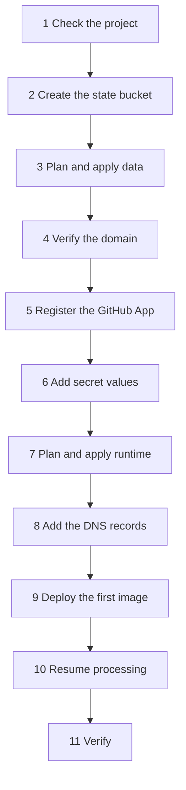

# Infrastructure

This folder holds the OpenTofu (Terraform-compatible) code for the App on Google Cloud. It implements the
[cloud design](../docs/design/cloud/architecture.md), [Security](../docs/design/cloud/security.md), and
[Operations](../docs/design/cloud/operations.md).

The owner plans and applies every change from a workstation. CI only checks the code: `fmt`, `validate`, `test`, and
`tflint`, with no backend and no credentials.

## Stacks

```mermaid
flowchart LR
    subgraph DATA["infra/data · long-lived"]
        APIS["APIs and guardrails<br/>(imported)"]
        FS[("Firestore (default)")]
        SM["Secret Manager<br/>secrets without values"]
        SA["Service accounts<br/>and their IAM"]
        AR["Artifact Registry"]
        WIF["Workload Identity<br/>pool and provider"]
    end
    subgraph RUNTIME["infra/runtime · replaceable"]
        RUN["Cloud Run<br/>public, worker"]
        TQ["Cloud Tasks<br/>webhooks, operator"]
        SCH["Cloud Scheduler<br/>sweep"]
        MON["Uptime check<br/>and alerts"]
        DM["Domain mapping"]
    end
    STATE[("GCS state bucket<br/>coupling-dev-510710-tfstate")]
    DATA -->|"outputs, read by<br/>terraform_remote_state"| RUNTIME
    DATA --- STATE
    RUNTIME --- STATE
```



| Stack     | State prefix | Holds                                                                                                                                                                                                           |
| --------- | ------------ | --------------------------------------------------------------------------------------------------------------------------------------------------------------------------------------------------------------- |
| `data`    | `data`       | Enabled APIs, Cloud Run quota preferences, guardrail alert and its channel, essential contact, Firestore, backups, secrets, service accounts, IAM, Artifact Registry, Workload Identity, data-access audit logs |
| `runtime` | `runtime`    | The two Cloud Run services, the worker invoker binding, the two queues, the Scheduler job, the uptime check, the alerts, the log-based sweep counter, the domain mapping                                        |

A routine runtime change cannot destroy data: Firestore, the secrets, and the imported guardrails have
`deletion_policy = "PREVENT"`, and Firestore also has delete protection on in Google Cloud.

### Who owns what

| Item                                     | Owner                                                                                      |
| ---------------------------------------- | ------------------------------------------------------------------------------------------ |
| Every resource, IAM binding, and setting | Terraform, applied by the owner                                                            |
| Image and traffic of the two services    | CI. Terraform ignores `image`, `traffic`, `client`, `client_version` and the revision name |
| Secret values                            | The owner, directly in Secret Manager. Never in Terraform                                  |
| Billing budget                           | The owner, on the billing account. Not in Terraform                                        |
| DNS for `coupling.dev`                   | The owner, at the registrar. Not in Terraform                                              |

## Names

| Resource           | Name                                                                                                                                                                  |
| ------------------ | --------------------------------------------------------------------------------------------------------------------------------------------------------------------- |
| State bucket       | `coupling-dev-510710-tfstate`                                                                                                                                         |
| Cloud Run services | `archfit-public`, `archfit-worker`                                                                                                                                    |
| Service accounts   | `archfit-public`, `archfit-worker`, `archfit-invoker` (queues and Scheduler), `archfit-deploy` (CI)                                                                   |
| Queues             | `archfit-webhooks`, `archfit-operator`                                                                                                                                |
| Scheduler job      | `archfit-sweep`                                                                                                                                                       |
| Artifact Registry  | `europe-west1-docker.pkg.dev/coupling-dev-510710/archfit-app/archfit-app`                                                                                             |
| Secrets            | `archfit-github-private-key`, `archfit-github-webhook-secret`, `archfit-github-oauth-secret`, `archfit-cookie-key`, `archfit-operator-token`, `archfit-anthropic-key` |
| Workload Identity  | pool `github`, provider `archfit-app`                                                                                                                                 |
| Firestore          | `(default)`, Native mode, `europe-west1`                                                                                                                              |
| Domain             | `app.coupling.dev`                                                                                                                                                    |

## Settings

Each service mounts only the secrets that its account can read. The data stack sets this list once, and the runtime
stack reads it. Every secret is a file at `/secrets/<secret>/value`, and its `*_FILE` variable names that file.

| Service          | Ingress       | Invoker check              | Secrets                                                                             | Other settings                                                              |
| ---------------- | ------------- | -------------------------- | ----------------------------------------------------------------------------------- | --------------------------------------------------------------------------- |
| `archfit-public` | All           | Off (no `allUsers` grant)  | App private key, webhook secret, OAuth secret, cookie key, Anthropic key (optional) | `ARCHFIT_ROLE=public`, `ARCHFIT_TASKS_QUEUE`, OAuth client ID, timeout 60 s |
| `archfit-worker` | Internal only | On, `archfit-invoker` only | App private key, webhook secret, operator token                                     | `ARCHFIT_ROLE=worker`, timeout 600 s                                        |

Both services also get `ARCHFIT_BASE_URL=https://app.coupling.dev`, `ARCHFIT_GITHUB_APP_ID`, and
`ARCHFIT_STORE=firestore`. Each runs 0 to 2 instances with 1 vCPU and 512 MiB, and CPU only during requests.

| Queue              | Route (enforced)     | Rate              | Retries                         | Who can add tasks         |
| ------------------ | -------------------- | ----------------- | ------------------------------- | ------------------------- |
| `archfit-webhooks` | `/internal/webhooks` | 5/s, 10 at a time | For 2 hours, backoff 10 s–600 s | `archfit-public`          |
| `archfit-operator` | `/internal/grants`   | 1/s, 1 at a time  | 5 attempts in 1 hour            | The owner (project owner) |

Both queues call the worker with an OIDC token for `archfit-invoker`. The Scheduler calls `/internal/sweep` at minute 0
of each hour (UTC) with the same identity.

### Alerts

All alerts email the owner through the `Owner email` channel.

| Alert                       | Condition                                                                |
| --------------------------- | ------------------------------------------------------------------------ |
| Public health check failing | The uptime check of `/healthz` on the `run.app` URL fails for 10 minutes |
| Public 5xx responses        | At least one 5xx response in 5 minutes                                   |
| Error log line              | A line with severity `ERROR` or higher on either service                 |
| Sweep missing               | No `sweep: pass finished` line in 2 hours. Off while `paused` is true    |
| Webhook queue growing       | More than 50 tasks wait for 15 minutes                                   |
| Task dispatches fail        | A task attempt ends without OK in 5 minutes, including 401 and 403       |
| Guardrail change (imported) | IAM, API, quota, key or out-of-region Cloud Run change                   |

The budget alerts live on the billing account.

## Decisions

The design leaves these choices to the implementation. Each one is the simplest option that meets the design.

- **OpenTofu 1.7 or later.** Import blocks use `for_each`. Terraform 1.7 or later also works.
- **Only the `google` provider, pinned at 8.5.0.** No resource needs `google-beta`. The lock file has hashes for
  `linux_amd64` and `darwin_arm64`.
- **Imports as import blocks.** The variable `import_existing` (default `true`) turns them on. An import block does
  nothing once its resource is in state. Tests turn it off, because the test framework cannot import.
- **Secret versions are pinned.** `secret_versions` names the version of each secret. The default is `1`. A new value
  reaches a service only through a new revision. `latest` is never used.
- **Secret replication** is user-managed in `europe-west1`, so secrets stay in the one region.
- **Sizing.** 2 services × 2 instances × 1 vCPU uses the full 4 vCPU quota. During a rollout, new instances can wait
  for quota. Raise the quota before a release needs more (see [Project guardrails](../docs/design/cloud/operations.md#project-guardrails)).
- **Timeouts.** The public service has 60 s, above the 55 s handler deadline. The worker has 600 s, for the sweep.
- **The uptime check calls the `run.app` URL**, so it works before DNS. `/healthz` does not depend on the host.
- **Workload Identity** matches the numeric repository ID `1373981201`, the ref `refs/heads/main`, and the workflow
  `coupling-dev/archfit-app/.github/workflows/deploy.yaml@refs/heads/main`. A repository rename or a new repository
  with the same name does not match.
- **Artifact Registry** keeps the 10 newest images and deletes other images after 30 days.
- **Queues and the Scheduler start paused** (`paused = true`). A pull request sets the default to `false` when the
  first real image serves.
- **Notification channels.** Only the imported owner email channel. A Google Cloud mobile app channel needs the
  owner's device; the owner can add it in the console and then to the alerts.

## First deployment

Run these steps in this order. Use the owner account with 2-step verification. Run every command from the repository
root, except where a step says otherwise. Do not run a release at the same time.



### 0. Prepare the workstation

```sh
gcloud auth login
gcloud auth application-default login
gcloud auth application-default set-quota-project coupling-dev-510710
gcloud config set project coupling-dev-510710
tofu version   # 1.7 or later
```

Each apply of IAM, an API, or a quota sends a guardrail alert email. This is expected.

### 1. Check the project

The data stack imports what the guardrail session created on 2026-10-05. Compare the real state with the code before
the first plan.

```sh
# Must print exactly the 25 services in infra/data/apis.tf (local.services).
gcloud services list --enabled --project=coupling-dev-510710 --format='value(config.name)' | sort

# Must print the 13 preferences in infra/data/guardrails.tf (local.run_quota_preferences).
gcloud quotas preferences list --project=coupling-dev-510710 --format='table(name.basename(), quotaId, dimensions, quotaConfig.preferredValue)'

# Must print the alert policy 9192556684800536581 and the channel 5888030191618892716.
gcloud monitoring policies list --project=coupling-dev-510710 --format='value(name, displayName)'
gcloud beta monitoring channels list --project=coupling-dev-510710 --format='value(name, displayName)'

# Prints the essential contact. The last part of the name is its ID for step 3.
gcloud essential-contacts list --project=coupling-dev-510710 --format='value(name)'
```

If a list differs, stop. Change the code to match the project in a pull request first.

### 2. Create the state bucket

Do this once. The bucket is not in Terraform.

```sh
gcloud storage buckets create gs://coupling-dev-510710-tfstate \
  --project=coupling-dev-510710 --location=europe-west1 \
  --uniform-bucket-level-access --public-access-prevention
gcloud storage buckets update gs://coupling-dev-510710-tfstate --versioning
```

### 3. Plan and apply the data stack

```sh
export TF_VAR_owner_email='<owner account email>'
export TF_VAR_essential_contact_id='<ID from step 1>'
tofu -chdir=infra/data init
tofu -chdir=infra/data plan -out=data.tfplan
```

Expected plan summary:

```text
Plan: 41 to import, 32 to add, N to change, 0 to destroy.
```

- **41 to import:** 25 APIs, 13 quota preferences, the alert policy, its channel, and the essential contact.
- **32 to add:** Firestore and its backup schedule (2), 6 secrets and 8 secret grants (14), 4 service accounts and
  7 IAM grants (11), the Artifact Registry repository (1), the Workload Identity pool and provider (2), and 2 audit
  log settings (2).
- **N to change:** only Terraform-side fields on imported resources, for example `disable_on_destroy`,
  `disable_dependent_services` and `deletion_policy`. If a change touches a real setting (a filter, a quota value, an
  email, a category), stop. Copy the live value into the code in a pull request, and plan again.
- **0 to destroy.** Any destroy: stop.

Then apply the saved plan:

```sh
tofu -chdir=infra/data apply data.tfplan
tofu -chdir=infra/data plan   # must print "No changes."
```

### 4. Verify the domain

Verify `coupling.dev` in [Google Search Console](https://search.google.com/search-console) with the owner account:
add the TXT record that it shows at the registrar (Namecheap). The domain mapping in step 7 fails until the domain is
verified.

### 5. Register the GitHub App

Register the App with these settings. Keep the webhook inactive, and install it nowhere yet.

- Homepage URL: `https://app.coupling.dev`
- Callback URL: `https://app.coupling.dev/auth/callback`
- Webhook URL: `https://app.coupling.dev/webhooks/github`, inactive

Then set the defaults of `github_app_id` and `github_oauth_client_id` in `infra/runtime/variables.tf` in a pull
request. These IDs are not secret. A default keeps every later apply correct.

### 6. Add the secret values

Values go straight to Secret Manager. They never appear on a command line or in Terraform. Each first value is
version `1`, which matches `secret_versions`.

```sh
P=coupling-dev-510710

# From the App registration. Delete the local files after the upload.
gcloud secrets versions add archfit-github-private-key  --project=$P --data-file=<downloaded .pem>
gcloud secrets versions add archfit-github-oauth-secret --project=$P --data-file=<file with the client secret>

# Generated. 16 random bytes as hex are the 32 cookie-key bytes the App needs.
openssl rand -hex 32 | gcloud secrets versions add archfit-github-webhook-secret --project=$P --data-file=-
openssl rand -hex 16 | gcloud secrets versions add archfit-cookie-key            --project=$P --data-file=-
openssl rand -hex 32 | gcloud secrets versions add archfit-operator-token        --project=$P --data-file=-

# Copy the webhook secret into the App settings.
gcloud secrets versions access 1 --secret=archfit-github-webhook-secret --project=$P | pbcopy
```

The Anthropic key is optional. To use it, add a version and set `anthropic_key_version` to that number in a pull
request.

### 7. Plan and apply the runtime stack

```sh
tofu -chdir=infra/runtime init
tofu -chdir=infra/runtime plan -out=runtime.tfplan
```

Expected plan summary:

```text
Plan: 16 to add, 0 to change, 0 to destroy.
```

The 16 resources: 2 services, the worker invoker grant, 2 queues, the enqueuer grant, the Scheduler job, the uptime
check, 6 alert policies, the sweep counter, and the domain mapping. Then apply:

```sh
tofu -chdir=infra/runtime apply runtime.tfplan
tofu -chdir=infra/runtime output dns_records
```

The services start with the placeholder image. It answers every request with success and does nothing. The queues
and the Scheduler are paused.

### 8. Add the DNS records

Add each record from `dns_records` at the registrar. For a subdomain this is one `CNAME` record: `app` →
`ghs.googlehosted.com.`. The certificate can take up to 24 hours. Check the state:

```sh
gcloud beta run domain-mappings describe --domain=app.coupling.dev --region=europe-west1 --project=coupling-dev-510710
```

### 9. Deploy the first image

CI deploys through `.github/workflows/deploy.yaml` with the `archfit-deploy` account (outputs
`workload_identity_provider` and `deploy_service_account` of the data stack). Deploy the worker first.

Until that workflow exists, the owner deploys by hand, by digest:

```sh
IMG=europe-west1-docker.pkg.dev/coupling-dev-510710/archfit-app/archfit-app
gcloud auth configure-docker europe-west1-docker.pkg.dev
docker build --platform=linux/amd64 -t "$IMG:$(git rev-parse HEAD)" .
docker push "$IMG:$(git rev-parse HEAD)"
DIGEST=$(gcloud artifacts docker images describe "$IMG:$(git rev-parse HEAD)" --format='value(image_summary.digest)')
gcloud run deploy archfit-worker --image="$IMG@$DIGEST" --region=europe-west1 --project=coupling-dev-510710
gcloud run deploy archfit-public --image="$IMG@$DIGEST" --region=europe-west1 --project=coupling-dev-510710
```

### 10. Resume processing

Set the default of `paused` in `infra/runtime/variables.tf` to `false` in a pull request. After the merge:

```sh
tofu -chdir=infra/runtime plan -out=runtime.tfplan   # 4 to change: 2 queues, the Scheduler job, the sweep alert
tofu -chdir=infra/runtime apply runtime.tfplan
```

Then activate the App webhook, install the App on one test repository, and follow one pull request from webhook to
check. Then install it on the invited repositories.

### 11. Verify

```sh
P=coupling-dev-510710; R=europe-west1
curl -fsS https://app.coupling.dev/healthz                                           # 200
gcloud run services describe archfit-worker --region=$R --project=$P \
  --format='value(metadata.annotations."run.googleapis.com/ingress")'                # internal
curl -s -o /dev/null -w '%{http_code}\n' "$(tofu -chdir=infra/runtime output -json service_urls | jq -r .worker)/internal/sweep"  # not 200
gcloud tasks queues describe archfit-webhooks --location=$R --project=$P --format='yaml(httpTarget, state)'
gcloud scheduler jobs run archfit-sweep --location=$R --project=$P
gcloud logging read 'jsonPayload.msg="sweep: pass finished" OR jsonPayload.message="sweep: pass finished"' \
  --project=$P --freshness=10m --limit=1
tofu -chdir=infra/data plan      # No changes.
tofu -chdir=infra/runtime plan   # No changes.
```

## Routine changes

- Change the code in a pull request. CI checks it. After the merge, run `plan`, review it, and `apply` the saved plan.
- Apply `data` before `runtime` when a change touches both.
- **Rotate a secret:** add the new version, set its number in `secret_versions`, and apply `runtime`. Terraform
  creates new revisions with the current image. CI then promotes them. Follow the
  [rotation rules](../docs/design/cloud/security.md#secrets).
- **Pause processing** for an incident: `gcloud tasks queues pause archfit-webhooks --location=europe-west1`. The next
  `runtime` plan shows the queue as changed until `paused` matches.

## Roll back

- **A bad release** (image or traffic): follow [Roll back](../docs/design/cloud/operations.md#roll-back). Terraform
  is not involved.
- **A bad infrastructure change:** revert the pull request, then `plan` and `apply` the stack again. Read the plan:
  a revert that replaces a service creates a new revision with the current image.
- **A runtime resource that must go:** a `destroy` of the runtime stack removes services, queues, the Scheduler, and
  alerts. Data stays. A deleted queue name cannot be used again for about 7 days, so prefer a revert.
- **The data stack** is not destroyed. Firestore, the secrets, and the guardrails refuse a destroy
  (`deletion_policy = "PREVENT"`). To stop managing a resource without touching it, use `tofu state rm`.
- **A damaged state file:** the bucket keeps old versions. List them, and copy a good generation back:

  ```sh
  gcloud storage ls --all-versions gs://coupling-dev-510710-tfstate/data/
  gcloud storage cp gs://coupling-dev-510710-tfstate/data/default.tfstate#<generation> \
    gs://coupling-dev-510710-tfstate/data/default.tfstate
  ```

## Local checks

```sh
tofu fmt -check -recursive infra
for s in infra/data infra/runtime; do
  tofu -chdir=$s init -backend=false && tofu -chdir=$s validate && tofu -chdir=$s test
done
tflint --chdir=infra --init --config="$PWD/infra/.tflint.hcl"
tflint --chdir=infra --recursive --config="$PWD/infra/.tflint.hcl"
```

`tofu test` uses a mock provider. It calls no Google API.

## Known gaps

- The billing budget is on the billing account, outside this code.
- Disabled APIs and the removed default Editor grant cannot be expressed as resources. The guardrail alert reports a
  change to either.
- The deploy workflow `deploy.yaml` and its post-release check do not exist yet. The check reads the queue routing, so
  the deploy account will also need `roles/cloudtasks.viewer` on the two queues.
- Cloud Logging reads severity only from its own key name. Until the App writes that key, the error-line alert matches
  only platform lines.
- The inline-fallback alert, the log-based counters for requests and verdicts, and the long-retention log bucket wait
  for the App log lines that they count.
