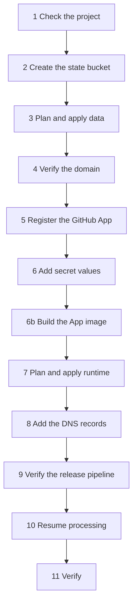

# Infrastructure

This folder holds the OpenTofu (Terraform-compatible) code for the App on Google Cloud. It implements the
[cloud design](../docs/design/cloud/architecture.md), [Security](../docs/design/cloud/security.md), and
[Operations](../docs/design/cloud/operations.md).

The owner plans and applies every change from a workstation. CI only checks the code: `fmt`, `validate`, `test`, and
`tflint`, with no backend and no credentials.

## Stacks

```mermaid
flowchart LR
    subgraph DATA["infra/data · long-lived"]
        APIS["APIs and guardrails<br/>(imported)"]
        FS[("Firestore (default)")]
        SM["Secret Manager<br/>secrets without values"]
        SA["Service accounts<br/>and their IAM"]
        AR["Artifact Registry"]
        WIF["Workload Identity<br/>pool and provider"]
    end
    subgraph RUNTIME["infra/runtime · replaceable"]
        RUN["Cloud Run<br/>public, worker"]
        TQ["Cloud Tasks<br/>webhooks, operator"]
        SCH["Cloud Scheduler<br/>sweep"]
        MON["Uptime check<br/>and alerts"]
        DM["Domain mapping"]
    end
    STATE[("GCS state bucket<br/>coupling-dev-510710-tfstate")]
    DATA -->|"outputs, read by<br/>terraform_remote_state"| RUNTIME
    DATA --- STATE
    RUNTIME --- STATE
```



| Stack     | State prefix | Holds                                                                                                                                                                                                           |
| --------- | ------------ | --------------------------------------------------------------------------------------------------------------------------------------------------------------------------------------------------------------- |
| `data`    | `data`       | Enabled APIs, Cloud Run quota preferences, guardrail alert and its channel, essential contact, Firestore, backups, secrets, service accounts, IAM, Artifact Registry, Workload Identity, data-access audit logs |
| `runtime` | `runtime`    | The two Cloud Run services, the worker invoker binding, the two queues and their IAM, the Scheduler job, the uptime check, the alerts, the log-based sweep counter, the domain mapping                          |

A routine runtime change cannot destroy data: Firestore, the secrets, and the imported guardrails have
`deletion_policy = "PREVENT"`, and Firestore also has delete protection on in Google Cloud.

### Who owns what

| Item                                     | Owner                                                                   |
| ---------------------------------------- | ----------------------------------------------------------------------- |
| Every resource, IAM binding, and setting | Terraform, applied by the owner                                         |
| Image and traffic of the two services    | CI. Terraform ignores `image`, `traffic`, `client` and `client_version` |
| Secret values                            | The owner, directly in Secret Manager. Never in Terraform               |
| Billing budget                           | The owner, on the billing account. Not in Terraform                     |
| DNS for `coupling.dev`                   | The owner, at the registrar. Not in Terraform                           |

## Names

| Resource           | Name                                                                                                                                                                  |
| ------------------ | --------------------------------------------------------------------------------------------------------------------------------------------------------------------- |
| State bucket       | `coupling-dev-510710-tfstate`                                                                                                                                         |
| Cloud Run services | `archfit-public`, `archfit-worker`                                                                                                                                    |
| Service accounts   | `archfit-public`, `archfit-worker`, `archfit-invoker` (queues and Scheduler), `archfit-deploy` (CI)                                                                   |
| Queues             | `archfit-webhooks`, `archfit-operator`                                                                                                                                |
| Scheduler job      | `archfit-sweep`                                                                                                                                                       |
| Artifact Registry  | `europe-west1-docker.pkg.dev/coupling-dev-510710/archfit-app/archfit-app`                                                                                             |
| Secrets            | `archfit-github-private-key`, `archfit-github-webhook-secret`, `archfit-github-oauth-secret`, `archfit-cookie-key`, `archfit-operator-token`, `archfit-anthropic-key` |
| Workload Identity  | pool `github`, provider `archfit-app`                                                                                                                                 |
| Firestore          | `(default)`, Native mode, `europe-west1`                                                                                                                              |
| Domain             | `app.coupling.dev`                                                                                                                                                    |

## Settings

Each service mounts only the secrets that its account can read. The data stack sets this list once, and the runtime
stack reads it. Every secret is a file at `/secrets/<secret>/value`, and its `*_FILE` variable names that file.

| Service          | Ingress       | Invoker check              | Secrets                                                                             | Other settings                                                                          |
| ---------------- | ------------- | -------------------------- | ----------------------------------------------------------------------------------- | --------------------------------------------------------------------------------------- |
| `archfit-public` | All           | Off (no `allUsers` grant)  | App private key, webhook secret, OAuth secret, cookie key, Anthropic key (optional) | `ARCHFIT_ROLE=public`, `ARCHFIT_QUEUE=cloudtasks`, `ARCHFIT_TASKS_QUEUE`, timeout 330 s |
| `archfit-worker` | Internal only | On, `archfit-invoker` only | App private key, webhook secret, operator token           | `ARCHFIT_ROLE=worker`, custom audience = worker URL, timeout 600 s                      |

When narrowing secret access in an existing deployment, remove the unused mounts from the serving worker revisions
before revoking their IAM grants. Old revisions and rollback targets can still reference those secrets and fail to start
after access is revoked. Review this as a staged data/runtime change. Do not apply the data stack alone first.

These settings follow [Roles and routing](../docs/design/cloud/operations.md#roles-and-routing) and
[Firestore](../docs/design/cloud/operations.md#firestore). Both services also get `ARCHFIT_BASE_URL=https://app.coupling.dev`,
`ARCHFIT_GITHUB_APP_ID`, `ARCHFIT_GITHUB_OAUTH_CLIENT_ID`, `ARCHFIT_STORE=firestore`,
`ARCHFIT_FIRESTORE_PROJECT=coupling-dev-510710`, `ARCHFIT_WORKER_URL`, and `ARCHFIT_INVOKER`. `ARCHFIT_WORKER_URL` is
the deterministic URL `https://archfit-worker-335297348272.europe-west1.run.app`. The queues and the Scheduler use it
as the target and the token audience, so all of them name one string. The worker does not get the Anthropic key: only
the public service calls the LLM. Each runs 0 to 2 instances with 1 vCPU and 512 MiB, and CPU only during requests.

| Queue              | Route (enforced)     | Rate              | Retries                         | Who can add tasks         |
| ------------------ | -------------------- | ----------------- | ------------------------------- | ------------------------- |
| `archfit-webhooks` | `/internal/webhooks` | 5/s, 10 at a time | For 2 hours, backoff 10 s–600 s | `archfit-public`          |
| `archfit-operator` | `/internal/grants`   | 1/s, 1 at a time  | 5 attempts in 1 hour            | The owner (project owner) |

Both queues call the worker with an OIDC token for `archfit-invoker`. The Scheduler calls `/internal/sweep` at minute 0
of each hour (UTC) with the same identity.

### Alerts

All alerts email the owner through the `Owner email` channel.

| Alert                       | Condition                                                                                                                        |
| --------------------------- | -------------------------------------------------------------------------------------------------------------------------------- |
| Public health check failing | The uptime check of `/healthz` on the `run.app` URL fails for 10 minutes                                                         |
| Public 5xx responses        | At least one 5xx response in 5 minutes                                                                                           |
| Error log line              | A line with severity `ERROR` or higher on either service                                                                         |
| Sweep missing               | No scheduled sweep finished (request line of `POST /internal/sweep` with outcome `swept`) in 2 hours. Off while `paused` is true |
| Sweep job fails             | A Scheduler attempt for `archfit-sweep` fails (401, 5xx, deadline). Off while `paused` is true                                   |
| Webhook queue growing       | More than 50 tasks wait for 15 minutes                                                                                           |
| Task dispatches fail        | A task attempt ends without OK in 5 minutes, including 401 and 403                                                               |
| Guardrail change (imported) | IAM, API, quota, key or out-of-region Cloud Run change                                                                           |

The budget alerts live on the billing account.

## Decisions

The design leaves these choices to the implementation. Each one is the simplest option that meets the design.

- **OpenTofu 1.8 or later.** Import blocks use `for_each` (1.7), and the tests use mock providers (OpenTofu 1.8).
- **Only the `google` provider, pinned at 8.5.0.** No resource needs `google-beta`. The lock file has hashes for
  `linux_amd64` and `darwin_arm64`.
- **Imports as import blocks.** The variable `import_existing` (default `true`) turns them on. An import block does
  nothing once its resource is in state. Tests turn it off, because the test framework cannot import.
- **Secret versions are pinned.** `secret_versions` names the current version of each secret. The default is `1`.
  During webhook rotation, `webhook_secret_previous_version` mounts another numeric version of the same secret on both
  services. It defaults to `null`. A new value reaches a service only through a new revision. `latest` is never used.
- **Secret replication** is user-managed in `europe-west1`, so secrets stay in the one region.
- **Sizing.** 2 services × 2 instances × 1 vCPU uses the full 4 vCPU quota. During a rollout, new instances can wait
  for quota. Raise the quota before a release needs more (see [Project guardrails](../docs/design/cloud/operations.md#project-guardrails)).
- **Timeouts.** The public service has 330 s, above the 300 s deadline of the managed assist route. Uploads and the
  other routes stop at 55 s in the App. The worker has 600 s, for the sweep.
- **The uptime check calls the `run.app` URL**, so it works before DNS. `/healthz` does not depend on the host.
- **The public account can act as the invoker.** A webhook task names the invoker in its own `oidcToken`, and Cloud
  Tasks requires that. The enforced queue-level route still sends the token only to `/internal/webhooks`.
- **Services keep deletion protection on.** A replacement requires a reviewed real App image digest and an owner
  decision. See [Roll back](#roll-back).
- **The revision name is not ignored.** Cloud Run rejects a kept revision name with a changed template, so Terraform
  lets Cloud Run name each revision it creates.
- **Workload Identity** matches the numeric repository ID `1373981201`, the ref `refs/heads/main`, and the workflow
  `coupling-dev/archfit-app/.github/workflows/deploy.yaml@refs/heads/main`. A repository rename or a new repository
  with the same name does not match.
- **Artifact Registry** keeps the 10 newest images and deletes other images after 30 days.
- **Queues and the Scheduler start paused** (`paused = true`). A pull request sets the default to `false` when the
  first real image serves.
- **Notification channels.** Only the imported owner email channel. A Google Cloud mobile app channel needs the
  owner's device; the owner can add it in the console and then to the alerts.

## First deployment

Run these steps in this order. Use the owner account with 2-step verification. Run every command from the repository
root, except where a step says otherwise. Do not run a release at the same time.



### 0. Prepare the workstation

```sh
gcloud auth login
gcloud auth application-default login
gcloud auth application-default set-quota-project coupling-dev-510710
gcloud config set project coupling-dev-510710
tofu version   # 1.8 or later
```

Each apply of IAM, an API, or a quota sends a guardrail alert email. This is expected.

### 1. Check the project

The data stack imports what the guardrail session created on 2026-10-05. Compare the real state with the code before
the first plan.

```sh
# Must print exactly the 25 services in infra/data/apis.tf (local.services).
gcloud services list --enabled --project=coupling-dev-510710 --format='value(config.name)' | sort

# Must print the 13 preferences in infra/data/guardrails.tf (local.run_quota_preferences).
gcloud quotas preferences list --project=coupling-dev-510710 --format='table(name.basename(), quotaId, dimensions, quotaConfig.preferredValue)'

# Must print the alert policy 9192556684800536581 and the channel 5888030191618892716.
gcloud monitoring policies list --project=coupling-dev-510710 --format='value(name, displayName)'
gcloud beta monitoring channels list --project=coupling-dev-510710 --format='value(name, displayName)'

# Prints the essential contact. The last part of the name is its ID for step 3.
gcloud essential-contacts list --project=coupling-dev-510710 --format='value(name)'
```

If a list differs, stop. Change the code to match the project in a pull request first.

### 2. Create the state bucket

Do this once. The bucket is not in Terraform.

```sh
gcloud storage buckets create gs://coupling-dev-510710-tfstate \
  --project=coupling-dev-510710 --location=europe-west1 \
  --uniform-bucket-level-access --public-access-prevention
gcloud storage buckets update gs://coupling-dev-510710-tfstate --versioning
```

### 3. Plan and apply the data stack

```sh
export TF_VAR_owner_email='<owner account email>'
export TF_VAR_essential_contact_id='<ID from step 1>'
tofu -chdir=infra/data init
tofu -chdir=infra/data plan -out=data.tfplan
```

Expected plan summary:

```text
Plan: 41 to import, 34 to add, N to change, 0 to destroy.
```

- **41 to import:** 25 APIs, 13 quota preferences, the alert policy, its channel, and the essential contact.
- **34 to add:**
  - Firestore, its backup schedule and the index exemption of `kv.value`: 3.
  - 6 secrets and 8 secret grants: 14.
  - 4 service accounts and 8 IAM grants: 12.
  - Artifact Registry repository: 1.
  - Workload Identity pool and provider: 2.
  - Audit log settings: 2.
- **N to change:** only Terraform-side fields on imported resources, for example `disable_on_destroy`,
  `disable_dependent_services` and `deletion_policy`, and `dimensions` from `null` to `{}` on the ten preferences
  without a region (the same empty value). If a change touches a real setting (a filter, a quota value, an
  email, a category), stop. Copy the live value into the code in a pull request, and plan again.
- **0 to destroy.** Any destroy: stop.

Then apply the saved plan:

```sh
tofu -chdir=infra/data apply data.tfplan
tofu -chdir=infra/data plan   # must print "No changes."
```

### 4. Verify the domain

Verify `coupling.dev` in [Google Search Console](https://search.google.com/search-console) with the owner account:
add the TXT record that it shows at the registrar (Namecheap). The domain mapping in step 7 fails until the domain is
verified.

### 5. Register the GitHub App

Register the App with these settings. Keep the webhook inactive, and install it nowhere yet.

- Homepage URL: `https://app.coupling.dev`
- Callback URL: `https://app.coupling.dev/auth/callback`
- Webhook URL: `https://app.coupling.dev/webhooks/github`, inactive

Then add defaults for `github_app_id` and `github_oauth_client_id` in `infra/runtime/variables.tf` in a pull
request. These IDs are not secret. Until they have values, the runtime plan stops and asks for them.

### 6. Add the secret values

Values go straight to Secret Manager. They never appear on a command line or in Terraform. Each first value is
version `1`, which matches `secret_versions`.

```sh
P=coupling-dev-510710

# From the App registration. Delete the local files after the upload.
gcloud secrets versions add archfit-github-private-key  --project=$P --data-file=<downloaded .pem>
gcloud secrets versions add archfit-github-oauth-secret --project=$P --data-file=<file with the client secret>

# Generated. 16 random bytes as hex are the 32 cookie-key bytes the App needs.
openssl rand -hex 32 | gcloud secrets versions add archfit-github-webhook-secret --project=$P --data-file=-
openssl rand -hex 16 | gcloud secrets versions add archfit-cookie-key            --project=$P --data-file=-
openssl rand -hex 32 | gcloud secrets versions add archfit-operator-token        --project=$P --data-file=-

# Copy the webhook secret into the App settings.
gcloud secrets versions access 1 --secret=archfit-github-webhook-secret --project=$P | pbcopy
```

The Anthropic key is optional. To use it, add a version, then add `"archfit-anthropic-key" = "<version>"` to
`secret_versions` in a pull request. Without that entry the key is not mounted, and managed AI stays off.

### 6b. Build the initial App image

After the data stack exists, run the build-only workflow on `main`:

```sh
gh workflow run deploy.yaml --ref main -f mode=build
```

This builds and pushes the real App image without reading or deploying Cloud Run services. Download `build.json` from
its `release-<run>-<attempt>` artifact. The job summary also names the digest.
Set `initial_image_digest` to that digest in a local, ignored `infra/runtime/bootstrap.auto.tfvars` file. Keep this input
for later plans. Terraform uses it only when creating a service; CI owns subsequent image and traffic changes.
Do not use the engine image or a `hello` placeholder. Keep webhooks inactive and processing paused.

### 7. Plan and apply the runtime stack

```sh
tofu -chdir=infra/runtime init
tofu -chdir=infra/runtime plan -out=runtime.tfplan
```

Expected plan summary:

```text
Plan: 19 to add, 0 to change, 0 to destroy.
```

The 19 resources: 2 services, the worker invoker grant, 2 queues, the enqueuer grant, 2 queue reader grants for the
deploy account, the Scheduler job, the uptime check, 7 alert policies, the sweep counter, and the domain mapping. Then
apply:

```sh
tofu -chdir=infra/runtime apply runtime.tfplan
tofu -chdir=infra/runtime output dns_records
```

The services start with the real App image at `initial_image_digest`. Invalid configuration or unreadable secrets
stop startup. Requests pass through the App's authentication, not a success-returning placeholder. The queues and the
Scheduler remain paused until the release checks pass.

### 8. Add the DNS records

Add each record from `dns_records` at the registrar. For a subdomain this is one `CNAME` record: `app` →
`ghs.googlehosted.com.`. The certificate can take up to 24 hours. Check the state:

```sh
gcloud beta run domain-mappings describe --domain=app.coupling.dev --region=europe-west1 --project=coupling-dev-510710
```

### 9. Verify the release pipeline

CI deploys through `.github/workflows/deploy.yaml` with the `archfit-deploy` account. The workflow names the outputs
`workload_identity_provider` and `deploy_service_account` of the data stack. Compare them first:

```sh
# projects/335297348272/locations/global/workloadIdentityPools/github/providers/archfit-app
tofu -chdir=infra/data output workload_identity_provider
# archfit-deploy@coupling-dev-510710.iam.gserviceaccount.com
tofu -chdir=infra/data output deploy_service_account
```

If a value differs, change the workflow in a pull request first. Then run the first release by hand, and follow it:

```sh
gh workflow run deploy.yaml --ref main -f mode=release
gh run watch "$(gh run list --workflow=deploy.yaml --limit=1 --json databaseId --jq '.[0].databaseId')"
```

The release must end with `Release: released` and `Post-release checks: passed` in the job summary. Then turn on a
release for each push to `main`:

```sh
gh variable set RELEASE_ON_PUSH --body true
```

See [Releases](#releases) for what the workflow does and how to roll back.

### 10. Resume processing

Set the default of `paused` in `infra/runtime/variables.tf` to `false` in a pull request. After the merge:

```sh
tofu -chdir=infra/runtime plan -out=runtime.tfplan   # 5 to change: 2 queues, the Scheduler job, 2 sweep alerts
tofu -chdir=infra/runtime apply runtime.tfplan
```

Then activate the App webhook, install the App on one test repository, and follow one pull request from webhook to
check. Then install it on the invited repositories.

### 11. Verify

```sh
P=coupling-dev-510710; R=europe-west1
curl -fsS https://app.coupling.dev/healthz                                           # 200
gcloud run services describe archfit-worker --region=$R --project=$P \
  --format='value(metadata.annotations."run.googleapis.com/ingress")'                # internal
curl -s -o /dev/null -w '%{http_code}\n' "$(tofu -chdir=infra/runtime output -json service_urls | jq -r .worker)/internal/sweep"  # not 200
gcloud tasks queues describe archfit-webhooks --location=$R --project=$P --format='yaml(httpTarget, state)'
gcloud scheduler jobs run archfit-sweep --location=$R --project=$P
gcloud logging read 'jsonPayload.msg="sweep: pass finished" OR jsonPayload.message="sweep: pass finished"' \
  --project=$P --freshness=10m --limit=1
tofu -chdir=infra/data plan      # No changes.
tofu -chdir=infra/runtime plan   # Only template.revision -> null on services CI deployed (see Routine changes)
```

## Releases

The deploy workflow [`.github/workflows/deploy.yaml`](../.github/workflows/deploy.yaml) runs the scripts in
[`scripts/deploy/`](../scripts/deploy/). It follows [Release](../docs/design/cloud/operations.md#release).

| Run                                                                 | What it does                                                                    |
| ------------------------------------------------------------------- | ------------------------------------------------------------------------------- |
| Push to `main`, while the variable `RELEASE_ON_PUSH` is `true`      | Builds the image of the commit and releases it                                  |
| `gh workflow run deploy.yaml --ref main -f mode=build`              | Builds the initial App image only; records its digest in `build.json`           |
| `gh workflow run deploy.yaml --ref main -f mode=release`            | The same release path, for the current `main`                                   |
| `... -f mode=image -f image_digest=sha256:<digest>`                 | Image rollback: releases an earlier image again with the current secrets        |
| `... -f mode=traffic -f public_revision=<r> -f worker_revision=<r>` | Traffic rollback: moves traffic back to earlier release revisions (one or both) |

- A run on another ref gets no credentials: Workload Identity admits only `main`.
- Each release names its revisions `archfit-worker-r<run>-<attempt>` and `archfit-public-r<run>-<attempt>`.
- The release record is the artifact `release-<run>-<attempt>` (`release.json`) and the job summary: the commit of
  the run, the image digest, the new revisions, and the revisions with traffic before the release. Take the rollback
  inputs from it: the revision names in "traffic before" (without `=<percent>`) for a traffic rollback, the `digest`
  of an earlier release for an image rollback.
- A release or rollback fails when the worker ingress is not internal, the worker invoker check is off, the worker's
  IAM policy has any binding other than `roles/run.invoker` for `archfit-invoker`, or a queue routes to another
  method, scheme, host, path, enforce mode, identity, or audience. Then the revisions of the release already have
  traffic. Fix the setting with Terraform (`apply` the runtime stack), or roll back.
- A release that stops before the public promotion, and a traffic rollback of the public service, remove the
  `canary` tag. A revision without traffic is then not reachable at the tag URL.
- Before a rollback, stop releases on push: `gh variable set RELEASE_ON_PUSH --body false`. A newer waiting run
  cancels an older waiting one, so a push could replace the waiting rollback. Check that the rollback run started.
  Turn releases on push on again when the cause is fixed.
- The deploy account can read the two queues (`roles/cloudtasks.viewer` on each queue, in the runtime stack) for the
  routing check. It has no other new role.

## Routine changes

- Change the code in a pull request. CI checks it. After the merge, run `plan`, review it, and `apply` the saved plan.
- Apply `data` before `runtime` when a change touches both, except staged secret-access removal described in [Settings](#settings).
- After a CI deploy, the runtime plan shows `template[0].revision` changing to `null` on that service: gcloud names
  each revision it deploys. This diff is safe. An apply creates one more revision with the current image and no
  traffic.
- **Rotate a secret:** add the new version, set its number in `secret_versions`, and apply `runtime`. Terraform
  creates a new revision of each service that mounts the secret, with the current image. Traffic stays on the revisions
  that CI promoted, so the next release through CI deploys and promotes a revision with the new version. Follow the
  [rotation rules](../docs/design/cloud/security.md#secrets).
- **Rotate the webhook secret:** set the new current version in `secret_versions` and the old numeric version in
  `webhook_secret_previous_version`. Apply `runtime`, then release through CI so both serving roles accept both values.
  Change GitHub's secret, wait for old signed tasks to drain, then set the previous version to `null`, apply and release
  again before disabling it. See the [rotation rules](../docs/design/cloud/security.md#secrets).
- **Pause processing** for an incident: `gcloud tasks queues pause archfit-webhooks --location=europe-west1`. The next
  `runtime` plan shows the queue as changed until `paused` matches.

## Roll back

- **A bad release** (image or traffic): follow [Roll back](../docs/design/cloud/operations.md#roll-back). Terraform
  is not involved.
- **A bad infrastructure change:** revert the pull request, then `plan` and `apply` the stack again. An update keeps
  the current image.
- **A replaced or recreated service** starts with the real App image at `initial_image_digest`. Keep
  `deletion_protection` on. Before an approved replacement, pause processing and webhooks, review the initial digest and
  current configuration, and follow the first-deployment release checks before resuming. Never use a success-returning
  placeholder to bypass startup failures.
- **A runtime resource that must go:** a `destroy` of the runtime stack removes services, queues, the Scheduler, and
  alerts. Data stays. It needs the same steps as a replacement. A deleted queue name cannot be used again for about
  7 days, so prefer a revert.
- **The data stack** is not destroyed. Firestore, the secrets, and the guardrails refuse a destroy
  (`deletion_policy = "PREVENT"`). To stop managing a resource without touching it, use `tofu state rm`.
- **A damaged state file:** the bucket keeps old versions. List them, and copy a good generation back:

  ```sh
  gcloud storage ls --all-versions gs://coupling-dev-510710-tfstate/data/
  gcloud storage cp gs://coupling-dev-510710-tfstate/data/default.tfstate#<generation> \
    gs://coupling-dev-510710-tfstate/data/default.tfstate
  ```

## Local checks

```sh
tofu fmt -check -recursive infra
for s in infra/data infra/runtime; do
  tofu -chdir=$s init -backend=false && tofu -chdir=$s validate && tofu -chdir=$s test
done
tflint --chdir=infra --init --config="$PWD/infra/.tflint.hcl"
tflint --chdir=infra --recursive --config="$PWD/infra/.tflint.hcl"
```

`tofu test` uses a mock provider. It calls no Google API.

## Known gaps

- The billing budget is on the billing account, outside this code.
- Disabled APIs and the removed default Editor grant cannot be expressed as resources. The guardrail alert reports a
  change to either.
- Cloud Logging reads severity only from its own key name. Until the App writes that key, the error-line alert matches
  only platform lines.
- Dedicated enqueue-failure counters, the log-based counters for requests and verdicts, and the long-retention log bucket wait
  for the App log lines that they count.
- A metric-absence condition fires only after its metric had a data point since the policy changed. A sweep that never
  succeeds is caught by the "Sweep job fails" alert instead.
- Cloud Tasks writes no audit log for `CreateTask`. The data-write audit logs record only `RunTask` and `DeleteTask`.
  So a grant task has no recorded creator. Only the project owner can add tasks to the operator queue.
