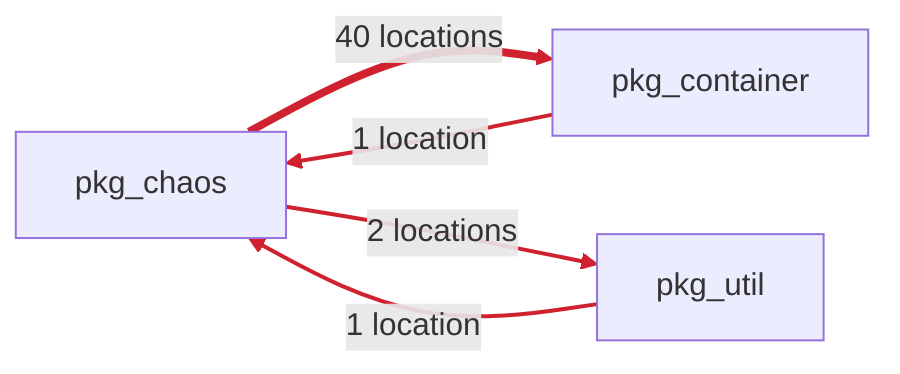

<!-- archfit:comment -->
<!-- archfit:head bbbbbbbbbbbbbbbbbbbbbbbbbbbbbbbbbbbbbbbb run 7.1 -->
## Archfit: Architecture violations found · advisory

> [!NOTE]
> This check does not block merging: the gate is advisory for this repository.

- **Next:** Fix the blocking findings, then push.
- Reason: `blocking_findings` (architecture)
- Detail: 1 blocking finding

### Findings

**4 rule violations** · 1 dependency cycle · 2 advisories · 6 accepted · 6 introduced by this pull request

#### Dependency cycle among `pkg_chaos`, `pkg_container`, `pkg_util`

**violation** · `no-module-cycles` · high, new, introduced



| Dependency | Where | Strength | Distance | Volatility |
| --- | --- | --- | --- | --- |
| `pkg_chaos` → `pkg_container` | `pkg/chaos/cmd/builder.go:14`, `pkg/chaos/command.go:10`, `pkg/chaos/iptables/cmd/loss.go:11` and 37 more | functional | cross_module | high |
| `pkg_chaos` → `pkg_util` | `pkg/chaos/iptables/parse.go:12`, `pkg/chaos/netem/parse.go:11` | functional | cross_module | high |
| `pkg_container` → `pkg_chaos` | `pkg/container/appfilter.go:4` | functional | cross_module | high |
| `pkg_util` → `pkg_chaos` | `pkg/util/flagports.go:4` | functional | cross_module | high |

**Why:** Module pkg_chaos depends on pkg_container, and the two are in a dependency cycle among 3 declared modules

**Constraint:** Remove one direction of the module cycle; routing the dependency through another module keeps the cycle

<details>
<summary>2 advisories · never block</summary>

| Rule | Dependency | Where | Strength | Distance | Volatility |
| --- | --- | --- | --- | --- | --- |
| `bc/imbalanced_coupling` critical, new, introduced | `pkg_container` (`pkg/container/appfilter.go`) → `pkg_chaos` (`pkg/chaos/cliflags`) | `pkg/container/appfilter.go:4` | functional | cross_module | high |
| `bc/imbalanced_coupling` critical, new, introduced | `pkg_util` (`pkg/util/flagports.go`) → `pkg_chaos` (`pkg/chaos/cliflags`) | `pkg/util/flagports.go:4` | functional | cross_module | high |

`bc/imbalanced_coupling` · **Why:** balanced coupling: functional integration strength × cross_module distance × high volatility → critical severity (functional coupling across a module boundary to a volatile target → a change on one side forces a change on the other)

</details>

<details>
<summary>6 accepted · baseline or waiver · display only</summary>

| Rule | Dependency | Where | Strength | Distance | Volatility |
| --- | --- | --- | --- | --- | --- |
| `bc/imbalanced_coupling` critical, baseline, pre-existing | `cmd` (`cmd/commands.go`) → `pkg_chaos` (`pkg/chaos/iptables/cmd`) | `cmd/commands.go:7`, `cmd/commands.go:8`, `cmd/commands.go:9` and 3 more | functional | cross_module | high |
| `bc/imbalanced_coupling` critical, baseline, pre-existing | `cmd` (`cmd/runtime.go`) → `pkg_runtime` (`pkg/runtime/containerd`) | `cmd/runtime.go:12`, `cmd/runtime.go:13`, `cmd/runtime.go:14` | functional | cross_module | high |
| `bc/imbalanced_coupling` critical, baseline, pre-existing | `pkg_chaos` (`pkg/chaos/iptables/iptables.go`) → `pkg_container` (`pkg/container`) | `pkg/chaos/iptables/iptables.go:8`, `pkg/chaos/netem/netem.go:9`, `pkg/chaos/netem/target.go:10` and 2 more | functional | cross_module | high |
| `bc/imbalanced_coupling` critical, baseline, pre-existing | `pkg_chaos` (`pkg/chaos/iptables/parse.go`) → `pkg_util` (`pkg/util`) | `pkg/chaos/iptables/parse.go:12`, `pkg/chaos/netem/parse.go:11` | functional | cross_module | high |
| `bc/imbalanced_coupling` critical, baseline, pre-existing | `pkg_runtime` (`pkg/runtime/containerd/addresses.go`) → `pkg_container` (`pkg/container`) | `pkg/runtime/containerd/addresses.go:15`, `pkg/runtime/containerd/client.go:12`, `pkg/runtime/containerd/iptables.go:7` and 12 more | functional | cross_module | high |
| `bc/imbalanced_coupling` critical, baseline, pre-existing | `pkg_runtime` (`pkg/runtime/containerd/netem.go`) → `pkg_tc` (`pkg/tc`) | `pkg/runtime/containerd/netem.go:7`, `pkg/runtime/docker/netem.go:7` | functional | cross_module | high |

`bc/imbalanced_coupling` · **Why:** balanced coupling: functional integration strength × cross_module distance × high volatility → critical severity (functional coupling across a module boundary to a volatile target → a change on one side forces a change on the other)

</details>

<details>
<summary>Evidence, inputs and validation</summary>

### Dimensions

Measurement trust: customer-attested.

| Dimension | Status | Coverage | Confidence | Gate | Change |
| --- | --- | --- | --- | --- | --- |
| `intent` | measured | 1/1 (declared rules evaluated) | high | pass |  |
| `structure` | measured | 167/628 (discovered dependencies resolved inside the declared module map) | high | **fail** |  |
| `modularity` | measured | 0/6 (declared modules with a declared public surface) | low | pass |  |
| `coupling` | measured | 79/79 (cross-boundary edges scored) | high | **warn** |  |
| `change_locality` | measured | 6/6 (declared modules touched in the scanned history window) | high | pass |  |
| `complexity` | measured | 6/6 (declared modules with complete dependency-chain and degree values) | high | pass |  |
| `testability` | partial | 158/173 (classified source files) | medium | pass |  |
| `operations` | partial | 1/6 (declared modules with a corroborated deploy unit and qualifying owner) | medium | pass |  |
| `drift` | measured | 8/8 (distributed-monolith seams compared against the stored reference) | high | pass | comparable |

### Evidence gaps

- Analyzers that did not run (absent or disabled): `dependency-cruiser`, `grimp`, `cargo`, `jscpd`, `scip`, `ast-grep/syntax`, `ast-grep`, `cargo-modules`
- Dimension `structure`, unknown fact: external dependency structure — 461 dependencies leave the declared module map (461 on libraries, 0 to or from first-party code no module owns), so their direction and layer are outside this claim
- Dimension `modularity`, unknown fact: inferred public surface — no declared module states a public surface, so inferring one is outside this claim
- Dimension `change_locality`, unknown fact: essential vs accidental volatility — commit frequency corroborates a declared volatility; it cannot establish one
- Dimension `complexity`, unknown fact: function length distribution — ast-grep supplied no complete function or method extent for part or all of the out-of-claim size distribution
- Dimension `complexity`, unknown fact: cognitive complexity — no cognitive-complexity analyzer is claimed; module-graph shape is the architecture-level measure
- Dimension `testability`, unknown fact: supplied coverage units — coverage is disabled, so no supplied coverage units were observed
- Dimension `testability`, unknown fact: coverage path resolution — coverage is disabled, so no supplied coverage paths were available to resolve
- Dimension `testability`, unknown fact: coverage module attribution — coverage is disabled, so no supplied coverage was available to attribute to declared modules
- Dimension `testability`, unknown fact: coverage freshness — coverage is disabled, so no supplied coverage freshness could be established
- Dimension `operations`, unknown fact: corroborated deploy unit — one or more declared modules have no independently corroborating deploy manifest
- Dimension `operations`, unknown fact: observed runtime topology — committed manifests corroborate declared deploy units; they do not observe what is actually running
- Dimension `operations`, unknown fact: supply-chain inventory — SBOM and vulnerability facts are a separate report family and have no collector in v1

### Inputs and identity

- Policy digest: `1111111111111111111111111111111111111111111111111111111111111111`
- Baseline digest: `2222222222222222222222222222222222222222222222222222222222222222` (stated by the producer)
- Labels digest: `3333333333333333333333333333333333333333333333333333333333333333` (stated by the producer)
- Measurement profile: version `archfit.measurement.v2`, settings hash `eb46ade8e8c37ee1f509da1f83bddfac13e4d162602d9065ccc964e165810ef6`
- Producer identity, claimed: engine v3.0.0, image sha256:9f86d081884c7d659a2feaa0c55ad015a3bf4f1b2b0b822cd15d6c15b0f00a08, linux/amd64

Measurement is customer-attested: the producer is authenticated, the report content is not independently checked.

### Validation commands

```sh
archfit check -c /bundle/.archfit.yaml --root /src --base 3f53e38675a8ab6c453634fb51ebe58b9e5cde19
```

</details>

<details>
<summary>For coding agents</summary>

### Agent tasks

<!-- archfit:agent-tasks -->
```json
[
{"finding_id":"0d5aae18e2b632a4796190153b0c89b3","rule_id":"no-module-cycles","repair_kind":"code_change","goal":"Break the dependency cycle among declared modules pkg_chaos, pkg_container, pkg_util by removing one direction of it: drop the pkg_chaos -\u003e pkg_container dependency, or the dependency path from pkg_container back to pkg_chaos. Routing it through another module keeps the cycle.","constraints":["Remove one direction of the module cycle; routing the dependency through another module keeps the cycle"],"files":["pkg/chaos/cmd/builder.go","pkg/chaos/command.go","pkg/chaos/iptables/cmd/loss.go","pkg/chaos/iptables/iptables.go","pkg/chaos/iptables/loss.go","pkg/chaos/iptables/parse.go","pkg/chaos/lifecycle/cmd/exec.go","pkg/chaos/lifecycle/cmd/kill.go","pkg/chaos/lifecycle/cmd/pause.go","pkg/chaos/lifecycle/cmd/remove.go","pkg/chaos/lifecycle/cmd/restart.go","pkg/chaos/lifecycle/cmd/stop.go","pkg/chaos/lifecycle/exec.go","pkg/chaos/lifecycle/kill.go","pkg/chaos/lifecycle/pause.go","pkg/chaos/lifecycle/remove.go","pkg/chaos/lifecycle/restart.go","pkg/chaos/lifecycle/stop.go","pkg/chaos/netem/cmd/combine.go","pkg/chaos/netem/cmd/corrupt.go","pkg/chaos/netem/cmd/delay.go","pkg/chaos/netem/cmd/duplicate.go","pkg/chaos/netem/cmd/loss.go","pkg/chaos/netem/cmd/loss_ge.go","pkg/chaos/netem/cmd/loss_state.go","pkg/chaos/netem/cmd/rate.go","pkg/chaos/netem/combine.go","pkg/chaos/netem/corrupt.go","pkg/chaos/netem/delay.go","pkg/chaos/netem/duplicate.go","pkg/chaos/netem/loss.go","pkg/chaos/netem/loss_ge.go","pkg/chaos/netem/loss_state.go","pkg/chaos/netem/netem.go","pkg/chaos/netem/parse.go","pkg/chaos/netem/rate.go","pkg/chaos/netem/target.go","pkg/chaos/runner.go","pkg/chaos/stress/cmd/stress.go","pkg/chaos/stress/stress.go"],"validation":["archfit check -c /bundle/.archfit.yaml --root /src --base 3f53e38675a8ab6c453634fb51ebe58b9e5cde19"],"origin":"introduced"},
{"finding_id":"17a7a9622f148c7b21e252903ad0d0f5","rule_id":"no-module-cycles","repair_kind":"code_change","goal":"Break the dependency cycle among declared modules pkg_chaos, pkg_container, pkg_util by removing one direction of it: drop the pkg_chaos -\u003e pkg_util dependency, or the dependency path from pkg_util back to pkg_chaos. Routing it through another module keeps the cycle.","constraints":["Remove one direction of the module cycle; routing the dependency through another module keeps the cycle"],"files":["pkg/chaos/iptables/parse.go","pkg/chaos/netem/parse.go"],"validation":["archfit check -c /bundle/.archfit.yaml --root /src --base 3f53e38675a8ab6c453634fb51ebe58b9e5cde19"],"origin":"introduced"},
{"finding_id":"dd9d76ed1e290e7a210957c96c978a8a","rule_id":"no-module-cycles","repair_kind":"code_change","goal":"Break the dependency cycle among declared modules pkg_chaos, pkg_container, pkg_util by removing one direction of it: drop the pkg_util -\u003e pkg_chaos dependency, or the dependency path from pkg_chaos back to pkg_util. Routing it through another module keeps the cycle.","constraints":["Remove one direction of the module cycle; routing the dependency through another module keeps the cycle"],"files":["pkg/util/flagports.go"],"validation":["archfit check -c /bundle/.archfit.yaml --root /src --base 3f53e38675a8ab6c453634fb51ebe58b9e5cde19"],"origin":"introduced"},
{"finding_id":"e128caa5c2e58c5eba7cc3bc84157923","rule_id":"no-module-cycles","repair_kind":"code_change","goal":"Break the dependency cycle among declared modules pkg_chaos, pkg_container, pkg_util by removing one direction of it: drop the pkg_container -\u003e pkg_chaos dependency, or the dependency path from pkg_chaos back to pkg_container. Routing it through another module keeps the cycle.","constraints":["Remove one direction of the module cycle; routing the dependency through another module keeps the cycle"],"files":["pkg/container/appfilter.go"],"validation":["archfit check -c /bundle/.archfit.yaml --root /src --base 3f53e38675a8ab6c453634fb51ebe58b9e5cde19"],"origin":"introduced"}
]
```
<!-- /archfit:agent-tasks -->

</details>